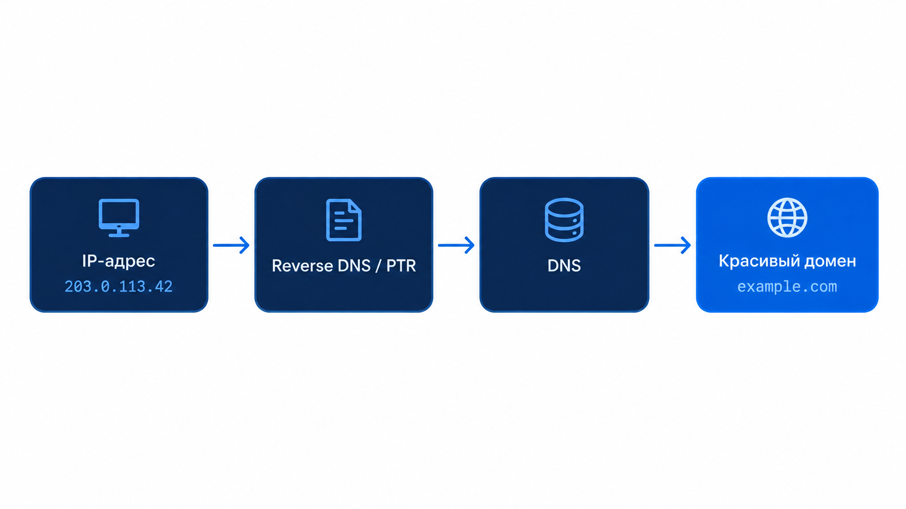
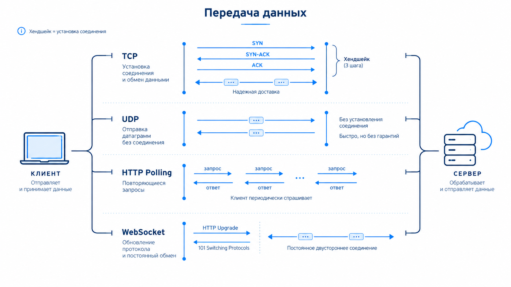
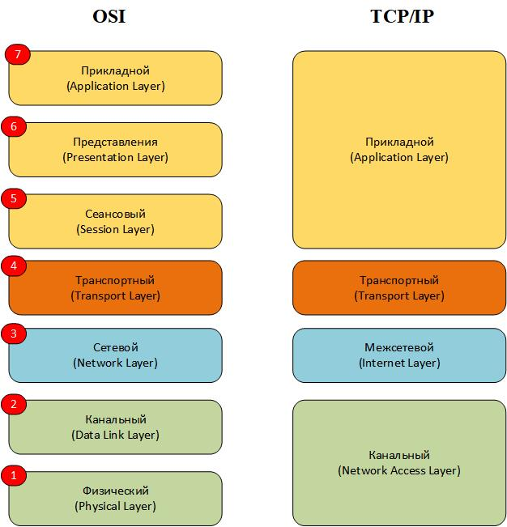
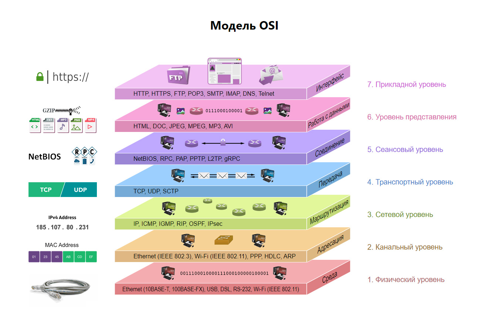
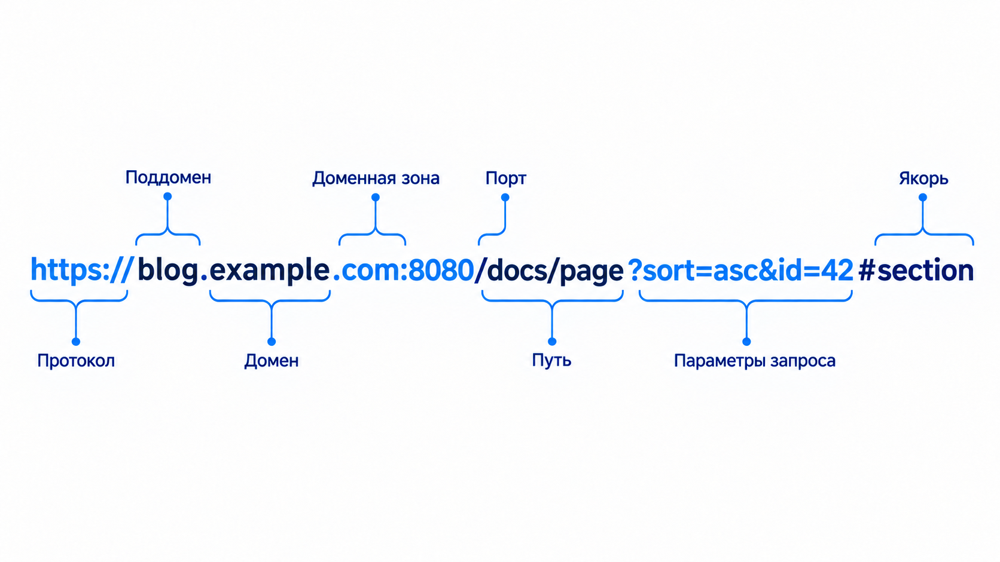
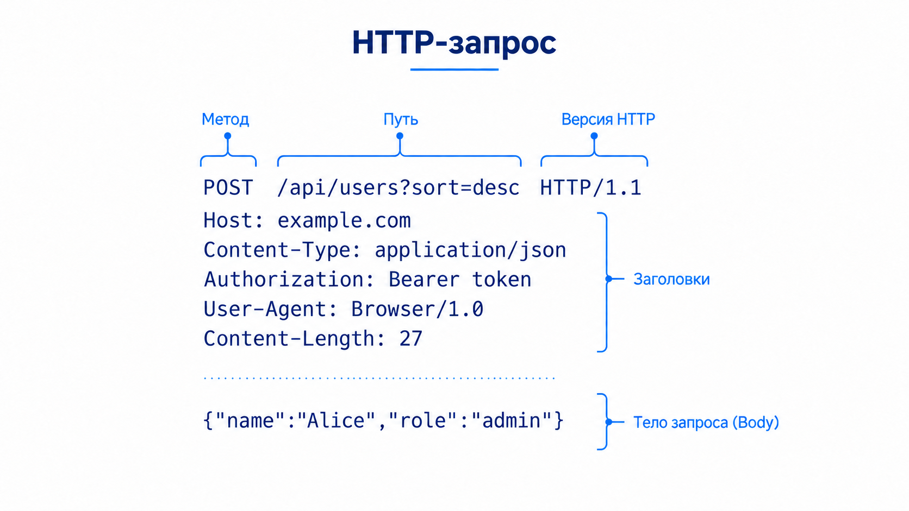

## Сеть. Как байты доходят до нужной программы.

Команда из скрипта живёт в одном процессе на одной машине: файл, переменная, код возврата. Процесс на другом компьютере этого файла не видит. Ему нужны три ответа, и каждый следующий без предыдущего бесполезен: какая машина, какая программа на ней, в каком виде байты.

Разберём адрес, порт и передачу байтов, затем запросим файл и запустим небольшой HTTP-сервис. После этого сравним способы получать обновления и разберём вход по SSH. gRPC и администрирование сервера оставим дополнительными разделами.

---

## **Сегодня пройдемся по этому плану:**

1. **Доставка сообщения** – уровни, IP, DNS, порт и сокет.
2. **TCP и UDP** – соединение, поток байтов и отдельные датаграммы.
3. **HTTP** – запросить файл, прочитать ответ и отличить ошибку сети от ошибки приложения.
4. **Свой API** – прочитать и изменить значение через FastAPI.
5. **Обновления и защита** – опрос, обзор WebSocket и SSE, HTTPS.
6. **SSH** – проверить сервер, войти и разобраться с ключами.
7. **Дополнительно** – gRPC, фильтрация соединений, проброс портов и передача файлов.

**Что понадобится:** Linux, как на настройке виртуальной машины. `ss` и `hostname -I` есть там. На macOS их нет, это не поломка установки. HTTP и gRPC ниже собираются на `127.0.0.1` без второй машины. Проброс порта и копирование файла в конце просят вход `ssh` на учебную машину.

Дальше локальные примеры из **одной папки**. Два окна: в первом живёт сервер, во втором вы его спрашиваете. «Остановите сервер» значит `Ctrl+C` в первом окне.

```bash
mkdir -p ~/Desktop/devtools-net && cd ~/Desktop/devtools-net
printf 'привет из файла\n' > hello.txt
# mkdir -p – создать папку вместе с родителями
# printf  – записать одну строку
# >       – в файл hello.txt
```

---

## **Уровни.**

Один кусок текста не может сам найти чужой компьютер. По дороге у каждого участка свой вопрос, и отвечать на все сразу одной записью нельзя: провод не знает, какая страница открыта, а страница не знает, в какой разъём воткнут кабель.

Сообщение заворачивают. Внутренний текст остаётся текстом. Снаружи к нему приклеивают заголовок того уровня, который сейчас везёт сообщение. Получатель снимает заголовки в обратном порядке и на каждом шаге понимает только свой.

```text
что хочет программа:     текст запроса
транспорт добавляет:     порты и договор о доставке
сеть добавляет:          IP отправителя и IP получателя
канал добавляет:         адрес соседа на этом проводе
провод:                  сигнал
```

На приёме провод сдаёт кадр каналу, канал снимает свой заголовок и отдаёт пакет сети, сеть снимает IP и отдаёт сегмент транспорту, транспорт отдаёт программе байты по порядку. Нижний уровень не читает страницу. Верхний не выбирает разъём.

> **Уровень** – граница одного вопроса. Это не программа, которую ставят. Путать вопросы значит просить провод ответить, какой файл запрошен.

Дальше каждый уровень отдельно: какую задачу он закрыл, из чего состоит его заголовок, где он кончается.

---

## **Провод.**

Самый нижний вопрос: как вообще передать сигнал соседу. В меди это напряжение, в радио это волна, в стекле это свет. Для программы здесь ещё нет ни адреса, ни порта, ни текста запроса.

Этот уровень на паре не собираем руками. Обжим витой пары и распиновка разъёма к протоколу программы не относятся: какой бы ни был кабель, следующие уровни устроены одинаково.

«нет интернета» иногда начинается здесь, и никакой HTTP-код при этом не появится. Нет сигнала до соседа – нечему нести IP.

---

## **MAC-адрес.**

Сигнал дошёл до устройства в той же сети: до роутера, до соседней машины, до порта коммутатора. Дальше нужен адрес этого устройства, не адрес сервера в другой стране.

> **MAC-адрес** – адрес сетевого интерфейса в локальной сети. Кадр канального уровня несёт MAC отправителя, MAC получателя и внутри себя уже готовый IP-пакет.

Коммутатор пересылает кадр внутри локальной сети, обычно сохраняя MAC-адреса. Роутер передаёт IP-пакет в другую сеть уже в новом кадре: у него другие MAC-адреса. IP получателя при обычной маршрутизации сохраняется; преобразование адресов разберём отдельно.

MAC не пишут в адрес страницы. Его не видно в `curl`. Он нужен только там, где два устройства соединены одним участком сети.

---

## **IP-адрес.**

Кадр доставляет пакет только соседу. Машина в другой сети этим кадром не достаётся. Нужен адрес, который переживает смену участков.

> **IP-адрес** – номер машины среди сетей. В заголовке IP-пакета лежат адрес отправителя, адрес получателя и номер протокола, которым читать внутренность: TCP или UDP. Текст страницы в этом заголовке не лежит.

IPv4 – 32 бита. Их записывают четырьмя числами от 0 до 255: `192.168.0.10`. Каждое число – один байт. IPv6 – длинная шестнадцатеричная запись на 128 бит. Сегодня используем IPv4. У IPv6 отличаются не только длина адреса, но и некоторые механизмы работы сети; здесь их не разбираем.

Адрес делится на две части. Левая называет сеть. Правая называет машину внутри неё. У записи `192.168.0.10/24` левые три числа – сеть, последнее – машина. `/24` значит: первые 24 бита из 32 относятся к сети. Роутер смотрит на левую часть и решает, в какую сторону отдать пакет. Правую часть читает уже сеть получателя, когда выбирает карту.

На виртуальной машине свои адреса печатает одна команда.

```bash
hostname -I
# hostname – имя и адреса машины
# -I       – все текущие IP, через пробел
```

Чисел может быть несколько. Для входа с ноутбука берут адрес той сети, в которой ноутбук видит машину: часто `10.` или `192.168.`. Адрес, который появился вместе с чужой программой на этой же машине, для входа не берём.

IP называет машину, не программу. Две программы на одном IP различаются портом.

---

## **Частный, публичный, статический и динамический адрес.**

У адреса два разных вопроса. Виден ли он из интернета. И останется ли тот же номер завтра.

> **Частный адрес** – адрес внутренней сети: диапазоны `10.0.0.0/8`, `172.16.0.0/12` и `192.168.0.0/16`. Его можно маршрутизировать между внутренними сетями, но не в публичном интернете. Домашний роутер выходит наружу с одного общего адреса и подставляет его вместо частного. По `192.168.0.10` из интернета к вам не постучаться.

> **Публичный адрес** – номер, который другие сети согласны маршрутизировать. По нему к машине можно вернуться извне, если по пути нет фильтра.

> **Статический адрес** – номер, который закрепили за машиной. Арендованный сервер обычно такой: завтра вход идёт на тот же IP.

> **Динамический адрес** – номер, который DHCP выдаёт на время аренды. Дома роутер раздаёт его ноутбуку сам. Когда аренда кончилась или машина подключилась снова, последнее число может быть уже другим. Провайдер так же может сменить адрес, с которого вы выходите в интернет.

Частный адрес часто динамический: сегодня `192.168.0.10`, завтра `192.168.0.15`. Публичный тоже бывает динамическим, пока за постоянный номер не платят отдельно.

«частный» не означает «динамический» или «эта машина». Частный адрес не предназначен для маршрутизации в публичном интернете. Динамический отвечает, кто выдал номер и надолго ли.

---

## **localhost.**

> **localhost** – имя этой машины. Ему соответствует `127.0.0.1` в IPv4 и `::1` в IPv6. Пакет на эти адреса не выходит в роутер и не ищет шлюз. Его забирает тот же сетевой стек, который его отправил.

Это не локальный адрес сети `192.168.` и не адрес из `hostname -I`. `hostname -I` показывает номера, по которым машину видят другие. `127.0.0.1` видит только она сама.

На чужой машине её `localhost` – это она. Когда ниже зайдём на сервер, его `127.0.0.1` не будет ноутбуком.

Имя `localhost` почти всегда лежит строкой в `/etc/hosts`. До DNS в интернете вопрос не доходит. Как имя вообще становится адресом, разберём сразу после следующего узла.

процесс, который слушает только `127.0.0.1`, с другого компьютера недоступен, даже если у машины есть публичный IP.

---

## **Следующий узел.**

Пакет с IP получателя ещё не прыгает через весь интернет одним кадром. Отправитель смотрит: получатель в моей сети или нет.

Если в моей, нужно узнать MAC этой машины. Если не в моей, пакет отдают роутеру, и MAC в кадре – MAC роутера. IP получателя внутри пакета остаётся прежним.

> **ARP** – вопрос в своей сети: у кого такой IP, ответь своим MAC. За пределы сети этот вопрос не уходит.

```bash
ip neigh
# ip    – сеть этой Linux-машины
# neigh – соседи: какой MAC уже узнали для какого IP
```

Строка появляется после того, как с этим IP уже говорили. Пустой список при коде 0 значит: соседей ещё не спрашивали, команда при этом выполнилась.

> **Шлюз** – роутер, которому отдают пакет, если получатель не в вашей сети. Каждый следующий роутер повторяет тот же выбор: снять чужой кадр, посмотреть IP получателя, надеть кадр к своему следующему соседу.

Так IP доезжает конец в конец, а MAC меняется на каждом участке.

`0.0.0.0` в адресе программы – не шлюз и не «весь интернет». Для слушателя это значит «принимай пакеты на всех своих IPv4». Клиенту такой адрес не пишут. Клиенту пишут конкретный IP машины.

---

## **DNS.**

Числовой адрес неудобно держать в голове, и у одного имени их бывает несколько: ближайший сервер зависит от того, откуда спрашивают.

> **DNS** – служба, которая по имени отдаёт записи. Имя `example.com` само пакеты не принимает. Его сначала переводят в адрес. Что программа потом спросит у сервера и какой пароль введёт, DNS не решает.

Имя становится адресом по шагам.

1. Программа спрашивает системный резолвер. Команда ниже делает то же.
2. Резолвер смотрит `/etc/hosts`. Строка про `localhost` закрывает вопрос сразу.
3. Если строки нет, запрос уходит рекурсивному резолверу: обычно роутеру или резолверу провайдера. Он ищет ответ и на время его запоминает.
4. Резолвер спрашивает сверху вниз. Корневые серверы знают, кто отвечает за зону `com`. Сервер зоны `com` знает, кто отвечает за `example.com`. Сервер этой зоны отдаёт запись.
5. Программа получает IP и только потом открывает соединение на порт.

> **Зона** – кусок дерева имён, за который отвечает один набор серверов. `com` – зона верхнего уровня. `example.com` – зона внутри неё.

Серверы зоны хранят её записи. Родитель хранит не сами записи, а кто отвечает за дочернюю зону: зона `com` знает серверы `example.com`, адреса имён лежат уже у них. Зона `.ru` поэтому не список машин в стране. Имя не сообщает, в какой стране стоит машина. Соседние зоны записи друг другу не копируют. Несколько серверов одной зоны держат одну копию.

Резолвер из шага 3 эту копию не хранит. Он помнит уже полученный ответ, пока не кончится срок, который пришёл вместе с записью. Этот срок называют TTL. Пока срок не вышел, путь до корня не повторяют. Если резолвер провайдера подставил свой ответ вместо записи зоны, сама запись в зоне не меняется.

```bash
getent hosts example.com
# getent – спросить системную базу
# hosts  – база имён
# получается строка: адрес, затем example.com
```

В строке может оказаться IPv4 или IPv6: это зависит от записей имени и системного резолвера. У одной зоны записей несколько, и они отвечают на разные вопросы.

| Тип     | Что лежит в ответе                                              |
| ------- | --------------------------------------------------------------- |
| `A`     | IPv4 для имени                                                  |
| `AAAA`  | IPv6 для имени                                                  |
| `CNAME` | другое имя; его резолвят следом, пока не получат `A` или `AAAA` |
| `NS`    | какие серверы отвечают за зону                                  |
| `MX`    | какой хост принимает почту для этого имени                      |
| `TXT`   | строка, часто ею подтверждают, что зона ваша                    |
| `PTR`   | имя по уже известному IP                                        |

`getent hosts` показывает результат `A` или `AAAA`. Учебную виртуалку по имени не ищут: у неё часто нет зоны, на неё заходят по IP из `hostname -I`.

Обратный вопрос нарисован отдельно: от уже известного IP к имени. Это запись `PTR`, не путь браузера. Браузер начинает с имени и приходит к `A`.



`CNAME` – ещё не адрес. Пока цепочка не дошла до `A` или `AAAA`, соединяться некуда. У одного имени бывает несколько `A`, и из разных сетей ответ разный.

---

## **Порт.**

Пакет пришёл на машину, где работают несколько программ. Одного IP недостаточно: транспортный заголовок содержит порт, по которому ядро найдёт нужный сокет. Порт не является номером процесса.

> **Порт** – число от 0 до 65535. Вместе с протоколом оно выбирает программу, которой отдать байты. Пара «IP и порт» – адрес программы. Порт не папка и не провод.

Один и тот же номер у TCP и у UDP – два разных списка. Программа может слушать `8000/tcp` и не занимать `8000/udp`.

Часть номеров закреплена привычкой. Их встретим там, где появится сама программа: 22 у входа в оболочку, 80 у запроса страницы, 443 у того же запроса внутри шифрования. Свой учебный процесс поставим на 8000: на Linux для портов ниже установленного порога обычно нужны дополнительные права; порог и разрешения зависят от настроек системы.

Слушающий порт связан с открытым сокетом. После закрытия слушателя остаются нюансы повторного использования адреса, поэтому занятость проверяем командой, а не только по наличию прежнего процесса.

---

## **Сокет.**

Порт – число в заголовке. Программе нужно место, через которое она это число занимает и читает байты.

> **Сокет** – конец связи, который программа открывает у ядра. Слушающий сокет ждёт новые соединения на адресе и порте. Когда клиент подключился, у сервера появляется второй сокет: разговор с этим клиентом. Слушающий остаётся ждать следующих.

Программа читает и пишет в сокет так же, как в файл. На диске такого файла нет.

Для уже открытого TCP ядро различает четыре числа: свой IP, свой порт, чужой IP, чужой порт. Поэтому несколько клиентов одновременно ходят на один `127.0.0.1:8000`. Справа порт один. Слева у каждого клиента свой временный порт, его выдаёт ядро на время соединения. Выбирать его заранее не нужно.

```text
клиент А  127.0.0.1:53124 ──► 127.0.0.1:8000  сервер
клиент Б  127.0.0.1:53125 ──► 127.0.0.1:8000  тот же сервер
```

«сокет = IP + порт» неполно. Для открытого TCP важны все четыре числа и ещё протокол. Закрыли один разговор – слушающий порт может остаться.

---

## **TCP.**

Страница, файл и вход в оболочку не переносят дырку в середине. Потерянный кусок нельзя молча выбросить: на том конце получится другой текст.

> **TCP** – транспорт с соединением. Перед данными стороны договариваются. Потом байты приходят по порядку, потерянное досылается. Программа читает поток. Граница одной отправки не обязана совпасть с границей одного чтения: где кончается сообщение, решает уже протокол программы.

Поток программа читает из сокета соединения. Клиент создаёт сокет до установления связи; сервер получает подключённый сокет через принятие соединения. В нашем примере HTTP-запрос отправляется после установления TCP-соединения. Успешное соединение ещё не значит, что файл на сервере существует. Это следующий уровень.

---

## **Рукопожатие TCP.**

Без договора отправитель не знает, дошли ли байты. Подтверждение как раз об этом.



Верхняя полоса – TCP. Скобка справа – рукопожатие, три сегмента. Точки после неё – данные и подтверждения, что данные дошли.

> **ACK** – номер следующего байта, который сторона ждёт. Всё до этого номера она уже получила.

1. `SYN` – клиент просит соединение и называет свой стартовый номер.
2. `SYN-ACK` – сервер согласен, называет свой стартовый номер и присылает `ACK` на номер клиента.
3. `ACK` – клиент подтверждает номер сервера. Соединение открыто, только теперь в него пишут данные.

Дальше тот же `ACK` подтверждает уже не стартовый номер, а принятые байты. Не пришёл `ACK` – отправитель посылает этот кусок снова. Поэтому в тексте не остаётся дырки.

Закрытие – не обрыв провода. Сторона, которая всё передала, шлёт `FIN`, вторая отвечает `ACK` и закрывает свою половину.

Верхние две полосы – транспорт. Вторая – без `SYN` и без `ACK`, это UDP, следующий раздел. Нижние две – прикладной разговор по уже открытому TCP. Рукопожатие на них второй раз не нарисовано. К ним вернёмся после запроса и ответа.

три шага открывают соединение. Они не читают метод, пароль и путь. Ошибка приложения приходит уже внутри открытого TCP.

---

## **UDP.**

Иногда ждать подтверждения вредно. Опоздавший кусок голоса уже не нужен: следующий важнее.

> **UDP** – транспорт без соединения и без досылки. Одна датаграмма: порт отправителя, порт получателя, длина, данные. Дошла она или нет, протокол не проверяет. Порядок не обещает.

Так везут голос и положения в игре. Персонаж «прыгает», когда часть положений не пришла. В наших примерах HTTP/1.1 и SSH используют TCP. Сам UDP надёжности не даёт, но её может обеспечить протокол поверх него: например, HTTP/3 использует QUIC поверх UDP.

DNS часто спрашивает по UDP: вопрос короткий, при потере его задают ещё раз целиком. Это свойство короткого вопроса, не правило «всё быстрое возить UDP».

одинаковый номер порта у TCP и UDP – разные сокеты. Слушателей TCP эта пара смотрит одной командой. UDP той же командой не виден.

---

## **Кто слушает.**

Процесс, который готов принять соединение, говорит ядру: этот TCP-порт мой. Пока он жив, второй процесс тот же порт обычно не получает.

Поднимем слушателя и сразу увидим его в списке. Из чего состоит ответ, разберём следующим большим шагом. Здесь это процесс, который занял 8000 и отдаёт файлы текущей папки.

Окно останется занятым.

```bash
cd ~/Desktop/devtools-net
python3 -m http.server 8000 --bind 127.0.0.1
# python3        – интерпретатор
# -m http.server – модуль из поставки Python
# 8000           – порт
# --bind         – на каком адресе слушать
# 127.0.0.1      – только эта машина
```

Второе окно:

```bash
ss -ltn
# ss – socket statistics
# -l – listening, только слушающие
# -t – tcp
# -n – numeric, числа без имён служб
```

В строке ищите `127.0.0.1:8000`. `0.0.0.0:22` значило бы: порт 22 принимают на всех адресах этой машины.

Имя процесса эта команда не показывает.

```bash
ss -ltnp
# -p – process, PID и имя
# чужой процесс без sudo часто без имени
```

Только один порт:

```bash
ss -ltn 'sport = :8000'
# sport = :8000 – фильтр: локальный порт 8000
```

Пустой список при коде 0 – норма: команда выполнилась, слушателей нет. Код возврата здесь не признак пустого порта.

`ss` показывает, что процесс занял номер. Что он ответит, видно только запросом.

---

## **Своя машина.**

Сервер выше привязан к тому самому `127.0.0.1`. Другая машина до этого порта напрямую не дойдёт, даже если знает публичный IP. Так и задумано: учебный сервис пока не опубликован.

`localhost` может разрешиться и в IPv6 `::1`. Сервер мы привязали к IPv4. Дальше пишем `127.0.0.1` явно, чтобы клиент не попробовал сначала другой адрес.

Остановить сервер в первом окне: `Ctrl+C`. Поднимите его снова перед следующим разделом той же командой.

---

## **Модель OSI.**

В старой модели семь имён. Четыре нижних мы уже прошли: провод, канал, сеть, транспорт. Выше учебник рисует ещё три уровня. Справа на схеме те же нижние уровни, а сеанс и представление сложены в один прикладной: соединение держит TCP, кодировку и смысл называет протокол приложения.



Сеанс – кто участник этого разговора и как его продолжить, если соединение моргнуло. Представление – в каком виде закодированы байты: текст, картинка, структура. Приложение – смысл: страница, письмо, вход в оболочку, вызов функции.

На полной схеме уровни заполнены примерами протоколов. Это список имён, не порядок сегодняшней пары.



На сеансовом уровне этой схемы указан gRPC. По пути байта это вызов поверх HTTP/2, прикладной смысл. Отдельной прослойки между TCP и HTTP у него нет. До этого вызова ещё дойдём. Шифрование соединения – отдельный договор поверх TCP, до текста приложения. Его разберём, когда текст нельзя везти открытым.

уровень на рисунке – не место, куда «ставят» протокол одной стрелкой. Один протокол закрывает один вопрос. Вызов функции, который встретится в конце пары, едет внутри HTTP. Это смысл приложения, не отдельный сеанс под TCP.

---

## **HTTP.**

TCP отдал программе поток байтов. Поток не говорит, где кончается просьба и где начинается ответ. Две программы договариваются о тексте сообщения.

> **HTTP** – протокол обмена запросами и ответами. Здесь используем HTTP/1.1 поверх TCP. Клиент посылает запрос, сервер присылает ответ. По умолчанию его слушают на порту 80. Наш процесс слушает 8000: номер мы задали сами.

Запрос – три части, в этом порядке.

1. **Строка запроса.** Метод, путь, версия. Путь `/hello.txt` – какой ресурс просим.
2. **Заголовки.** Строки `Имя: значение`. Ими говорят размер, тип, к какому имени обращались.
3. **Пустая строка и тело.** У чтения файла тела обычно нет.

Ответ устроен так же: строка с кодом, заголовки, тело.

Поднимите сервер, если закрыли окно.

```bash
cd ~/Desktop/devtools-net
python3 -m http.server 8000 --bind 127.0.0.1
```

---

## **GET. Прочитать.**

> **GET** – метод «прочитать ресурс». Он не просит сервер что-то записать. `curl` без указания метода посылает именно его.

```bash
curl -v --http1.1 -sS http://127.0.0.1:8000/hello.txt
# curl      – клиент HTTP
# -v        – показать строки запроса и ответа
# --http1.1 – текстовый вид запроса и ответа
# -s        – silent, без полосы прогресса
# -S        – ошибки всё равно показать
```

Строки с `>` послал клиент, строки с `<` вернул сервер. Пустая строка отделяет заголовки от тела.

```text
> GET /hello.txt HTTP/1.1
> Host: 127.0.0.1:8000
>
< HTTP/1.0 200 OK
< Content-Length: 29
<
привет из файла
```

`GET` – метод, `/hello.txt` – путь, `HTTP/1.1` – версия запроса. `Host` – к какому имени и порту обращались. `200` – сервер принял запрос и отдал ресурс. `Content-Length` – длина тела в байтах. Русские буквы в UTF-8 занимают больше одного байта, поэтому число может не совпасть с количеством букв. Версия ответа у этого сервера может быть `HTTP/1.0`, хотя запрос был 1.1: версию ответа выбирает сервер.

Чужой путь на том же сервере:

```bash
curl -sS -D - -o /dev/null http://127.0.0.1:8000/net-takogo-fajla
# -o /dev/null – тело выбросить, оставить строку состояния
# получается: HTTP/1.0 404 File not found
```

Сервер жив: код есть. Нет запрошенного пути.

Остановите сервер через `Ctrl+C` и спросите снова.

```bash
curl -sS --connect-timeout 2 -D - http://127.0.0.1:8000/hello.txt
# --connect-timeout 2 – не ждать соединения дольше двух секунд
# получается: Connection refused
# строки HTTP/ нет
```

`Connection refused` – TCP никто не принял. `404` – TCP приняли, HTTP ответил, ресурса нет. Это разные места на пути. Поднимите сервер обратно той же командой.

---

## **URI и URL.**

> **URI** – строка, которая называет ресурс.
>
> **URL** – такой URI, в котором есть способ до него дойти: схема и место. `http://127.0.0.1:8000/hello.txt` говорит и как говорить, и где лежит ресурс.

Бывает URI без места. `urn:isbn:0451450523` называет книгу и не говорит, с какого хоста её скачать. В HTTP-запросе такой строки нет. Дальше разбираем URL.

Адрес, который уже открывали:

```text
http://   127.0.0.1   :8000   /hello.txt
схема     хост         порт    путь
```

Схема выбирает протокол приложения. Хост и порт открывают TCP. Путь уходит в запрос. Хост здесь число, DNS не нужен. Если на месте хоста имя `localhost`, резолвер отвечает `127.0.0.1` из `/etc/hosts`.

Те же части на имени с поддоменом. Схема `https` – тот же HTTP внутри шифрования. Как устроено шифрование, будет в разделе HTTPS. Картинка заранее показывает, из чего строка собрана.



Слева направо:

- `https://` – схема;
- `blog` – поддомен, метка перед зоной;
- `example` – имя в зоне, на картинке оно подписано «домен»;
- `com` – зона верхнего уровня;
- целиком `blog.example.com` – имя, которое пойдёт в DNS;
- `:8080` – порт; если порта в строке нет, для `http` берут 80, для `https` берут 443;
- `/docs/page` – путь в запросе;
- `?sort=asc&id=42` – параметры запроса, часть адреса, их видно в журнале;
- `#section` – якорь; браузер оставляет его у себя и в запрос не отправляет.

Пароль в параметры не кладут.

Один запрос из этих частей.



Первая строка: метод, путь с параметрами, версия. Дальше заголовки. Пустая строка отделяет их от тела. `Host`, `Content-Type` и `Content-Length` мы уже видели. `Content-Type` говорит, в каком виде тело. Остальные строки заголовков устроены так же: имя и значение.

путь `/hello.txt` – не имя файла на вашем ноутбуке. Его читает сервер относительно того, что он сам решил отдавать. У нашего процесса это папка, из которой его запустили.

---

## **POST.**

Чтение файла тело не требует. Передать серверу свои данные – другой вопрос: их кладут после пустой строки.

> **POST** – метод «передать данные на обработку». Заголовок говорит, в каком виде тело. Тело – сами байты.

Наш `http.server` умеет отдавать файлы и не принимает POST. Это видно по коду, без второго сервера.

```bash
curl -sS -D - -o /dev/null -X POST http://127.0.0.1:8000/ \
  -H 'Content-Type: text/plain' --data 'name=ada'
# -X POST      – метод
# -H           – один заголовок запроса
# Content-Type – в каком виде тело
# --data       – тело
# получается: HTTP/1.0 501 Unsupported method ('POST')
```

Три куска на месте: метод, заголовок, тело. Сервер их разобрал и ответил, что такого метода у него нет.

`501` – ответ живого сервера. Это не отказ TCP и не сломанный `curl`.

---

## **Код ответа.**

Первая строка ответа начинается с трёхзначного числа. По первой цифре видно, чей это исход.

| Первая цифра | Что случилось                                                              |
| ------------ | -------------------------------------------------------------------------- |
| 1            | промежуточный ответ, разговор ещё не кончен                                |
| 2            | сервер сделал, что просили. `200` – обычный успех                          |
| 3            | перенаправление или использование сохранённого ответа, например `304`                       |
| 4            | запрос клиента сервер не берёт. `404` мы уже получили: такого пути нет     |
| 5            | запрос понятен, на стороне сервера он не выполнился. `501` мы уже получили |

Коды внутри цифры заучивать списком не нужно. `200` значит: сервер считает, что справился.

Три кода, которые уже получили, можно запомнить картинкой. [HTTP Cats](https://http.cat/) отдаёт рисунок по номеру в пути: [200](https://http.cat/200), [404](https://http.cat/404), [501](https://http.cat/501). Номер в адресе выбирает картинку. Если картинка нашлась, первая строка ответа самого сайта будет `200`, даже когда на рисунке написано 404.

код 4 – процесс ответил. Упал бы он – строки `HTTP/` не было бы, было бы `Connection refused` или обрыв без кода.

---

## **FastAPI.**

Файловый сервер отдал файл и на POST ответил `501`. Чтобы одно число можно было прочитать и заменить, путь и метод должны попасть в функцию, а не в раздачу папки.

> **FastAPI** – библиотека, которая публикует функцию как HTTP-путь. Словарь из `return` уходит клиенту как JSON. Строку `HTTP/1.1` пишет не функция, а `uvicorn`: процесс, который слушает порт и зовёт функцию.

**JSON** – текстовый формат объектов с именованными полями, массивов и простых значений. В нашем запросе `{ "value": 7 }` – объект с одним числовым полем.

Рядом с конспектом лежит `app.py`: `GET /value` читает число, `POST /value` записывает поле `value` из JSON. Число живёт в памяти процесса и пропадёт, когда процесс остановят. Остановите `http.server`. Скопируйте `app.py` из папки этой лекции в `~/Desktop/devtools-net` и запускайте уже оттуда. В этом примере изучаем HTTP-запросы; готовый код сервиса не требуется писать с нуля.

```bash
cd ~/Desktop/devtools-net
python3 -m venv .venv
.venv/bin/python -m pip install fastapi 'uvicorn[standard]'
# venv     – свой Python и пакеты в папке .venv
# fastapi  – пути из app.py
# uvicorn  – слушает порт
.venv/bin/uvicorn app:app --host 127.0.0.1 --port 8000
# app:app – модуль app, объект app
# --host  – только эта машина
# --port  – 8000
```

В браузере откройте `http://127.0.0.1:8000/docs`. Страница показывает те же два пути. Это обычный GET, в ответ пришёл HTML.

Второе окно:

```bash
curl -sS -D - http://127.0.0.1:8000/value
# получается: HTTP/1.1 200 и {"value": 0}

curl -sS -D - -X POST http://127.0.0.1:8000/value \
  -H 'Content-Type: application/json' \
  --data '{"value": 7}'
# --data – тело; кавычки берегут фигурные скобки от shell
# получается: HTTP/1.1 200 и {"value": 7}

curl -sS http://127.0.0.1:8000/value
# число 7 осталось в работающем процессе
```

Чужой тип поля – ошибка запроса, не падение процесса. Код здесь `422`: объявленное поле не приняло строку. Входящее поле проверяет pydantic по типу, объявленному в `app.py`. При `422` функция не вызывается. Словарь из `return` эта проверка не затрагивает.

```bash
curl -sS -D - -X POST http://127.0.0.1:8000/value \
  -H 'Content-Type: application/json' \
  --data '{"value": "семь"}'
# получается: HTTP/1.1 422
```

Повторить тот же POST с `7` можно: итоговое число снова `7`. Это свойство этой функции. HTTP сам не обещает, что всякий POST при повторе оставит то же состояние.

`404` – такого пути нет. `422` – путь верный, тело не подошло под поле `value`. Оба кода приходят по живому TCP. `501` файлового сервера здесь уже не появится: POST у этого пути есть.

---

## **REST.**

`/value` уже устроен как ресурс. Путь называет вещь. Метод называет действие: GET читает, POST передаёт новое число. Код говорит, что вышло. Тело – JSON этой вещи.

> **REST** – архитектурный стиль взаимодействия систем. В HTTP API его идеи проявляются так: адрес называет ресурс, метод называет операцию над ним, ответ – представление ресурса. Браузер, `curl` и чужой язык говорят с ним без общего сгенерированного кода. Договор описывает ресурсы, методы и представления данных; для HTTP API его можно формализовать, например, через OpenAPI. JSON распространён, но не обязателен.

Так делают страницы и публичные API: клиент любой, лишь бы умел HTTP. `app.py` – маленький образец этого стиля, не полная система хранения.

Не всякий HTTP API соответствует REST. При этом операции записи не обязательны: интерфейс только для чтения тоже может следовать этому стилю. Здесь мы разобрали работу с ресурсом; полный набор ограничений REST в этот пример не входит.

---

## **Обновление данных.**

Дальше сравниваем способы получать изменения. Выполним короткий опрос; долгий опрос, WebSocket и SSE рассмотрим как обзор без запуска отдельных серверов.

`GET /value` возвращает число в момент запроса. Сервер сам о новом значении не напишет: пара «запрос и ответ» на этом кончается. На картинке передачи данных это две нижние полосы: повтор запроса и одно соединение после смены протокола.

### Короткий опрос

`uvicorn` должен всё ещё слушать `8000`. Если нет, поднимите его снова той же командой.

```bash
while true; do
  date
  curl -sS http://127.0.0.1:8000/value
  printf '\n'
  sleep 2
done
# while true – пока не прервут
# sleep 2    – пауза в секундах
# Ctrl+C     – остановить цикл, не сервер
```

Каждая строка – новый TCP и новый HTTP, потому что каждый `curl` завершается и закрывает своё соединение. Протокол этого не требует: следующее сообщение может пойти в то же соединение. В другом окне можно послать POST с новым числом: следующий проход цикла его увидит, предыдущий уже завершился.

> **Короткий опрос** – клиент сам решает, когда спросить снова, даже если число не менялось.

частый опрос не ускоряет сервер. Он плодит соединения. Изменение видно не сразу, а к следующей проверке.

### Долгий опрос

Короткий опрос тратит запросы впустую, если событие редкое.

> **Долгий опрос** – клиент отправляет HTTP-запрос, а сервер ждёт события или истечения срока, прежде чем ответить. После ответа клиент отправляет новый запрос. TCP-соединение при этом можно использовать повторно.

Наш `GET /value` так не делает: он отвечает сразу. Большой таймаут у `curl` не заставит этот сервер ждать. Ждать должен код сервера.

долгий опрос всё ещё один ответ на один запрос. Следующая порция приходит в ответ на следующий запрос, а не продолжает уже завершённый ответ.

### WebSocket

Чат шлёт сообщения часто и с обеих сторон. Открывать HTTP на каждую реплику дорого, а сервер не может написать первым, пока клиент не спросил. Поверх уже открытого HTTP/1.1 договариваются сменить протокол и оставить тот же TCP.

> **WebSocket** – обмен сообщениями по долгому соединению. Клиент начинает с GET и просит смену. Если сервер согласен, первая строка ответа – `101`. Дальше идут кадры, не пары «запрос и ответ». Писать могут оба, пока соединение не закроют.

В нашем `app.py` есть только HTTP-пути. Добавление заголовков `Upgrade` к запросу не создаст WebSocket-обработчик. Для него нужны отдельный маршрут сервера и клиент, который выполняет рукопожатие и понимает кадры. Здесь сравниваем способы обмена, а сервер WebSocket не запускаем.

`ws://` обозначает соединение без TLS, `wss://` – защищённое TLS. С самим TLS разберёмся в разделе HTTPS.

### Поток только к клиенту

Генерация ответа по кускам, как токены модели, часто не требует писать в канал обратно. Клиент один раз просит. Сервер пишет куски и закрывает соединение.

> **SSE (Server-Sent Events)** – поток текстовых событий в HTTP-ответе с типом `text/event-stream`. События имеют определённый формат, например строки `data: ...`, разделённые пустой строкой. Пишет сервер; для отправки данных обратно клиент делает отдельный запрос. Не любой ответ по кускам является SSE.

WebSocket здесь шире, чем нужно: вторая сторона канала пустая. SSE остаётся HTTP, его проще провести там, где смену протокола режут.

Браузерный `EventSource` умеет переподключаться. Восстановление пропущенных событий требует поддержки сервера, например обработки идентификатора последнего события.

---

## **HTTPS.**

Пока оба конца на `127.0.0.1`, пакет не выходит наружу. Как только он идёт через чужие сети, текст HTTP по дороге можно прочитать: метод, путь, заголовки, тело. IP и порт при этом видны. Шифруется содержимое.

> **TLS** – договор поверх уже открытого TCP. Сервер показывает сертификат. Клиент проверяет, что имя, к которому он шёл, в этом сертификате есть. Стороны получают общий ключ сессии и дальше шифруют байты. Пароль и страница едут уже внутри.

> **HTTPS** – HTTP внутри TLS. Снаружи порт 443. Рукопожатие TLS происходит до первой строки `GET`.

Три шага, без списка шифров.

1. Клиент говорит, какие версии TLS он умеет.
2. Сервер присылает сертификат и свою половину обмена ключами.
3. Клиент проверяет имя и подпись сертификата. Дальше оба считают ключ сессии, и HTTP идёт шифрованным.

```bash
curl -sS -D - -o /dev/null https://example.com/ | head -n 1
# https – порт 443 и TLS, метод по-прежнему GET
# head -n 1 – первая строка уже расшифрованного ответа
# получается строка HTTP/ с кодом 200
```

Свой сертификат сегодня не выпускаем. Учебный сервис на `127.0.0.1` остаётся на HTTP.

`https://` туда, где слушает HTTP без TLS, обрывается на первом байте. Клиент ждёт TLS. Флаг, который отключает проверку сертификата, не проверяет имя: после него клиент уже не знает, та ли машина ответила.

---

## **HTTP/2.**

HTTP/1.1 мы видели как текст: строка запроса, заголовки, пустая строка, тело. Одно соединение в этой версии обычно занято одним запросом, пока ответ не дочитан.

> **HTTP/2** – те же методы, пути и коды. Меняется перевозка: заголовки и тело едут двоичными кадрами, и несколько запросов идут по одному TCP, не дожидаясь конца соседнего. `GET` остаётся чтением. `404` остаётся «такого пути нет».

Это понадобится в конце пары: вызов функции между сервисами едет по HTTP/2, не по тексту HTTP/1.1, который печатал `curl --http1.1`.

`HTTP/2` – не новый набор методов. Новый у него формат кадров на уже открытом TCP.

---

## **SSH.**

HTTP просит ресурс. Другая задача: выполнить команду на чужой машине так, будто открыт её терминал. Пароль и команды нельзя везти открытым текстом.

> **SSH** – протокол приложения поверх TCP. Сервер по умолчанию слушает порт 22. Клиент открывает соединение, проверяет машину, потом машина проверяет пользователя. Внутри уже шифрованного канала открывается оболочка. Файл и чужой порт тем же каналом – в конце пары.

Рукопожатие здесь длиннее TCP. TCP только открыл соединение с портом 22.

1. Оба конца называют версию SSH.
2. Они согласуют ключ сессии. Сам ключ по сети не пересылается: каждая сторона добавляет свой секрет так, что оба получают одно и то же, а путь между ними этого секрета не видит.
3. Сервер доказывает, что владеет своим постоянным ключом машины. Клиент сверяет его с тем, что запомнил.
4. Пользователь доказывает вход: паролем или подписью своим ключом. Ключ, которым подписывают, на сервер не отправляется.
5. После этого открывают канал с оболочкой.

Пара ключей состоит из приватного ключа и связанного с ним публичного. Приватным ключом создают подпись, публичным проверяют её. Приватный ключ остаётся у владельца. Отпечаток – короткое представление публичного ключа для сверки.

Вход, если машина из настройки уже принимает ключ или пароль:

```bash
ssh USER@ADDRESS
# ssh     – клиент
# USER    – пользователь на той машине
# ADDRESS – IP из hostname -I или имя
# без -p  – порт 22
```

На первом соединении клиент показывает отпечаток ключа машины и спрашивает, доверяете ли вы ему. Сверьте его с тем, что показывает консоль виртуальной машины. После согласия публичный ключ машины ляжет в `~/.ssh/known_hosts`. Если в следующий раз отпечаток внезапно другой, предупреждение не стирают вслепую: либо машину переустановили, либо ответил не тот узел.

Выйти: `exit`. Закрылось это окно. Процессы, которые вы там не оставляли отдельно, уходят вместе с сессией.

`ssh` без адреса не ищет «ближайший сервер». Адрес или имя обязательны.

---

## **Ключи SSH.**

В одном входе две пары ключей. Они отвечают на разные вопросы.

| Чей ключ | Где секрет | Какой вопрос закрывает |
| --- | --- | --- |
| машины | на сервере | клиент попал на ту машину, которую уже видел |
| пользователя | на ноутбуке | сервер пускает владельца разрешённого ключа |

> **known_hosts** – файл на ноутбуке со ключами машин, которым уже сказали «да».
>
> **authorized_keys** – файл на сервере, в домашней папке пользователя. В нём публичные ключи тех, кому этот пользователь разрешил вход.

Ключ в `authorized_keys` не подтверждает, что машина та самая. Строка в `known_hosts` не даёт права войти.

Пароль – один способ доказать пользователя. Для повторного входа удобнее отдельная пара. Создадим её под новым именем, чтобы не затереть ключ, который уже лежит в `~/.ssh`.

```bash
ssh-keygen -t ed25519 -f "$HOME/.ssh/devtools_course_ed25519" -C 'devtools-course'
# -t ed25519 – алгоритм
# -f         – путь новой пары
# -C         – комментарий в публичном ключе, не секрет
# если файл уже есть, не соглашайтесь его перезаписать

ls -l "$HOME/.ssh/devtools_course_ed25519" "$HOME/.ssh/devtools_course_ed25519.pub"
# файл без .pub – приватный, его никуда не отправляют
# файл с .pub   – публичный, его кладут на сервер
```

> **Публичный ключ** можно показывать. **Приватный** остаётся у владельца. При входе сервер даёт данные этого соединения, клиент подписывает их приватным ключом, сервер проверяет подпись публичным. Приватный ключ на сервер не уходит. Парольная фраза, если её задали, шифрует приватный файл на диске ноутбука. Это не пароль учётной записи на сервере.

Канал шифрует отдельный ключ сессии. Стороны получают его в рукопожатии и по сети не пересылают.

Если на сервер уже можно войти, публичную строку дописывают туда:

```bash
ssh-copy-id -i "$HOME/.ssh/devtools_course_ed25519.pub" USER@ADDRESS
# -i – какую публичную строку дописать
# может спросить текущий пароль пользователя на сервере
```

Проверка именно этой парой:

```bash
ssh -i "$HOME/.ssh/devtools_course_ed25519" USER@ADDRESS 'whoami; hostname'
# -i      – приватный ключ на ноутбуке
# кавычки – команда выполнится на сервере
# whoami  – имя пользователя сервера
```

Если пароль учётки больше не спрашивают, а просят passphrase, парольную фразу ключа, ключ прочитан и клиент расшифровывает его локально. `Permission denied (publickey)` значит: сервер не принял предложенный ключ. Смотреть пользователя в адресе, строку в `authorized_keys` и `ssh -v`: какой ключ клиент вообще предложил. Приватный ключ в этот журнал не попадает.

`ssh USER@ADDRESS` и `ssh root@ADDRESS` – разные учётки на одном IP. У каждой свой `authorized_keys`.

---

## **Дополнительно. Чужой сервис.**

Наш сервер отдал файл из папки. Тот же метод читает и чужую запись: путь называет, что прочитать, тело после пустой строки – сама запись. [Open Notify](http://open-notify.org/Open-Notify-API/) по одному пути отвечает, сколько людей сейчас в космосе.

```bash
curl -sS -D - http://api.open-notify.org/astros.json
# /astros.json – какая запись
# получается первая строка: HTTP/1.1 200
# ниже текст с полем number и списком people
```

> **JSON** – текстовый формат данных: объекты с именованными полями, массивы и простые значения. Здесь ответ – объект. Здесь `number` – сколько людей, `people` – кто они. Это тело HTTP, не второй протокол вместо него.

Одно поле забирает `jq`. Это отдельная программа. Если shell пишет `command not found`, установите `jq` или выполните запрос без конвейера, чтобы увидеть JSON целиком.

```bash
curl -sS http://api.open-notify.org/astros.json | jq '.number'
# jq        – взять одно поле
# '.number' – поле number в корне
# кавычки   – чтобы фильтр целиком дошёл до jq
# получается число
```

фильтр без кавычек shell разбирает раньше `jq`. Скобки в фильтре до программы тогда не доходят.

---

## **Дополнительно. gRPC.**

Два сервиса могут предпочесть интерфейс удалённых методов интерфейсу ресурсов. Им нужны: имя функции, какие поля входят, какие выходят, и код клиента, собранный из этого описания.

> **RPC** – вызов метода удалённой программы. В коде он похож на локальную функцию. По сети это по-прежнему задержка, обрыв, повтор и отказ чужого процесса.

> **gRPC** – такой вызов поверх HTTP/2. Сервис и сообщения описывают в файле `.proto`. Тело едет не текстом JSON, а плотными байтами по номерам полей. Есть вызов с одним ответом и вызов, в котором ответов несколько.

> **Protocol Buffers** – этот формат сообщения. Номер поля в `.proto` входит в байты. Переименовать поле и отдать его номер другому смыслу опасно: старый клиент прочитает новые байты по-старому.

gRPC работает на прикладном уровне: сообщения передаёт HTTP/2, под ним TCP и IP. Ниже готовый пример сервера и клиента; разбираем контракт и результат, а не устройство библиотеки изнутри.

Где какой обмен берут на практике:

| Какой обмен | Что берут |
| --- | --- |
| страница или публичное API, клиент любой | HTTP и ресурс по пути |
| внутренние сервисы с общим описанием сообщений | gRPC |
| браузерный чат, писать должны обе стороны | WebSocket |
| лента кусков в одну сторону, как токены | SSE |
| редкая проверка одного числа | короткий опрос |

Остановите `uvicorn` в первом окне: порт 8000 ему больше не нужен. В ту же `.venv` ставим исполнение gRPC и генератор кода.

```bash
cd ~/Desktop/devtools-net
.venv/bin/python -m pip install grpcio grpcio-tools
```

Контракт: `Read` возвращает один ответ, `Watch` – несколько в одном вызове.

```bash
cat > counter.proto << 'PROTO'
syntax = "proto3";

package course;

service Counter {
  rpc Read (ReadRequest) returns (ReadReply);
  rpc Watch (ReadRequest) returns (stream ReadReply);
}

message ReadRequest {
  string name = 1;
}

message ReadReply {
  string text = 1;
  int32 sequence = 2;
}
PROTO
# package course – часть полного имени: course.Counter
# stream         – сервер может вернуть несколько сообщений
# = 1 и = 2      – номера полей, не значения ответа
```

Код сообщений и клиента из контракта не пишут руками:

```bash
.venv/bin/python -m grpc_tools.protoc -I. \
  --python_out=. --grpc_python_out=. counter.proto
# -I.                 – где искать .proto
# --python_out        – классы сообщений
# --grpc_python_out   – клиент и заготовка сервера
```

Сервер слушает `50051`. Шифрования на этом порту нет: оба конца на `127.0.0.1`. Для машины в сети сюда добавляют TLS, как к HTTPS.

```bash
cat > grpc_server.py << 'PY'
import time
from concurrent import futures
import grpc
import counter_pb2
import counter_pb2_grpc

class Counter(counter_pb2_grpc.CounterServicer):
    def Read(self, request, context):
        return counter_pb2.ReadReply(text=f"привет, {request.name}", sequence=1)

    def Watch(self, request, context):
        for number in range(1, 4):
            if not context.is_active():
                return
            time.sleep(1)
            yield counter_pb2.ReadReply(
                text=f"событие для {request.name}", sequence=number
            )

server = grpc.server(futures.ThreadPoolExecutor(max_workers=4))
counter_pb2_grpc.add_CounterServicer_to_server(Counter(), server)
server.add_insecure_port("127.0.0.1:50051")
server.start()
print("gRPC слушает 127.0.0.1:50051", flush=True)
server.wait_for_termination()
PY

.venv/bin/python grpc_server.py
```

Клиент вызывает методы как функции. `timeout` – сколько секунд ждать. Это не HTTP-код.

```bash
cat > grpc_client.py << 'PY'
import grpc
import counter_pb2
import counter_pb2_grpc

with grpc.insecure_channel("127.0.0.1:50051") as channel:
    client = counter_pb2_grpc.CounterStub(channel)
    request = counter_pb2.ReadRequest(name="Мира")
    answer = client.Read(request, timeout=3)
    print(answer.text, answer.sequence)
    for event in client.Watch(request, timeout=5):
        print(event.text, event.sequence)
PY

.venv/bin/python grpc_client.py
# получается:
# привет, Мира 1
# событие для Мира 1
# событие для Мира 2
# событие для Мира 3
```

`Read` – один ответ. `Watch` – три ответа одного вызова, с паузой между ними. Это не JSON-массив, который приехал в конце.

У результата два слоя. HTTP/2 довёз вызов. Итог вызова – статус gRPC: успех `OK`, плохие аргументы, нет ресурса, истекло время. Увидеть, что TCP открылся, недостаточно, чтобы объявить вызов успешным.

`curl http://127.0.0.1:50051/` не собирает такой вызов. Нужен клиент, который знает тот же `.proto`. Браузером этот порт как страницу не открывают.

---

## **Дополнительно. Межсетевой экран.**

Слушающий порт на `0.0.0.0` доступен с других машин, если по пути нет запрета. Ключ и рукопожатие SSH до этого запрета не доходят: пакет отбрасывают раньше.

> **ufw** – инструмент настройки межсетевого экрана на Ubuntu. Результат зависит от правил и политики по умолчанию; при запрете входящих соединений разрешающие правила открывают нужный доступ. С самой машины на `127.0.0.1` этот список обычно не мешает.

Сначала разрешают тот порт, по которому вы сами вошли. Потом включают фильтр. Второе окно с уже открытым входом не закрывайте, пока `status` не покажет этот порт. На общей машине `enable` без администратора не выполняют.

```bash
sudo ufw allow 22/tcp
# ufw   – uncomplicated firewall
# allow – разрешить
# 22/tcp – порт SSH; если вход у вас на другом номере, ставьте его
sudo ufw enable
sudo ufw status
# status – что разрешено
```

Учебный `8000` наружу этой командой не открывают: он слушает `127.0.0.1` на самой машине.

Без разрешения SSH можно потерять удалённый доступ. После изменения правил проверьте новый вход из второго окна. Уже открытая сессия не гарантирует возможность восстановить доступ; для этого нужна консоль машины.

---

## **Журнал входа.**

Фильтр либо пустил пакет к порту 22, либо нет. Если пакет дошёл, а пароль неверный, `sshd` пишет строку в журнал службы. Это уже не список портов.

```bash
sudo journalctl -u ssh -n 20 --no-pager
# journalctl – журнал служб на машине с systemd
# -u ssh     – служба ssh; на части систем имя sshd
# -n 20      – последние двадцать строк
# --no-pager – печатать в этот терминал, не открывать less
```

В строках неудачного пароля есть адрес, с которого пробовали войти. Свой учебный `http.server` таких строк не пишет.

пустой журнал не значит, что вход закрыт. Имя службы может быть `sshd`, не `ssh`. Спросите то, которое есть на машине.

---

## **fail2ban.**

`ufw` отвечает на вопрос порта: 22 разрешён, значит соединение до службы входа доходит. Пароль при этом можно пробовать снова и снова.

> **fail2ban** – программа, которая читает тот журнал и на время перестаёт пускать адрес, с которого ошибок слишком много. В `ufw` порт 22 по-прежнему разрешён. Молчит один адрес, не номер порта.

Порог сегодня не крутим и службу не включаем: низкий порог после нескольких опечаток закрывает ваш адрес. Вход только по ключу исключает подбор пароля учётной записи через SSH, но не исключает другие нежелательные попытки подключения.

Один и тот же адрес после нескольких неверных паролей перестаёт попадать на 22. `ufw status` при этом всё ещё показывает 22 разрешённым.

бан адреса не чинит закрытый порт и не заменяет ключ. Он только перестаёт принимать новые соединения с адреса, который уже слишком часто ошибся.

---

## **Дополнительно. Проброс и копирование.**

Оболочка на сервере уже открывается. Тем же SSH, без нового протокола, можно принести себе чужой порт или положить файл. Нужна та же учебная машина, пользователь и ключ, что и для входа.

### Проброс к себе

`http.server` на сервере, привязанный к `127.0.0.1:8000`, с ноутбука напрямую не виден: `127.0.0.1` на ноутбуке – это ноутбук. Открывать 8000 наружу значит отдать папку всем, кто дойдёт до IP.

> **Локальный проброс** – `ssh` слушает порт на ноутбуке. Всё, что пришло на него, по уже открытому каналу попадает в соединение, которое SSH открывает на сервере.

На сервере, в отдельной сессии, в своей папке:

```bash
mkdir -p ~/Desktop/devtools-net && cd ~/Desktop/devtools-net
printf 'ответ удалённой машины\n' > hello.txt
python3 -m http.server 8000 --bind 127.0.0.1
```

На ноутбуке, окно остаётся занятым:

```bash
ssh -i "$HOME/.ssh/devtools_course_ed25519" -N \
  -L 127.0.0.1:8080:127.0.0.1:8000 USER@ADDRESS
# -N              – не открывать оболочку, держать канал
# -L              – слушать слева у себя
# 127.0.0.1:8080  – порт на ноутбуке
# 127.0.0.1:8000  – куда подключаться уже на сервере
```

```text
curl ──► ноутбук:8080 ── SSH ──► сервер:127.0.0.1:8000 ──► http.server
```

Второе окно ноутбука:

```bash
curl -sS http://127.0.0.1:8080/hello.txt
# получается: ответ удалённой машины
```

Три адреса в `-L` читаются так. Слева – где слушать у себя. Справа – адрес и порт глазами сервера. Закроете окно `ssh` – проброс исчезнет. Сервер на той стороне остановите отдельно.

правый `127.0.0.1` – не ноутбук. Напишете туда IP ноутбука, сервер пойдёт в этот IP со своей стороны и до своего `http.server` не попадёт.

### Проброс от себя

Обратный вопрос: сервис слушает на ноутбуке, а увидеть его должен процесс на сервере.

> **Обратный проброс** – порт открывают на сервере. Байты с него SSH приносит на порт ноутбука.

```bash
ssh -i "$HOME/.ssh/devtools_course_ed25519" -N \
  -R 127.0.0.1:9000:127.0.0.1:8000 USER@ADDRESS
# -R              – слушать на сервере
# 9000            – порт на сервере
# 127.0.0.1:8000  – куда подключаться на ноутбуке
```

С сервера тогда бьют в `127.0.0.1:9000`. В повседневной работе чаще нужен `-L`: к себе тянут чужой порт.

`-R` не прячет порт от тех, кто уже вошёл на сервер. Прячется путь из интернета до ноутбука.

### Скопировать файл

Войти в оболочку, чтобы положить один файл, не обязательно. `scp` пользуется тем же SSH.

```bash
scp -i "$HOME/.ssh/devtools_course_ed25519" \
  hello.txt USER@ADDRESS:~/Desktop/devtools-net/hello.txt
# первый путь – файл на ноутбуке
# двоеточие   – дальше путь на сервере
```

Обратно тот же порядок: откуда, потом куда.

```bash
scp -i "$HOME/.ssh/devtools_course_ed25519" \
  USER@ADDRESS:~/Desktop/devtools-net/hello.txt hello-back.txt
```

Каталог переносят с `-r`. Без него `scp` на папке останавливается.

`scp` не ищет сервер сам. Нет того же пользователя, ключа и адреса, что у `ssh`, – копировать некуда.

### Только отличие

`scp` каждый раз передаёт файл целиком. Если в каталоге много файлов и добавлен один, заново едут все.

> **rsync** – копирование по SSH, которое сверяет источник и приёмник и передаёт отличие.

```bash
rsync -a -e "ssh -i $HOME/.ssh/devtools_course_ed25519" \
  hello.txt USER@ADDRESS:~/Desktop/devtools-net/hello.txt
# rsync – сверка и передача отличий
# -a    – archive: права и время сохранить, каталог обходить целиком
# -e    – какой командой открывать канал
```

Повторный запуск на неизменном файле почти ничего не передаёт.

закрывающий слэш у каталога-источника меняет смысл. `dir` кладёт сам каталог, `dir/` кладёт его содержимое в цель. Для одного файла слэш не нужен.

---

## **Команды и частые ошибки.**

Ошибку ищут по пути сообщения, слева направо. На каком шаге оборвалось, тот уровень и смотрят.

```text
имя ─► IP ─► адрес и порт ─► транспорт ─► защищённый канал, если нужен ─► протокол приложения
```

| Команда | Какой вопрос |
| --- | --- |
| `hostname -I` | какие IP у этой Linux-машины |
| `ip neigh` | какой MAC уже известен соседу |
| `getent hosts имя` | какой IP у имени |
| `ss -ltn` | кто слушает TCP |
| `ss -ltnp` | то же и имя процесса |
| `python3 -m http.server 8000 --bind 127.0.0.1` | отдать файлы папки по HTTP |
| `.venv/bin/uvicorn app:app --host 127.0.0.1 --port 8000` | два пути `/value` |
| `curl -sS -D - URL` | строка состояния, заголовки и тело |
| `curl -sS URL \| jq '.number'` | одно поле JSON |
| `ssh -i ключ USER@ADDRESS` | оболочка на другой машине |
| `sudo ufw allow 22/tcp` | не закрыть себе вход, прежде чем включать фильтр |
| `sudo journalctl -u ssh -n 20 --no-pager` | последние строки службы входа |
| `.venv/bin/python grpc_client.py` | вызов `Read` и поток `Watch` |
| `ssh -N -L 127.0.0.1:8080:127.0.0.1:8000 USER@ADDRESS` | дополнительно: порт сервера слушать у себя |
| `ssh -N -R 127.0.0.1:9000:127.0.0.1:8000 USER@ADDRESS` | дополнительно: свой порт отдать на сервер |
| `scp -i ключ файл USER@ADDRESS:путь` | дополнительно: скопировать файл по SSH |

**Сообщения:**

- `Could not resolve host` – имя не стало IP;
- `Connection refused` – на этом IP и порту никто не слушает TCP;
- `Connection timed out` – подтверждение соединения не пришло; путь или фильтр;
- `404` – слушатель ответил, такого пути нет;
- `422` – путь `/value` есть, тело не подошло под поле `value`;
- `501 Unsupported method` – файловый сервер не принимает POST;
- `Address already in use` – порт занят, смотрите `ss -ltnp`;
- предупреждение SSH про изменившийся ключ машины – сначала понять, та ли машина, не стирать `known_hosts` вслепую;
- `Permission denied (publickey)` – сервер не принял ключ пользователя;
- проброс молчит после закрытия окна `ssh` – канал держало это окно;
- `ufw enable` оборвал ssh – в `allow` не было порта, по которому вы вошли;
- на 22 пускает всех, кроме вашего адреса, а `ufw` порт разрешает – этот адрес на время закрыл `fail2ban`;
- `curl` против порта gRPC не доказывает, что сервер мёртв: у этого порта другой клиент;

---

## **Дополнительно почитать.**

- [RFC 9293, TCP](https://www.rfc-editor.org/rfc/rfc9293.html) – рукопожатие, порт и поток байтов, которые сегодня уже открывали.
- [RFC 9110, семантика HTTP](https://www.rfc-editor.org/rfc/rfc9110.html) – метод, заголовок и код в том виде, в каком их ждёт чужой сервер.
- [RFC 9114, HTTP/3](https://www.rfc-editor.org/rfc/rfc9114.html) – почему HTTP не ограничивается TCP.
- [RFC 6202, long polling и streaming](https://www.rfc-editor.org/rfc/rfc6202.html) – чем ожидание ответа отличается от потока событий.
- [gRPC: основные понятия](https://grpc.io/docs/what-is-grpc/core-concepts/) – вызов и контракт после нашего `Read` и `Watch`.
