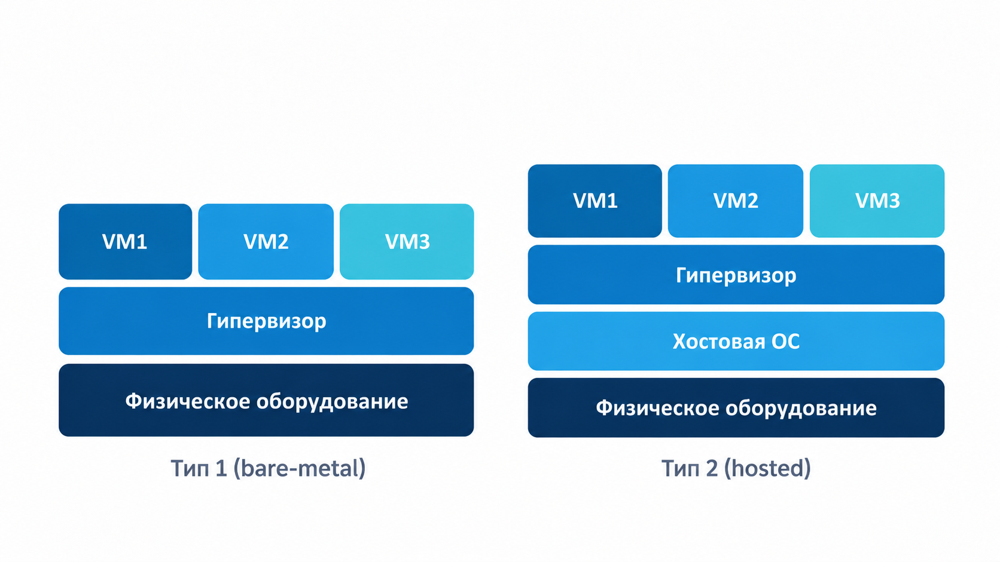
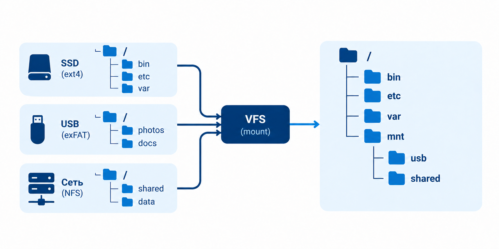
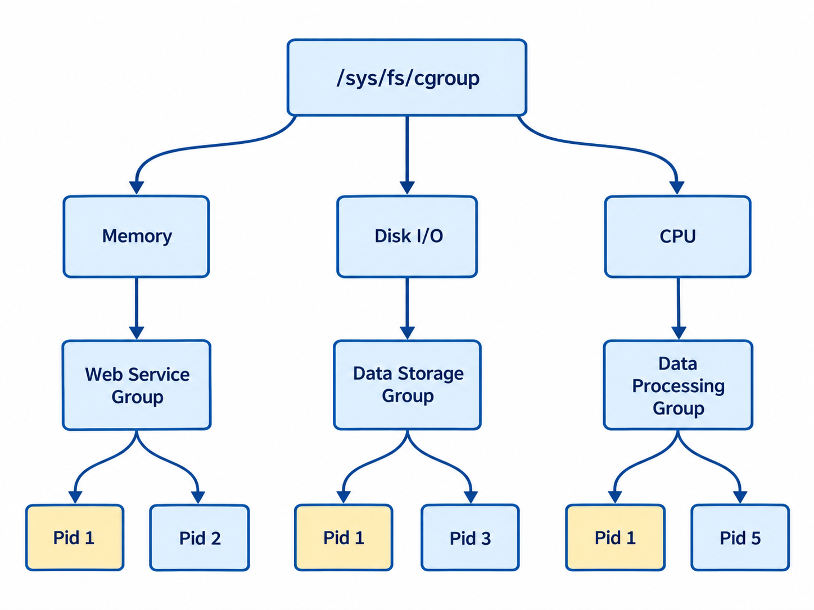

## Контейнеры. Изоляция и виртуализация.

На прошлой паре мы запускали сервис и обращались к нему по сети. Теперь представьте, что вы передали тот же код коллеге. У вас сервис работает, а у коллеги не запускается: версия Python другая, нужной системной библиотеки нет, порт уже занят. Код одинаковый. Почему результат разный?

Сегодня разберём, от чего зависит окружение программы и зачем его отделяют от соседних программ. Сначала поймём идею изоляции. Затем посмотрим, как её решает виртуальная машина и как – контейнер. Разберём файлы, монтирование, пространства имён и ограничения ресурсов. Здесь разбираем устройство окружения на схемах и небольших примерах, без ручной настройки изоляции.

---

## **Сегодня пройдемся по этому плану:**

1. **Проблема окружения** – почему одинаковый код может работать по-разному.
2. **Изоляция и воспроизводимость** – зачем они нужны и что именно мы отделяем.
3. **Виртуальная машина** – как на одном физическом сервере работают несколько гостевых ОС.
4. **Контейнер** – как отделить запуск приложения, сохранив общее ядро Linux.
5. **Образ и файлы** – откуда берётся подготовленное окружение приложения.
6. **Том и монтирование** – что именно подключают, куда и зачем, от флешки до данных контейнера.
7. **Namespaces** – почему разные процессы видят разную картину системы.
8. **cgroups** – как считают и ограничивают расход памяти и CPU.
9. **Выбор для задачи** – когда нужна VM, когда контейнер и почему их часто используют вместе.

---

## **Почему одного кода недостаточно.**

Возьмём знакомый `app.py`. Его можно скопировать на другую машину буквально байт в байт, но запуск зависит не только от файла. Программе нужны интерпретатор, библиотеки Python, иногда системные библиотеки и доступные устройства. Она читает настройки, открывает файлы и слушает сетевой порт. Всё это находится **вокруг** нашего кода.

Мы уже умеем создавать `.venv`. Это полезный шаг: два Python-проекта могут использовать разные версии пакета и не менять пакеты друг друга. Но виртуальное окружение берёт уже установленный Python и работает внутри той же операционной системы. Оно не даёт программе отдельное ядро, сетевой интерфейс или собственный порт `127.0.0.1:8000`.

**Ядро** – центральная часть операционной системы: оно управляет процессами, памятью, устройствами и сетью. Программа обращается к нему, когда ей надо открыть файл, создать процесс или отправить данные. Две программы в разных `.venv` всё равно обращаются к одному ядру своей машины.

Представьте два API на одной Linux-машине. У каждого своё `.venv`. Если оба попробуют слушать один адрес и порт, второй получит `Address already in use`: Python-пакеты раздельные, а сетевое пространство пока общее. Если один API использует почти всю память машины, второму тоже может стать плохо. Значит, вопрос шире, чем установка зависимостей.

```text
Одинаковый код
    + подходящие файлы и библиотеки
    + настройки, сеть и доступные ресурсы
    = работающий запуск в конкретном окружении
```

Здесь появляются две связанные задачи. Первая – **повторить окружение**, чтобы программа запускалась у коллеги и на сервере. Вторая – **разделить соседние запуски**, чтобы одна программа не мешала другой. Это не одна и та же задача: одинаковые пакеты не создают отдельную сеть, а отдельная сеть не устанавливает нужную версию Python.

---

## **Что такое изоляция и что мы отделяем.**

Допустим, на одной машине работают API, обработчик фоновых задач и база данных. Обработчик внезапно занимает много памяти. API и база начинают отвечать медленно или перестают отвечать совсем. При этом код API не менялся. Причина – соседние программы делят ресурсы машины.

> **Изоляция** – настройка границ между запусками. Мы решаем, какие части системы видит программа и какие общие ресурсы ей разрешено использовать. Граница помогает одному запуску не мешать другому, но её надо **настроить**: само слово «контейнер» не включает все возможные ограничения автоматически.

Что именно может оказаться по разные стороны такой границы?

| Часть окружения | Что может пойти не так без границы | Что хотим отделить |
| --- | --- | --- |
| Файлы и зависимости | приложениям нужны разные версии библиотек или разные настройки | видимое дерево файлов каждого запуска |
| Процессы | приложение видит чужие процессы и может обращаться к ним, если хватает прав | видимый список и нумерацию процессов |
| Сеть | два сервиса хотят один порт, а `localhost` у всех общий | интерфейсы, адреса, маршруты и набор портов |
| Память и CPU | одна программа забирает ресурсы у соседей | учёт и предел расхода для группы процессов |
| Пользователи и права | номер пользователя внутри запуска может совпасть с привилегированным номером снаружи | отображение идентификаторов и разрешённые действия |

Здесь есть важное различие. **Видимость** – что процессу показывает система: например, какие PID – номера процессов – он видит. **Доступ** – что ему разрешено сделать с увиденным файлом или процессом. Отдельный список PID не создаёт запас памяти, а спрятанный каталог сам по себе не делает программу безопасной. Позже мы увидим, каким механизмом задают каждую границу.

> **Воспроизводимость** – возможность снова запустить программу в заранее описанном окружении. Изоляция отвечает на вопрос «как соседние запуски разделены?», воспроизводимость – «можем ли мы повторить этот запуск?». Обычно нам нужны обе: подготовить подходящие файлы и не дать сервисам мешать друг другу.

Границы можно провести на разных уровнях. Один способ – дать приложению отдельную **виртуальную машину** с собственной ОС. Другой – оставить Linux общим, но отделить окружение **его процессов**. На втором способе построены контейнеры. Посмотрим сначала на целую виртуальную машину: после неё станет видно, что контейнеру нужно повторить, а что ему вообще не требуется.

---

## **Виртуализация: одна физическая машина, несколько гостевых.**

У провайдера стоит физический сервер: процессоры, память, диски, сетевые устройства. Такой сервер часто называют **bare metal**, или «голое железо». Если вы арендуете целый сервер, вам достаётся эта физическая машина. Но провайдер может разместить на ней несколько независимых клиентов, предоставив каждому виртуальную машину.

> **Виртуализация** – способ предоставить несколько логических окружений поверх общих физических ресурсов. Виртуальная машина использует настоящие CPU и память сервера; «виртуальная» означает, что видимые ей устройства и распределение ресурсов создаёт и контролирует специальный слой.

Этот слой называется **гипервизором**. Он предоставляет каждой виртуальной машине виртуальные процессоры, память и устройства и управляет тем, как они используют физический сервер. Внутри виртуальной машины загружается **гостевая ОС** – со своим ядром, системными службами и процессами.

> **Виртуальная машина (VM)** – гостевая система со своим ядром, запущенная на ресурсах физического компьютера через гипервизор. **Хост** – сторона, которая предоставляет ей эти ресурсы.

Представьте сервер на 64 ядра и 128 ГиБ памяти. Одному клиенту провайдер выдаёт VM с четырьмя виртуальными CPU и 8 ГиБ памяти, другому – VM с другой конфигурацией. Клиенты делят физическую машину, но управляют **разными гостевыми системами**. Если внутри вашей VM работает Ubuntu, её процессы обслуживает ядро этой Ubuntu, а не ядро соседней VM.

В настройках VM можно указать число виртуальных CPU, объём памяти и размер виртуального диска. Внутри гостевой ОС они выглядят как ресурсы отдельного компьютера. Снаружи гипервизор решает, когда виртуальным CPU работать на физических ядрах и как обращаться к настоящим устройствам. Поэтому «VM на четыре CPU» не означает, что четыре физических ядра сервера навсегда вынули из общего пользования. Конкретные правила распределения зависят от платформы и её настроек.

У гостя есть и собственный системный жизненный цикл: ОС устанавливают, обновляют и перезагружают. Если внутри VM обновили Python или системную библиотеку, это меняет **её** окружение, а не автоматически окружение соседней VM. Именно такая самостоятельность полезна, когда команды хотят управлять системой целиком или когда приложениям нужны разные ОС и ядра.

Гипервизоры обычно показывают двумя схемами. В первой он расположен прямо над физическим оборудованием. Во второй сначала работает хостовая ОС, а уже в ней запускают гипервизор. Например, на ноутбуке с macOS можно открыть Ubuntu через Parallels.

| Схема | Слои снизу вверх | Типичный случай |
| --- | --- | --- |
| Тип 1 | оборудование → гипервизор → VM | серверы виртуализации у провайдера |
| Тип 2 | оборудование → хостовая ОС → гипервизор → VM | гостевая ОС на личном ноутбуке |



Прочитайте рисунок снизу вверх. Слева гипервизор стоит непосредственно над оборудованием, справа между ними есть хостовая ОС. Верхние прямоугольники – VM. **Внутри каждой из них**, хотя рисунок этого не показывает, загружается своё гостевое ядро. Поэтому VM 1 и VM 2 – не просто две папки и не два процесса с разными Python-пакетами.

Слова «виртуальный CPU» тоже не означают, что процессор обязательно полностью эмулируют программой, выполняя каждую инструкцию заново. При аппаратной виртуализации значительная часть кода гостя работает на настоящем процессоре; гипервизор управляет доступом к ресурсам. Полная эмуляция другой архитектуры – отдельный случай. Для нашей темы достаточно понимать **границу**: у VM есть собственное гостевое ядро и виртуальные устройства.

Что происходит при старте выключенной VM? Гипервизор подготавливает виртуальные устройства, загружается гостевая система, запускаются её службы, и уже в ней стартует приложение. Эта отдельная ОС даёт широкую самостоятельность, но её надо хранить, обновлять и загружать. Если нам нужен второй экземпляр маленького API, целая новая гостевая система может оказаться избыточной.

Когда программа просит у ядра открыть файл или отправить данные, это обращение называют **системным вызовом**. У программы внутри VM такие запросы принимает ядро гостевой ОС. Это позволяет задать простой проверочный вопрос.

**Вопрос к аудитории:** На MacBook запущена Ubuntu-VM. Кто обслуживает системные вызовы программы *внутри* Ubuntu: ядро macOS или ядро Ubuntu?

**Ответ:** Ядро гостевой Ubuntu. Гипервизор и хостовая macOS предоставляют ей ресурсы, но внутри VM работает отдельная гостевая система.

---

## **Контейнер: приложение в своём окружении.**

Вернёмся к нашему API. Мы хотим подготовить для него нужные файлы, отделить его сеть и процессы от соседей, при необходимости ограничить память. Но загружать ради каждой копии API ещё одну гостевую ОС не обязательно. Linux умеет настроить эти границы **для обычных процессов** уже работающей системы.


Название напоминает о грузовых контейнерах: в каждом можно перевозить своё содержимое, а снаружи работать с ними как с отдельными единицами. Для программ это только аналогия: их «стенки» создают настройки запуска Linux. Поэтому дальше будем разбирать, что именно настроено, а не считать название гарантией полной изоляции.

> **Контейнер** – запущенное приложение или группа процессов с подготовленным файловым окружением и настроенными границами внутри Linux. Контейнерные процессы используют ядро той Linux-системы, в которой работают. Отдельная гостевая ОС внутри контейнера не загружается.

```text
VM:         физические ресурсы → гипервизор → гостевое ядро → приложение
контейнер: физические ресурсы → работающее ядро Linux → процесс приложения
                                                       ↑
                                      подготовленные файлы и границы
```

Например, на арендованной Ubuntu-VM можно запустить контейнер API, контейнер обработчика задач и контейнер PostgreSQL. Для каждого запуска подготавливают нужные файлы и настройки. Но **все процессы этих контейнеров обращаются к одному ядру Ubuntu-VM**. Если контейнеры работают на другой VM, они используют ядро уже той другой гостевой системы. Граница VM и граница контейнера могут работать одна внутри другой.

Контейнер не обязан состоять ровно из одного процесса: API может создавать дочерние процессы для обработки запросов. Обычно у контейнера есть **основной процесс**, по которому отслеживают время жизни запуска. Когда он завершился, контейнерный движок считает запуск законченным. Это ещё одно отличие от представления о контейнере как о маленьком компьютере, который продолжает жить сам по себе.

Контейнерный движок **подготавливает условия запуска**, а затем ядро выполняет обычный процесс приложения. Чтобы понять контейнер, будем последовательно спрашивать, какие части окружения этого процесса изменили.

Чтобы такое окружение получилось, надо ответить на три вопроса:

1. **Какие файлы получит приложение?** Нужны его код, библиотеки, настройки и подходящие системные файлы.
2. **Что приложение увидит вокруг?** Можно отделить список процессов, сеть, имя машины и точки подключения файловых систем.
3. **Сколько общих ресурсов оно сможет занять?** Можно учитывать и ограничивать память и время CPU для его группы процессов.

Дальше пройдём ровно по этим трём вопросам. Пока важно не спутать их: подготовленные файлы не ограничивают память, а ограничение памяти не создаёт приложению отдельную сеть. Контейнерный движок соединяет нужные части при запуске; степень изоляции зависит от конкретных настроек.

На macOS Linux-контейнеры, например при использовании Colima, работают через Linux-VM: ядро macOS не предоставляет Linux-механизмы контейнеров напрямую. Поэтому фраза «контейнеры делят ядро хоста» означает **ядро Linux-среды, где они фактически запущены**. На ноутбуке этой средой может быть VM; у облачного провайдера – ваша арендованная Linux-VM.

Общее ядро – практическое ограничение воспроизводимости. Образ может принести подходящий Python и системные библиотеки, но не способен заменить ядро хоста или сам по себе установить в хост драйвер видеокарты – системный компонент для работы с устройством. Для программы, которая использует GPU, важны и подготовленные файлы контейнера, и совместимость драйвера и устройства с той Linux-средой, где процесс работает. Поэтому фраза «один образ запустится совершенно везде» слишком сильная; точнее говорить, что образ помогает **повторить описанную часть окружения** на подходящих машинах.

**Вопрос к аудитории:** Если в файлах контейнера есть Ubuntu, значит ли это, что внутри загрузилось второе ядро Ubuntu?

**Ответ:** Нет. Там могут быть программы и библиотеки Ubuntu, но их системные вызовы обслуживает ядро Linux-среды, запустившей контейнер. Чтобы увидеть, откуда берутся эти файлы, разберём образ.

---

## **Образ и контейнер: подготовили и запустили.**

Вы можете заранее собрать для API подходящие файлы: нужную версию Python, библиотеки и сам `app.py`. Эти файлы надо где-то хранить и передавать другой машине. В контейнерном мире для этого используют **образ**.

> **Образ** – подготовленный набор файлов и настроек, из которого создают контейнеры. Образ сам по себе не выполняется: скачанный образ PostgreSQL ещё не означает, что на машине запущена база данных.

Из одного образа можно создать несколько контейнеров. Каждый будет отдельным запуском с собственным основным процессом и своими изменениями файлов. Аналогия со знакомым кодом: файл программы существует до запуска, а процесс появляется только после запуска. Образ и контейнер связаны похожим образом, хотя образ содержит гораздо больше, чем один исполняемый файл.

```text
Один образ: Python + библиотеки + код API
       ├── запуск A → процесс A и его изменения
       └── запуск B → процесс B и его изменения
```

Чтобы не делать полную копию всех файлов при каждом запуске, образы обычно хранят **слоями**. Один слой может содержать базовые системные файлы, следующий – язык и библиотеки, ещё один – код приложения. Контейнерный движок показывает процессу единое дерево каталогов, а изменения конкретного запуска записывает отдельно от исходных слоёв образа. При **copy on write** («копировании при записи») общий файл не копируют заранее для каждого запуска: отдельная версия появляется, когда его меняют. Конкретная реализация зависит от способа хранения слоёв.

Процессу не приходится выбирать слой вручную. Когда он открывает `/usr/bin/python3`, он просто видит обычный путь. Нужный файл берётся из подготовленных слоёв. Для записи появляется верхний, изменяемый слой конкретного запуска. Так образ может оставаться общим для нескольких контейнеров, хотя каждый из них выглядит для своего процесса как отдельное дерево файлов.

Если контейнер A изменит файл в своём верхнем слое, это не перепишет исходный образ и не станет автоматически изменением контейнера B. Общие подготовленные файлы сохраняются, а каждый запуск ведёт свои изменения.

Остановка процесса сохраняет изменяемый слой контейнера. Удаление контейнера удаляет этот слой; новый контейнер из того же образа не получает старые изменения автоматически. Для API это обычно удобно: новую версию кода можно развернуть из нового образа. Для PostgreSQL было бы опасно: его записи должны жить дольше отдельного процесса. Поэтому различают **файлы программы**, которые можно собрать заново, и **данные сервиса**, которые хранят отдельно и подключают к новому запуску. Что значит «подключают»? Для ответа сначала разберём обычную флешку.

Образы можно хранить в **реестре** – сервисе для хранения и скачивания образов; Docker Hub является знакомым примером. Реестр передаёт подготовленные файлы. Он не переносит работающий процесс и не добавляет машине второе ядро.

---

## **Том и монтирование: от устройства к пути.**

Представьте, что вы вставили флешку с фотографиями. Кажется, будто файлы сразу «появились в компьютере». Разложим это событие на части. У нас есть физическое устройство, которое хранит данные. На нём может быть **раздел** – выделенная часть пространства флешки. В разделе обычно создана **файловая система**: она организует данные в файлы и каталоги и хранит сведения о том, где лежит содержимое каждого файла. И только после подключения этой файловой системы программы получают путь к фотографиям.

### **Что такое том.**

> **Том (volume)** – логически выделенная область хранения данных. Она может находиться на разделе физического диска, на виртуальном диске или быть собрана из нескольких устройств. Том – это ответ на вопрос **«где хранить данные?»**, а файловая система – способ организовать данные в файлы и каталоги.

Слова «диск», «раздел», «том» и «файловая система» в разговоре часто смешивают. Для нашей темы достаточно различать их роли:

| Что это               | Роль                                                    | Пример                                      |
| --------------------- | ------------------------------------------------------- | ------------------------------------------- |
| Физическое устройство | хранит данные                                           | флешка или SSD                              |
| Раздел                | выделяет часть устройства                               | первая область на флешке                    |
| Том                   | логическая область, отданная под хранение               | раздел, виртуальный диск или логический том |
| Файловая система      | превращает область хранения в дерево файлов и каталогов | exFAT, ext4                                 |
| Точка монтирования    | даёт этому дереву путь в Linux                          | `/media/student/USB`                        |

Это **возможная**, а не обязательная цепочка: файловую систему можно создать и на устройстве без разделов, а логический том может использовать несколько физических дисков. Нам не нужно сейчас учиться размечать диск. Важно понять следующий переход: наличие области хранения ещё не говорит программе, **по какому пути** открывать её файлы.

### **Что именно монтируют и зачем.**

В Linux все доступные файлы видны в одном дереве каталогов, начинающемся с `/`. У самой системы уже есть корневая файловая система, подключённая к `/`. Чтобы добавить к этому дереву файловую систему флешки, выбирают каталог, например `/media/student/USB`. После подключения программа открывает `/media/student/USB/photo.jpg` и получает файл **с флешки**.

> **Монтирование** – подключение файловой системы или уже существующего дерева файлов к выбранному месту в дереве каталогов. **Точка монтирования** – каталог, через который эти файлы становятся доступны.



Прочитайте схему слева направо. На SSD, флешке и сетевом хранилище есть свои файловые системы и свои каталоги. **VFS (Virtual File System, виртуальная файловая система)** – часть ядра, которая даёт программам единый способ работать с разными файловыми системами. После монтирования их содержимое видно в одном дереве: корневая система доступна через `/`, флешка – через `/mnt/usb`, сетевые файлы – через `/mnt/shared`. Значит, файл `photos/photo.jpg` с флешки программа сможет открыть, например, по пути `/mnt/usb/photos/photo.jpg`. На рисунке показаны сами точки подключения; содержимое каталогов `usb` и `shared` справа для краткости не раскрыто.

Когда говорят «смонтировать диск» или «смонтировать том», обычно имеют в виду **подключить файловую систему**, находящуюся на нём. Сами байты с флешки при этом не копируются в каталог. Ядро связывает путь с нужной файловой системой. Монтировать можно и файловые системы, предоставленные сетью или памятью, а не только физическими дисками. Поэтому смысл `mount` шире, чем «подключить флешку».

Команда Linux `mount` управляет подключением: в простом случае ей указывают **источник** и **каталог**, куда показать файлы. У конкретной флешки своё имя устройства; на ноутбуке файловый менеджер обычно делает эти действия сам. После работы флешку **размонтируют**. Команда называется `umount`, без буквы `n` после `u`. Размонтирование убирает связь с путём, но не удаляет фотографии. Перед извлечением оно также даёт системе закончить ожидающие операции записи.

Точка монтирования – это адрес входа, а не папка, в которую перенесли содержимое. Если в каталоге что-то лежало до подключения, смонтированная файловая система временно скрывает прежнее содержимое по этому пути. После размонтирования оно снова видно. Так можно мысленно проверить, что произошло: **изменился путь к данным**, сами данные не «переехали».

Зачем всё это нужно? Программа работает с обычными путями, даже если файлы физически лежат на разных устройствах. Внешний диск, системные файлы и сетевое хранилище можно включить в одно дерево. Для приложения важен путь, по которому оно читает и записывает данные; источник этого пути может меняться без переписывания самого приложения.

### **Том в Docker – связанное слово, другой уровень.**

В Docker слово **volume** употребляют для хранилища, которым управляет контейнерный движок. Обычно это область в файловой системе той машины, где работает Docker, подключаемая к каталогу контейнера. Такой Docker volume **не обязан быть отдельным физическим диском или разделом**. Название подчёркивает его роль: хранить данные отдельно от записываемого слоя конкретного контейнера. Если сам volume сохраняют, его можно подключить после пересоздания контейнера; если удалить volume, данные исчезнут.

Представьте PostgreSQL: программа внутри ожидает данные по пути `/var/lib/postgresql/data`. Движок подключает туда volume. Процесс базы видит обычный каталог и записывает в него файлы. Если контейнер пересоздали, тот же volume можно подключить к новому запуску, и сохранённые записи останутся доступны. Здесь важно помнить две разные жизни: **контейнерный процесс может закончиться, а хранилище данных – остаться**.

Есть и **bind mount**: в контейнер подключают уже выбранный каталог хоста, например папку проекта. В обоих случаях процесс видит файлы по пути внутри контейнера. Разница в том, **кто выбирает и ведёт место хранения**: при bind mount путь хоста указываем мы, при Docker volume им управляет движок. Один вариант удобен для данных под управлением движка, другой – для доступа к выбранной папке проекта.

Монтирование отвечает на вопрос **«куда ведёт этот путь?»**. Но могут ли два процесса на одном Linux видеть разные наборы таких подключений? Да. Для этого существует отдельное пространство имён монтирования – один из механизмов, на которых строят контейнер.

---

## **Namespaces: разные взгляды на одно ядро.**

Обычный процесс спрашивает ядро: «какие процессы есть?», «как называется машина?», «какие сетевые интерфейсы доступны?». Ядро может дать разным группам процессов **разные ответы** на такие вопросы. Механизм называется **namespace**, или «пространство имён».

> **Namespace** – способ отделить для группы процессов определённый вид системного окружения. Он меняет то, что процесс видит или какие идентификаторы использует внутри работающей Linux-системы, но не копирует её ядро.

| Пространство имён | Что отделяет                                      | Как это заметно процессу                                                    |
| ----------------- | ------------------------------------------------- | --------------------------------------------------------------------------- |
| `pid`             | список и номера процессов                         | внутри первым процессом может быть PID 1                                    |
| `uts`             | имя машины                                        | внутри другое значение hostname                                             |
| `net`             | интерфейсы, адреса, маршруты и порты              | у запуска может быть свой `localhost:8000`                                  |
| `mnt`             | список монтирований                               | подключение может быть видно только внутри                                  |
| `ipc`             | часть способов обмена между процессами            | отдельные очереди сообщений и области разделяемой памяти                    |
| `user`            | отображение идентификаторов пользователей и групп | UID 0 – номер `root` внутри – может соответствовать обычному номеру снаружи |

Таблицу не надо заучивать как набор флагов. Смотрите на **вопрос**, который задаёт приложение. Когда оно просит список процессов, важен `pid`. Когда открывает путь к файлу – подготовленное дерево файлов и `mnt`. Когда хочет слушать порт – `net`. Разные пространства имён можно применять вместе, но одно не делает работу другого.

### **Один процесс – два номера.**

Представьте оболочку внутри нового PID namespace. Для процессов в этом пространстве она первая и имеет PID 1. При этом Linux-система снаружи тоже видит эту оболочку – уже под своим, обычным номером, например 4312. Никакой копии оболочки нет: **это один процесс и два взгляда на его номер**.

```text
внутри пространства:  bash → PID 1
снаружи, на хосте:    тот же bash → PID 4312
```

Это полезно контейнеру: его приложение видит своё небольшое дерево процессов и не принимает соседние сервисы за свои. Хост при этом может наблюдать процессы контейнера и управлять ими. PID 1 внутри пространства не означает, что мы загрузили второе ядро или заново включили компьютер.

Первый процесс в таком пространстве особенно важен для его жизни. Если он завершится, остальные процессы этого PID namespace тоже не смогут продолжать работу в прежнем виде. Отсюда практическое правило контейнеров: основной процесс должен действительно представлять работу сервиса. Если приложение запустило полезную работу в фоне, а его основной процесс сразу вышел, контейнерный запуск завершится, хотя студент мог ожидать «работы в фоне как у VM».

### **Имя, сеть и файлы – разные границы.**

UTS namespace позволяет приложению видеть своё имя машины. Это **не создаёт** запись DNS и не меняет автоматически IP-адрес. Имя, которое показывает система внутри контейнера, и адрес, по которому к нему приходит клиент, – разные вопросы из сетевой пары.

NET namespace даёт свой набор сетевых интерфейсов и портов. Поэтому два сервиса в разных сетевых пространствах могут оба слушать `127.0.0.1:8000`: у каждого свой `localhost`. Но новая сеть не обязана сразу иметь доступ в интернет или связь с хостом. Их отдельно настраивают – вместе с маршрутом и публикацией нужного порта. Слово «своя сеть» не означает «связь уже работает».

Представьте API, который слушает порт 8000 **внутри** своего сетевого пространства. Клиент снаружи не попадёт в него только потому, что знает число 8000: его собственный `127.0.0.1` ведёт к другому сетевому пространству. Контейнерный движок может организовать путь от адреса и порта хоста к адресу и порту контейнера. В Docker такую связь настраивают публикацией порта. Сейчас важно удержать последовательность: сначала сеть отделили, потом явно связали её с внешней.

MNT namespace отделяет **список точек монтирования**. При его создании список сначала похож на прежний: данные не копируются и новый диск не появляется. Дальше нужное дерево файлов подключают и задают процессу подходящий корень. Поэтому «новое пространство монтирований» и «свои файлы» – связанные, но разные шаги.

IPC namespace нужен программам, которые обмениваются данными через очереди сообщений или разделяемую память ядра. На нашей паре достаточно знать, что это ещё один вид общего окружения, который можно отделить; обычный HTTP-запрос между сервисами объясняется сетевым пространством, а не IPC.

USER namespace касается идентификаторов и прав. Например, UID 0 внутри может отображаться на обычного пользователя снаружи. Но это нужно **настроить**. Нельзя делать вывод «раз внутри написано `root`, значит всё безопасно» или «раз это контейнер, его процесс не может повлиять на хост». Реальные права зависят от отображения пользователей, разрешённых возможностей процесса и доступных файлов. Контейнер – управляемая граница, а не обещание абсолютной защиты.

Итак, namespaces задают процессу **отдельный взгляд на систему** и, в случае `user`, отображение идентификаторов. Если процесс видит только свои PID, он всё равно может попытаться занять много общей памяти. Видимость и расход ресурсов – разные стороны запуска. За вторую отвечает следующий механизм.

---

## **cgroups: сколько ресурсов можно использовать.**

Пусть два сервиса уже получили разные сетевые пространства и списки процессов. Один из них запускает несколько дочерних работников, которые вместе занимают почти всю память VM. Другой сервис от этого страдает. Значит, изолировать **взгляд** программы оказалось недостаточно: нужно ещё учитывать и при необходимости ограничивать расход общих ресурсов.

> **cgroup (control group, «контрольная группа»)** – группа процессов, для которой ядро учитывает использование ресурсов и может задавать пределы. Дочерние процессы обычно остаются в той же группе, поэтому их расход учитывается вместе с расходом основного процесса.

Представьте, что сервису разрешено использовать 128 МиБ памяти. У него два работника: каждый пытается удержать по 100 МиБ. Лимит группы – **общий**, а не личные 128 МиБ для каждого работника. При нехватке памяти ядру может понадобиться завершить один из процессов группы. Так соседние сервисы не обязаны расплачиваться за бесконтрольный расход именно этого запуска.



На рисунке показана связь **группы процессов** с расходом памяти, CPU и операциями чтения и записи на диск. Ветви `Memory`, `Disk I/O` и `CPU` здесь условные: в cgroup v2 дерево строится из **групп процессов**, а несколько видов учёта и ограничений могут действовать на одну группу одновременно. Повторяющиеся `Pid 1` можно увидеть, если процессы находятся в разных PID namespaces; сама контрольная группа не выдаёт им новые номера. `Disk I/O` на схеме означает работу с диском, а не объём места для файлов.

С **памятью** и **CPU** важно не ожидать одинакового поведения. Когда группа достигает жёсткого предела памяти и не может освободить достаточно места, возможен OOM – нехватка памяти, при которой ядро завершает процесс. CPU-квота устроена иначе: процесс обычно не завершают, а временно задерживают, когда группа израсходовала разрешённое время за период.

Память процесса и место на диске – тоже разные ресурсы. Потолок `memory.max` не говорит, сколько гигабайт файлов разрешено записать базе данных. Файлы базы лежат в хранилище, а страницы данных и рабочие структуры, которые база держит в оперативной памяти (RAM), участвуют в учёте памяти. Интенсивность чтения и записи на диск можно регулировать отдельными настройками cgroup; количество места для файлов ограничивают другими механизмами. Если смешать эти величины, легко решить, что «выдали контейнеру 128 МиБ памяти» означает «база может хранить только 128 МиБ данных»; это неверно.

Допустим, квота равна 50 миллисекундам за каждые 100 миллисекунд. Постоянно считающая программа в среднем получит половину времени одного CPU. Она может выполняться то на одном, то на другом физическом ядре – ей не «отрезали половину процессора» навсегда. Если программа ждёт сеть, она может даже не приблизиться к этому пределу. Квота ограничивает **максимальный расход**, а не обещает скорость выполнения.

| Предел | Что происходит при достижении |
| --- | --- |
| Жёсткий предел памяти | возможна нехватка памяти и завершение процесса |
| Квота CPU | работа обычно ждёт следующего периода и идёт медленнее |

Группы образуют дерево. Ограничение, заданное родительской группе, продолжает действовать и на её потомков. Если у вашей Ubuntu-VM есть 4 ГиБ RAM, контейнер внутри неё не сможет получить 100 ГиБ только потому, что его собственный файл `memory.max` не задаёт дополнительного потолка. Сначала есть граница самой VM, а уже внутри неё – настройки процессов и контейнеров.

Не каждый контейнер обязательно запускают с жёстким лимитом CPU или памяти. Настройки выбирают по задаче и нагрузке. Например, сколько памяти нужно PostgreSQL, зависит от данных, числа одновременных запросов и настроек базы. Но сама возможность **учитывать группу процессов как одно целое** и управлять её расходом – важная часть контейнеризации.

Теперь различие двух механизмов можно сформулировать коротко: **namespace определяет видимую картину**, **cgroup – учёт и пределы ресурсов**. Ни один не заменяет другой; вместе с подготовленными файлами они помогают создать понятное окружение для запуска приложения.

---

## **Когда нужна VM, а когда контейнер.**

Вернёмся к начальной задаче. Мы хотели запускать сервис предсказуемо и не давать ему мешать соседям. VM и контейнеры могут помочь, но границы у них разные. Выбор начинается с вопроса: **нужна ли приложению отдельная ОС со своим ядром?**

| Вопрос | Виртуальная машина | Контейнер |
| --- | --- | --- |
| Какое ядро выполняет программу? | ядро гостевой ОС | ядро той Linux-среды, где запущен контейнер |
| Что запускают? | гостевую ОС, её службы и приложение | приложение с подготовленными файлами и границами |
| Можно ли получить отдельную гостевую ОС со своим ядром? | да, если платформа поддерживает гостя | нет: файлы другого дистрибутива не меняют ядро |
| От чего зависит старт? | от загрузки гостевой системы | от подготовки окружения и запуска процесса |
| Где обычно удобнее? | отдельная система и более сильная граница между окружениями | отдельные сервисы внутри работающего Linux |

У VM есть расходы на хранение, запуск и обслуживание гостевой ОС. Контейнеру не нужно загружать её заново, поэтому короткие запуски обычно удобнее масштабировать контейнерами. Но слово «контейнер» **не гарантирует** маленький размер: образ с большими библиотеками тоже может занимать гигабайты. И одна таблица не даёт точного числа секунд запуска для любой машины – на него влияют файлы, сеть, нагрузка и настройки.

Посмотрим на задачи, которые встречаются на практике:

| Ситуация                                                          | Разумный выбор              | Почему                                                                          |
| ----------------------------------------------------------------- | --------------------------- | ------------------------------------------------------------------------------- |
| Провайдер выдаёт вам свой сервер в облаке                         | VM                          | вы управляете отдельной гостевой ОС, деля физическое железо с другими клиентами |
| На macOS нужно запускать Linux-программы и исследовать Linux-ядро | Linux-VM                    | у гостя есть нужное ядро и механизмы Linux                                      |
| На одной Ubuntu работают API, обработчик задач и база             | контейнеры внутри VM        | сервисам дают свои файлы, сеть и настройки ресурсов, сохраняя одну гостевую ОС  |
| Нужно повторить окружение API в разработке и на сервере           | образ и контейнерный запуск | файлы и настройки запуска можно подготовить и использовать повторно             |
| Нужна другая ОС или собственное ядро                              | VM                          | контейнер не заменяет ядро среды, где выполняется                               |

Контейнеры можно запускать и на физическом Linux-сервере без VM. Виртуальная машина нужна, когда важна отдельная гостевая ОС; контейнер помогает управлять окружением приложения внутри уже работающего Linux.

Для базы данных выбор «контейнер или установка прямо в VM» не отменяет вопрос о хранении данных. В обоих случаях надо решить, где лежат записи, кто делает резервные копии и как восстановить сервис. При контейнерном запуске особенно важно не оставить данные только в изменяемом слое конкретного запуска.

Часто выбор **не взаимоисключающий**. Провайдер даёт вам Ubuntu-VM, а вы запускаете внутри контейнеры API и базы. VM отделяет вашу гостевую систему от соседних VM на физическом сервере; контейнеры помогают управлять отдельными приложениями **внутри** вашей системы. У каждой границы своя задача.

---

## **Дополнительно почитать.**

- [Linux manual: namespaces](https://man7.org/linux/man-pages/man7/namespaces.7.html) – виды пространств имён и их свойства.
- [Linux manual: mount namespaces](https://man7.org/linux/man-pages/man7/mount_namespaces.7.html) – как отделяют точки монтирования.
- [Linux manual: mount](https://man7.org/linux/man-pages/man8/mount.8.html) – что именно подключает команда `mount`.
- [Документация ядра Linux: cgroup v2](https://docs.kernel.org/admin-guide/cgroup-v2.html) – учёт процессов и настройки памяти и CPU.
- [Docker Docs: volumes](https://docs.docker.com/engine/storage/volumes/) – чем Docker volume отличается от изменяемого слоя контейнера.


