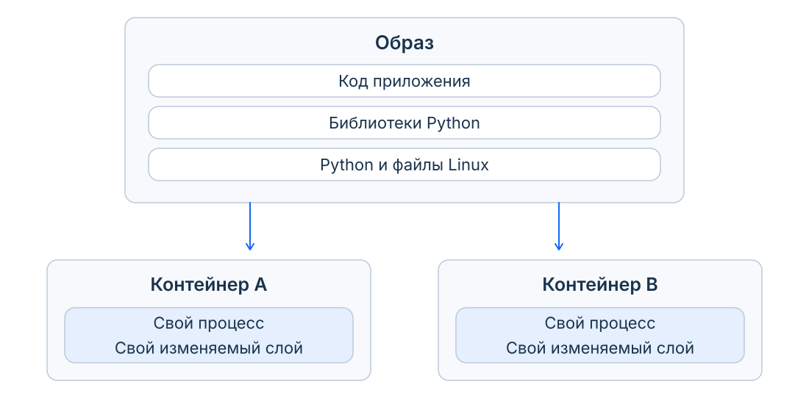
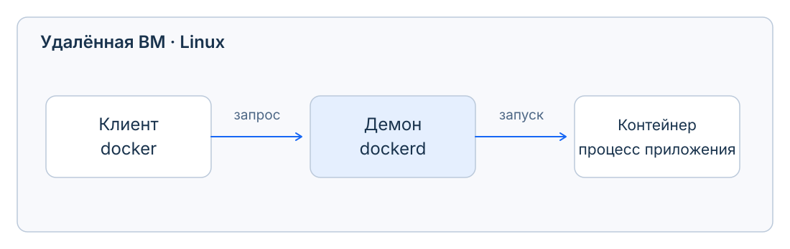
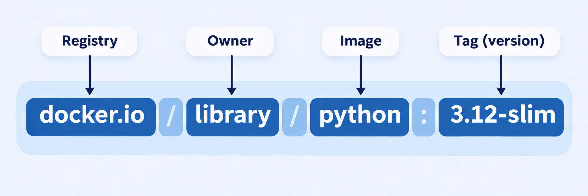
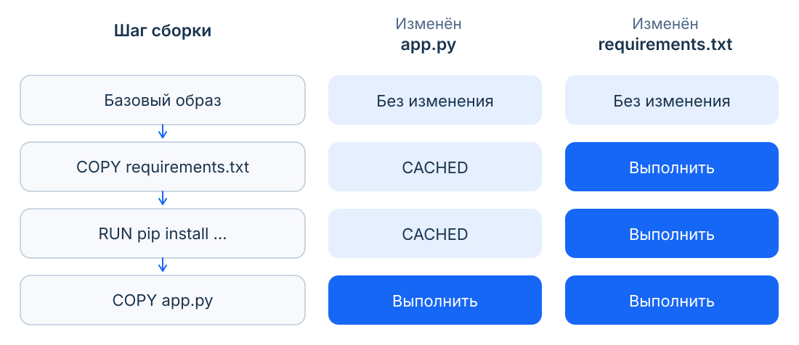
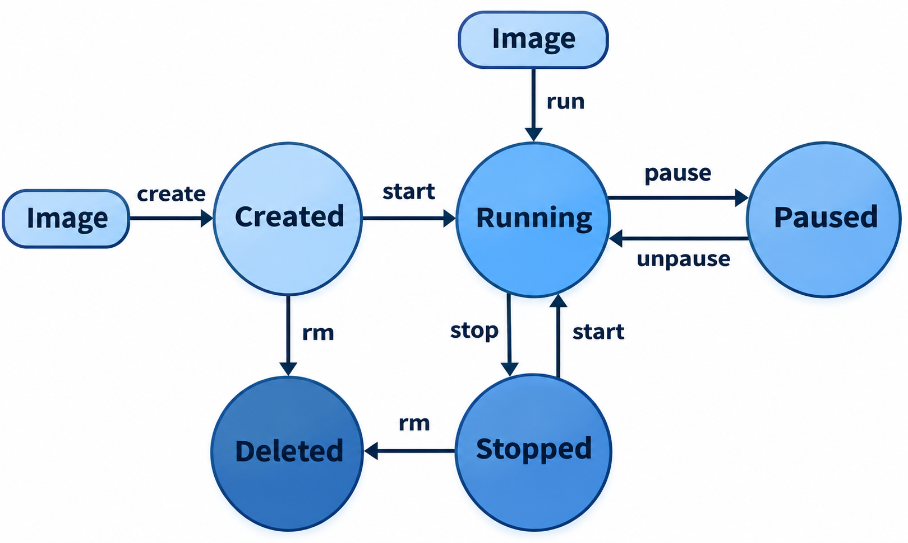
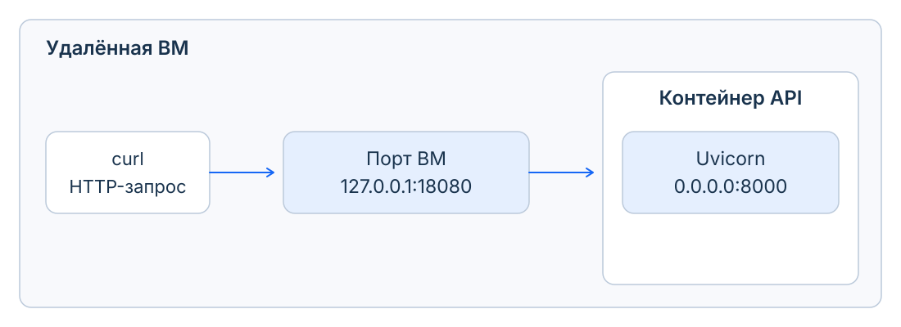
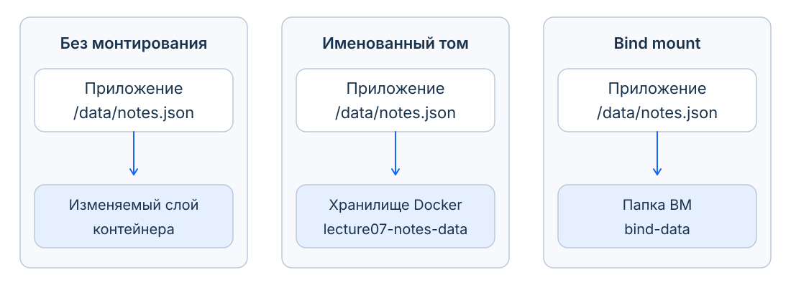

# Docker. Окружение, запуск и данные

Упакуем сервис заметок, запустим его на ВМ и научимся обновлять приложение, сохраняя записи. Сначала разберём устройство Docker на этом примере, затем проверим его в терминале.

## Часть I. Как устроен запуск

### Что Docker добавляет к прошлой паре

В шестой паре мы обсуждали два механизма ядра Linux. **Namespaces** задают, что видит процесс: например, свой набор процессов, сетевых интерфейсов и точек монтирования. **Cgroups** позволяют учитывать и ограничивать потребление ресурсов группой процессов: например, память и процессорное время.

Docker использует эти и другие механизмы Linux, чтобы создавать контейнеры. Его удобство для разработчика – в готовых действиях: описать окружение, собрать его, запустить приложение и управлять отдельными экземплярами. Сегодня работаем через Docker; вручную настраивать namespaces и cgroups не будем.

### Что именно мы передаём коллеге

Файл `app.py` ещё не приносит с собой Python, библиотеки и настройки. Если передать только код, коллеге придётся восстановить окружение. Хотим подготовить его один раз и использовать для отдельных запусков.

Есть и другая трудность: одному сервису нужна новая версия системной библиотеки, а другой ещё зависит от старой. Раздельные контейнерные окружения позволяют сохранить для каждого свой набор библиотек, вместо того чтобы обновлять общую установку ради одного приложения.

<div style="padding: 8px 12px; margin: 12px 0; border-radius: 6px; border-left: 3px solid #3b82f6; background-color: #eff6ff; color: #1e40af;">
<strong>Образ (<code>image</code>)</strong> – подготовленные файловые слои и настройки запуска: например, Python, библиотеки и наш код.<br>
<strong>Контейнер (<code>container</code>)</strong> – созданный из образа экземпляр со своими настройками и изменяемым слоем файлов. При запуске в нём работает процесс приложения.
</div>

Образ контейнера не является образом диска полноценной ВМ с загрузкой отдельной ОС.

ВМ имеет собственное ядро. Linux-контейнеры используют ядро хоста: у нас это Ubuntu-ВМ. Поэтому внутри контейнера могут быть файлы Debian и Python, хотя ядро обслуживает процессы со стороны Ubuntu. Не требуется загружать ещё одну ОС для каждого приложения; при этом ресурсы на саму программу всё равно нужны. Механизмы изоляции мы уже разбирали в шестой паре.

<div style="padding: 8px 12px; margin: 12px 0; border-radius: 6px; border-left: 3px solid #64748b; background-color: #f8fafc; color: #475569;">
<strong>Для справки: Java Virtual Machine (JVM)</strong><br>
Один из известных подходов к переносимости программ – JVM. Java-код компилируют в байткод, инструкции для этой виртуальной машины: один и тот же байткод можно выполнять на разных ОС с совместимой JVM. Здесь «виртуальная машина» означает среду выполнения программы, без отдельной гостевой ОС. Версии библиотек, настройки и внешние сервисы всё равно нужно согласовать. <a href="https://docs.oracle.com/javase/specs/jvms/se25/html/jvms-1.html#jvms-1.2">Устройство JVM</a>.
</div>

**Один образ, два независимых контейнера.**



Из одного образа можно создать два независимых запуска. Изменение файла в одном не переписывает образ и не меняет другой контейнер. Это пригодится, когда будем сравнивать способы хранения заметок.

### Почему изучаем Docker

Docker – широко принятый инструмент работы с контейнерами, своего рода стандарт де-факто в разработке. Но контейнеризация не принадлежит одному продукту. Например, **Podman** тоже умеет собирать образы и запускать контейнеры; многие его команды похожи на Docker. Мы изучаем Docker как распространённую отправную точку, а понятия образа, процесса и постоянных данных пригодятся и с другими инструментами.

На macOS также можно встретить **Colima**: она создаёт Linux-ВМ и может запускать в ней Docker Engine. Тогда мы пользуемся обычными командами `docker` без Docker Desktop. Podman – другой инструмент работы с контейнерами, а Colima в таком режиме предоставляет окружение для Docker. В нашей практике Docker уже установлен на удалённой ВМ. [Colima](https://github.com/abiosoft/colima).

При этом формальные стандарты – отдельная вещь: **OCI (Open Container Initiative)** описывает форматы образов, их распространение и запуск. Благодаря общим спецификациям инструменты могут использовать совместимые образы, хотя их возможности и команды не обязаны полностью совпадать. [Спецификации OCI](https://opencontainers.org/about/overview/).

### Кто выполняет команды

Мы подключимся по SSH к ВМ. Команда `docker` там – клиент: он отправляет запрос **Docker daemon**, процессу `dockerd`. Это серверная часть Docker Engine. Демон создаёт и запускает контейнеры, управляет образами, сетями и томами. На нашей ВМ клиент общается с ним через Unix-сокет `/var/run/docker.sock`. [Устройство Docker Engine](https://docs.docker.com/engine/).

<div style="padding: 8px 12px; margin: 12px 0; border-radius: 6px; border-left: 3px solid #3b82f6; background-color: #eff6ff; color: #1e40af;">
<strong>Демон (daemon)</strong><br>
Фоновый процесс, который обслуживает запросы или выполняет служебные задачи без постоянного ввода команд человеком. В Docker эту роль выполняет <code>dockerd</code>.
</div>

Например, `sshd` принимает SSH-подключения, а cron запускает задания по расписанию. Буква `d` в конце имени часто обозначает daemon, хотя это соглашение, а не обязательное правило.

Название появилось задолго до Docker. По воспоминанию Фернандо Корбато, его группа в MIT использовала его примерно с 1963 года, вдохновившись **демоном Максвелла**: воображаемым существом из мысленного эксперимента, которое следит за молекулами и сортирует их по скорости. Компьютерная аналогия – незаметный помощник, постоянно выполняющий работу системы.

Поэтому клиент может вернуть нам терминал, пока демон и приложение продолжают работать. Флаг `-d` (`--detach`) выбирает **detached mode**, отсоединённый режим: контейнер работает в фоне без подключения текущего терминала к его потокам. Здесь пара слов: **attach** – подключить, **detach** – отсоединить. В режиме **attached** клиент остаётся подключённым к потокам основного процесса; команда `docker attach` позволяет подключиться к работающему контейнеру позже.

Важно различать три места: ваша машина, удалённая ВМ и контейнер. Исходники для сборки лежат на ВМ; Docker работает на ВМ; команды внутри контейнера видят его файловое окружение. Устанавливать Docker внутрь контейнера нашего API не нужно.

**Кто выполняет команду после подключения по SSH.**



Здесь и клиент, и демон находятся на ВМ. На вашей машине открыт терминал SSH; запрос клиента к демону на ВМ передаётся через `/var/run/docker.sock`.

### Откуда берётся образ

Образ мы можем **собрать сами**: выбрать окружение, добавить зависимости и код своего приложения. Для этого опишем действия в Dockerfile – файле инструкций сборки, который разберём ниже. После сборки образ хранится локально у Docker; для первого запуска публиковать его куда-либо не обязательно.

Но коллега или другой сервер не видят наше локальное хранилище. Нам нужно место, куда можно отправить образ и откуда затем получить его на другой машине.

<div style="padding: 8px 12px; margin: 12px 0; border-radius: 6px; border-left: 3px solid #3b82f6; background-color: #eff6ff; color: #1e40af;">
<strong>Реестр образов (registry)</strong><br>
Сервис для хранения и распространения образов. Команда <code>push</code> публикует образ в реестре, <code>pull</code> получает его оттуда. Локальная сборка сама по себе ничего не публикует.
</div>

Реестр полезен и в обратную сторону: не обязательно готовить каждое окружение с нуля. Можно найти образ, уже собранный другими разработчиками или компанией: например, `Python`, `PostgreSQL` или `Nginx`. На странице образа смотрим, кто его поддерживает, какие доступны теги и как его запускать. Готовый Python возьмём за основу, а свой API добавим поверх него.

`Docker Hub` хранит публичные и закрытые образы. Организация может также развернуть свой реестр, например Harbor.

Кроме `Docker Hub`, образы можно хранить в других реестрах:

| Реестр                             | Пример ссылки на образ               |
| ---------------------------------- | ------------------------------------ |
| `GitHub Container Registry (GHCR)` | `ghcr.io/team/notes:v1`              |
| `Yandex Container Registry`        | `cr.yandex/<registry-id>/notes:v1`   |
| `Собственный Harbor`               | `registry.example.org/team/notes:v1` |

В Yandex Cloud `<registry-id>` заменяется идентификатором реестра, в GHCR `team` – пользователем или организацией. Для закрытых образов нужны права доступа. В практике используем Docker Hub. [Yandex Container Registry](https://yandex.cloud/ru/docs/container-registry/concepts/repository), [GHCR](https://docs.github.com/en/packages/working-with-a-github-packages-registry/working-with-the-container-registry).

Ссылка `registry.example.org/team/notes:v1` состоит из адреса реестра, пути репозитория и тега. У `python:3.12-slim-bookworm` адрес опущен: используется Docker Hub и официальный репозиторий Python.

<div style="padding: 8px 12px; margin: 12px 0; border-radius: 6px; border-left: 3px solid #3b82f6; background-color: #eff6ff; color: #1e40af;">
<strong>Тег (<code>tag</code>)</strong><br>
Читаемое имя, которое указывает на вариант образа в репозитории: например, <code>3.12-slim-bookworm</code> у Python или <code>v1</code> у нашего сервиса. Автор репозитория может переназначить тег другому содержимому.
</div>

Для точной фиксации содержимого используют **`digest`**, идентификатор в ссылке вида `repository@sha256:…`.



На схеме `docker.io` – Docker Hub, `library` – специальное пространство имён официальных образов, `python` – репозиторий, `3.12-slim` – тег. Подпись `Owner` здесь условна: `library` не является логином автора Python. `Tag (version)` тоже читаем с оговоркой: тег может обозначать версию или другой вариант образа. Короткая запись `python:3.12-slim` соответствует показанной полной ссылке; в практике мы дополнительно указываем `bookworm`.

<div style="padding: 8px 12px; margin: 12px 0; border-radius: 6px; border-left: 3px solid #ef4444; background-color: #fef2f2; color: #991b1b;">
<strong>Антипаттерн</strong><br>
Считать тег неизменяемой версией. <code>latest</code> не ищет самую новую версию автоматически. Даже тег с номером может со временем указывать на другое содержимое: одинаковое имя тега не доказывает одинаковое окружение. Для фиксации содержимого нужен <code>digest</code>.
</div>

### Почему у Python так много образов

Тег выбирает не только версию Python, но и системное окружение. Сравним четыре характерных варианта одной ветки:

| Вариант | Что получаем |
| --- | --- |
| `python:3.12-trixie` | Python на Debian Trixie с более широким набором системных пакетов |
| `python:3.12-slim-trixie` | Python на том же Debian Trixie, но с сокращённым набором пакетов |
| `python:3.12-slim-bookworm` | Сокращённое окружение на предыдущем выпуске Debian – Bookworm; его используем в практике |
| `python:3.12-alpine` | Python на Alpine Linux: другая система и библиотека C – musl вместо glibc |

`trixie` и `bookworm` – названия выпусков Debian. `slim` не урезает язык Python: он уменьшает окружение вокруг него. Поэтому компилятор или системную библиотеку иногда приходится устанавливать отдельно. Alpine тоже нельзя выбирать только по размеру: некоторые готовые бинарные Python-пакеты для него не подходят.

Доступные теги и Dockerfile смотрим на [странице официального Python-образа](https://hub.docker.com/_/python).

### Что будет делать приложение

Наш API принимает HTTP-запросы: `POST /notes` добавляет заметку, `GET /notes` возвращает список, `GET /health` сообщает версию. Заметка содержит `id` и `text`. В JSON-файле будет список таких записей:

```json
[{"id": "example-id", "text": "Проверить резервную копию"}]
```

Код уже подготовлен. Для HTTP используем FastAPI и сервер Uvicorn; приложение записывает JSON в каталог из переменной окружения `DATA_DIR`. Переменная окружения – именованная настройка, которую процесс получает при запуске. Для наших опытов она равна `/data`.

### Как получить собственный образ

**Сборка (`build`)** – получение образа из файлов проекта по заданным инструкциям. Её запускает команда `docker build`; результат – образ, из которого затем создаём контейнеры. Это не обязательно компиляция программы: у нас сборка установит библиотеки и скопирует Python-код.

**Dockerfile** – файл с этими инструкциями. Сначала посмотрим на него целиком: он берёт Python, устанавливает зависимости, добавляет код и описывает будущий запуск. Затем разберём его сверху вниз. Пока не требуется знать значение каждой строки.

```dockerfile
FROM python:3.12-slim-bookworm
WORKDIR /app
COPY requirements.txt ./requirements.txt
RUN python -m pip install --no-cache-dir -r requirements.txt
COPY app.py ./app.py
ENV DATA_DIR=/data
EXPOSE 8000
CMD ["python", "-m", "uvicorn", "app:app", "--host", "0.0.0.0", "--port", "8000"]
```

Это содержимое `demo/Dockerfile`, с которым будем работать в практике.

#### Основа и рабочая папка

Python у нас уже есть в готовом образе. `FROM` выбирает эту основу. Для кода заведём `/app`: `WORKDIR` создаст каталог и сделает его рабочим для следующих инструкций и будущего запуска.

```dockerfile
FROM python:3.12-slim-bookworm
WORKDIR /app
```

Папка `/app` относится к образу. На ВМ мы по-прежнему стоим в `~/devtools-demo/demo`. Сборка связывает два дерева файлов: берёт нужные файлы проекта и помещает их в подготовленное окружение.

#### Зависимости приложения

**Контекст сборки** – файлы, которые мы передаём сборщику. В нашем случае это папка `demo`. `COPY` получает два пути: источник **в контексте** и назначение **в образе**.

```dockerfile
COPY requirements.txt ./requirements.txt
RUN python -m pip install --no-cache-dir -r requirements.txt
```

Первая строка берёт `demo/requirements.txt` и создаёт `/app/requirements.txt`. Точка справа отсчитывается от уже заданного `WORKDIR`. Вторая строка выполняет команду **при сборке**: устанавливает перечисленные пакеты в Python образа.

`python -m pip` запускает модуль `pip`: `-m` означает запуск модуля Python. У `pip` параметр `-r` (`--requirement`) означает «прочитать требования из файла». 
`--no-cache-dir` не сохраняет кэш скачанных пакетов pip. Кэш самой сборки `Docker` – другой механизм; увидим его при изменении кода.

#### Код и его настройки

Теперь в окружении есть библиотеки. Добавим само приложение и выберем, где оно будет хранить заметки:

```dockerfile
COPY app.py ./app.py
ENV DATA_DIR=/data
```

`ENV` задаёт переменную окружения будущего процесса. Здесь `DATA_DIR` выбирает папку для заметок. Это удобно, когда один и тот же код нужно запускать с разными каталогами данных: локально писать в `./data`, в контейнере – в `/data`, а в отдельном запуске – в `/notes`.

В приложении настройка читается явно:

```python
DATA_DIR = Path(os.environ.get("DATA_DIR", "./data"))
```

`os.environ.get` получает значение из окружения, а при отсутствии переменной использует `./data`; `Path` представляет путь. В Dockerfile мы задаём `/data`, поэтому сервер будет сохранять `/data/notes.json`. Без такого чтения в коде произвольная переменная из `ENV` не изменила бы поведение приложения.

При запуске `-e` (`--env`, environment) задаёт переменную для конкретного контейнера. Через `-e DATA_DIR=/notes` выберем другое место хранения без пересборки. Так же приложения могут читать адрес базы или уровень логирования.

Мы копируем два нужных файла, а не всю папку проекта. `.dockerignore` дополнительно ограничивает контекст: локальное окружение, данные и секреты сборщику не нужны. `.gitignore` действует на Git; Docker его вместо `.dockerignore` не использует.

#### Команда запуска

Установленные файлы сами не начинают принимать запросы. Для нашего `FastAPI` нужен сервер `Uvicorn`. Запуск опишем через `CMD`:

```dockerfile
EXPOSE 8000
CMD ["python", "-m", "uvicorn", "app:app", "--host", "0.0.0.0", "--port", "8000"]
```

`python -m uvicorn` запускает модуль Uvicorn. В `app:app` первая часть означает файл `app.py`, вторая – объект приложения в нём. `--port 8000` задаёт порт сервера. `--host 0.0.0.0` разрешает принимать соединения на всех IPv4-интерфейсах **контейнера**.

`EXPOSE 8000` записывает предполагаемый порт в настройки образа. Доступ с ВМ мы ещё не настроили. `CMD` тоже пока ничего не запускает: сохраняет программу и аргументы для будущего контейнера. В квадратных скобках каждый аргумент записан отдельно; промежуточная оболочка здесь не нужна.

Получились два разных момента: **при сборке** установили пакеты через `RUN`, **при запуске** выполним сервер из `CMD`. Если поменять их местами, сборка будет пытаться держать HTTP-сервер, а контейнер – устанавливать пакеты вместо обслуживания запросов.

### Настройка сборки и настройка запуска

В Dockerfile задаём значение по умолчанию:

```dockerfile
ENV DATA_DIR=/data
```

При создании контейнера параметр `-e DATA_DIR=/notes` заменит его на `/notes`. Это настройка одного запуска: образ не меняется. Переменная выбирает путь для нашего приложения, но сама не создаёт каталог и не подключает хранилище. В практике сравним оба значения через Python.

`ARG` решает другую задачу: передаёт параметр **сборке**. Например, начало Dockerfile можно записать так:

```dockerfile
ARG PYTHON_VERSION=3.12
FROM python:${PYTHON_VERSION}-slim-bookworm
```

Для такого Dockerfile команда `docker build --build-arg PYTHON_VERSION=3.13 -t notes:py313 .` выберет Python 3.13. `--build-arg` передаёт параметр сборки, `-t` (`--tag`) задаёт имя и тег результата, точка выбирает текущую папку как контекст. `ARG` сам по себе не становится переменной окружения приложения. Пароли и токены не передаём ни через `ARG`, ни через `ENV` в Dockerfile: эти механизмы не предназначены для секретов. [Параметры сборки](https://docs.docker.com/build/building/variables/).

Теперь отделим **настройку** от **команды запуска**. `RUN` уже выполнился при сборке, а `CMD` только сохранил команду по умолчанию. У нашего образа нет `ENTRYPOINT`, поэтому команда после имени образа заменяет `CMD` целиком. Например, можно попросить запустить `python --version` вместо сервера.

Если хотим закрепить запускаемую программу, можно разделить последнюю строку Dockerfile:

```dockerfile
ENTRYPOINT ["python", "-m", "uvicorn"]
CMD ["app:app", "--host", "0.0.0.0", "--port", "8000"]
```

Здесь `ENTRYPOINT` задаёт программу, `CMD` – её аргументы по умолчанию. Для образа с таким окончанием аргумент `--version` после имени образа заменит `CMD`: получится `python -m uvicorn --version`. Сам `ENTRYPOINT` заменяется отдельным параметром `--entrypoint`. В разделе 12 соберём этот вариант и сравним оба запуска.

### Из чего состоят файловые слои

**Файловый слой** – изменения, которые нужно применить к предыдущему состоянию файловой системы: добавить файлы, заменить их содержимое или отметить удаление. Предыдущий слой при этом не переписывается; новое состояние получается из сочетания слоёв. Это не отдельный виртуальный диск и не обязательно одна папка. Docker объединяет слои образа в одно дерево файлов: приложение видит обычные `/app`, `/usr`, `/data`.

Например, базовый образ приносит Python, установка зависимостей добавляет библиотеки, `COPY app.py` – наш код. Слои готового образа не меняются при запуске. Поверх них у каждого контейнера есть **собственный изменяемый слой**:

| Действие без подключённого хранилища | Где находится результат |
| --- | --- |
| Читаем `/app/app.py` | Читаем файл, пришедший из образа |
| Меняем `/app/app.py` | Изменённая версия появляется в слое этого контейнера; исходный образ остаётся прежним |
| Создаём `/data/notes.json` | Новый файл записывается в слой этого контейнера |
| Удаляем файл из образа | В изменяемом слое отмечается удаление; файл перестаёт быть виден этому контейнеру |

Такой подход называют **копированием при записи (`copy-on-write`)**: общие данные не требуется заранее полностью копировать каждому контейнеру. `notes.json` – файл **внутри слоя**, а не отдельный слой. [Устройство слоёв](https://docs.docker.com/engine/storage/drivers/).

### Зачем нужен кэш сборки

Мы поменяли текст ответа API. Нужно ли заново скачивать все библиотеки? Если сначала скопировать `requirements.txt` и установить зависимости, а потом добавить `app.py`, изменение кода не затронет входные данные установки пакетов. Сборщик сможет повторно использовать её результат.

**Что пересобирается при изменении файлов.**

В обоих случаях базовый образ оставляем прежним. Сравниваем изменение только кода и изменение списка зависимостей.



Кэш pip и кэш сборки Docker независимы: `--no-cache-dir` у pip не отключает кэш Docker.

Если перед установкой скопировать весь проект, изменение кода затронет более ранний шаг. Поэтому порядок инструкций связан с частотой изменений. Файловый слой и инструкция не тождественны: `COPY` и `RUN` могут менять файлы, а `CMD` описывает запуск. Кэш Docker также отличается от кэша скачиваний pip.

<div style="padding: 8px 12px; margin: 12px 0; border-radius: 6px; border-left: 3px solid #ef4444; background-color: #fef2f2; color: #991b1b;">
<strong>Антипаттерн</strong><br>
Копировать весь проект до установки пакетов. <code>COPY . .</code> перед <code>RUN pip install ...</code> связывает установку зависимостей с изменением любого не исключённого файла проекта. Даже правка ответа API может заставить повторно выполнить установку.
</div>

Разделим файлы по тому, от чего зависит следующий шаг: сначала список пакетов, затем код.

<div style="padding: 8px 12px; margin: 12px 0; border-radius: 6px; border-left: 3px solid #3b82f6; background-color: #eff6ff; color: #1e40af;">
<strong>Полезный приём</strong><br>
Зависимости отдельно от кода. Копируем <code>requirements.txt</code>, устанавливаем пакеты, затем копируем <code>app.py</code>. Если изменился только код, результат установки можно взять из кэша. Изменение списка зависимостей, напротив, должно обновить этот шаг.
</div>

### От чьего имени работает приложение

`USER` выбирает пользователя для последующих `RUN` и запуска. Наш Python-образ работает от root; рабочему сервису обычно задают отдельного пользователя с правами на каталог данных. В первом опыте сохраняем исходного пользователя; настройку прав разберём отдельно.

### Когда контейнер работает, а когда существует

У контейнера есть основной процесс. Утилита выводит версию и заканчивает работу; HTTP-сервер остаётся ждать запросов. В обоих случаях поведение нормально. После завершения основного процесса контейнер обычно остаётся как остановленный объект с настройками и файлами.



| Действие | Что меняется |
| --- | --- |
| `create`, затем `start` | Создали контейнер, затем запустили его основной процесс |
| `run` | Создали новый контейнер и запустили |
| `stop` | Попросили процесс завершиться; после тайм-аута возможно принудительное завершение |
| `kill` | По умолчанию отправили SIGKILL, без ожидания корректного завершения |
| `start` | Повторно запустили существующий контейнер |
| `pause`, `unpause` | Приостановили и продолжили процессы |
| `rm` | Удалили контейнер с его изменяемым слоем |

На схеме `Stopped` соответствует обычному состоянию `exited`, `Deleted` – отсутствию объекта. Остановка и удаление – разные действия. Имя, заданное через `--name`, занято даже остановленным контейнером; `rename` меняет имя, а не создаёт новый экземпляр.

<div style="padding: 8px 12px; margin: 12px 0; border-radius: 6px; border-left: 3px solid #f59e0b; background-color: #fffbf0; color: #92400e;">
<strong>Пауза не заменяет остановку</strong><br>
Привычка оставлять ненужный сервис на <code>pause</code> не освобождает его ресурсы: процессы сохраняются вместе с выделенной памятью и открытыми файлами. Они не выполняют код, а запросы к сервису могут зависать или завершаться по тайм-ауту. Для обычного завершения работы используем <code>stop</code>; <code>pause</code> оставляем для кратких специальных остановок.
</div>

Механизм `pause` в Linux замораживает процессы через cgroups; он не завершает их. [Описание команды](https://docs.docker.com/reference/cli/docker/container/pause/).

<div style="padding: 8px 12px; margin: 12px 0; border-radius: 6px; border-left: 3px solid #64748b; background-color: #f8fafc; color: #475569;">
<strong>Откуда взялось sleepy_turing</strong><br>
Без <code>--name</code> Docker выбирает имя сам: слово-характеристику и фамилию из списка учёных и разработчиков, например <code>sleepy_turing</code>. Это случайное сочетание, а не характеристика программы. У контейнера также есть отдельный ID. В генераторе есть шутливое исключение: <code>boring_wozniak</code> не допускается.
</div>

Для повторяемых команд удобнее `--name lecture07-api`: сразу понятно, какой экземпляр изучаем. [Генератор имён Docker](https://github.com/moby/moby/blob/v27.5.1/pkg/namesgenerator/names-generator.go).

### Как работать с запущенным процессом

Сервер должен принимать запросы, пока мы вводим другие команды. Флаг `-d` (`--detach`) у `docker run` выбирает режим **detached** и возвращает терминал. `attach` делает обратное для подключения: присоединяет терминал к потокам уже работающего основного процесса. Ниже используем имя будущего API – `lecture07-api`; создадим его в разделе 6.

| Что хотим сделать | Команда | Что происходит |
| --- | --- | --- |
| Посмотреть вывод приложения | `docker logs lecture07-api` | Показывает сохранённые стандартный вывод и ошибки |
| Наблюдать новые строки | `docker logs -f lecture07-api` | Продолжает читать вывод; `-f` означает `--follow` |
| Выполнить отдельную команду | `docker exec lecture07-api python --version` | Создаёт дополнительный процесс в работающем контейнере |
| Открыть оболочку | `docker exec -it lecture07-api sh` | Запускает отдельную интерактивную оболочку |
| Подключиться к основному процессу | `docker attach lecture07-api` | Подключает терминал к его потокам, не создавая новую программу |

**Посмотрим логи и выполним отдельную команду:**

```bash
docker logs --tail 20 lecture07-api
docker exec lecture07-api python --version
```

`--tail 20` ограничивает вывод последними двадцатью строками. `exec` не заменяет основной сервер: команда печатает версию и завершается, сервер работает дальше. Для остановленного контейнера `exec` не подойдёт.

**Для работы внутри контейнера откроем оболочку:**

```bash
docker exec -it lecture07-api sh
```

У программы есть стандартный ввод для получения данных и вывод для результатов. Для привычной работы человека с оболочкой нужен ещё терминал: он поддерживает ввод строк и управляющие клавиши.

**TTY** – обозначение терминала, исторически от *teletype*. Docker выделяет **псевдотерминал** – программный аналог терминального устройства. Это не сама оболочка: `sh` остаётся отдельной программой. [Псевдотерминалы в Linux](https://man7.org/linux/man-pages/man7/pty.7.html).

| Флаг | Значение |
| --- | --- |
| `-i`, `--interactive` | Сохраняет стандартный ввод открытым |
| `-t`, `--tty` | Выделяет псевдотерминал |
| `-it` | Объединяет оба флага для интерактивной работы |

У `docker build -t` эта же буква означает тег: флаги читаем вместе с командой.

**Как закончить работу, не перепутав процессы:**

| Где находимся | Действие | Что завершится |
| --- | --- | --- |
| Просмотр `docker logs -f` | `Ctrl+C` | Только просмотр логов |
| Оболочка, открытая через `exec` | `exit` | Дополнительная оболочка; сервер останется |
| Подключение через `attach` | `Ctrl+C` | Сигнал может попасть в основной процесс и остановить приложение |

`attach` не открывает оболочку, если основной процесс – HTTP-сервер. Для обычной диагностики достаточно `logs` и `exec`; `attach` нужен для взаимодействия с самой запущенной программой. [Поведение `attach`](https://docs.docker.com/reference/cli/docker/container/attach/).

### Как добраться до HTTP-сервера

Сервер слушает порт `8000` внутри контейнера. Чтобы обратиться к нему через ВМ, публикуем порт: `-p` (`--publish`) в записи `-p 127.0.0.1:18080:8000`. Первое число – порт ВМ, второе – порт контейнера. Адрес перед ними ограничивает публикацию интерфейсом loopback ВМ.

`EXPOSE 8000` в Dockerfile описывает предполагаемый порт, но не публикует его. Сервер внутри контейнера слушает `0.0.0.0`, то есть все его IPv4-интерфейсы. Его собственный `127.0.0.1` не равен адресу ВМ. Для браузера на вашей машине используем SSH-туннель; запросы из терминала ВМ можно делать напрямую.

**Путь HTTP-запроса с ВМ.**



### Что произойдёт с заметками

В нашем первом запуске для `/data` ещё не подключено отдельное хранилище. Поэтому JSON попадает в изменяемый слой: `stop` его сохраняет, `rm` удаляет вместе с контейнером. Это неудобно для обновления: хотим заменять приложение, сохраняя записи.

<div style="padding: 8px 12px; margin: 12px 0; border-radius: 6px; border-left: 3px solid #3b82f6; background-color: #eff6ff; color: #1e40af;">
<strong>Том (<code>volume</code>)</strong> – отдельное хранилище под управлением Docker.<br>
<strong>Bind mount</strong> – подключение выбранной папки хоста к пути внутри контейнера.
</div>

**Монтирование** – подключение хранилища к пути внутри контейнера. Том и папка хоста – два источника файлов: первым управляет Docker, вторую выбираем мы. В обоих случаях выполняем монтирование.

Приложение продолжает писать в `/data`, но файлы оказываются в подключённом хранилище. Папка хоста здесь находится на ВМ, не на вашей машине.

**Один путь внутри контейнера, разные источники файлов.**



Для сравнения на схеме везде выбран `/data/notes.json`. `stop` и `start` сохраняют файл во всех трёх случаях. При удалении контейнера исчезает его изменяемый слой; данные в томе или папке ВМ остаются. В практике для bind mount отдельно выберем `/notes`, чтобы проверить настройку `DATA_DIR`.

Монтирование скрывает прежнее содержимое в точке подключения на время монтирования. Оно не превращает любое содержимое старого контейнера в автоматически перенесённые данные. В практике начнём с пустого хранилища и запишем новые заметки.

<div style="padding: 8px 12px; margin: 12px 0; border-radius: 6px; border-left: 3px solid #f59e0b; background-color: #fffbf0; color: #92400e;">
<strong>Общие файлы – осознанный выход за границу изоляции</strong><br>
Через <code>bind mount</code> контейнер видит выбранные файлы хоста и, если разрешена запись, может изменять и удалять их. Для разработки это удобно: правим исходники на хосте, контейнер видит изменения без новой сборки. Но доступ нужно ограничивать нужной папкой; если запись не нужна, добавляем <code>readonly</code>. Само монтирование не отключает всю изоляцию контейнера.
</div>

Изменённые исходники становятся видны сразу, но работающий сервер перечитает их только при перезапуске или настроенной автоперезагрузке. [Применение bind mounts](https://docs.docker.com/engine/storage/bind-mounts/).

Посмотрим на отдельный короткий пример с временным учебным томом. `--mount` описывает подключение: `type=volume` выбирает том, `source` задаёт его имя, `target` – путь в контейнере. Если такого тома нет, Docker создаст его при `run`. Флаг `--rm` удалит контейнер после завершения команды:

```console
$ docker run --rm --mount type=volume,source=lecture07-volume-example,target=/data python:3.12-slim-bookworm python --version
```

Python завершится, `--rm` удалит контейнер, а **именованный** том останется. Проверим список и удалим этот пустой учебный том:

```console
$ docker volume ls
$ docker volume rm lecture07-volume-example
```

`docker volume rm` удаляет том вместе с его данными. Перед этим нужно удалить использующие его контейнеры, в том числе остановленные. Для заметок в практике заведём отдельный том `lecture07-notes-data`.

**А если не задать имя тому?** В записи `--mount type=volume,target=/data` пропущен `source`. Docker создаст **анонимный том** со случайным длинным именем. Новый контейнер с такой же записью получит новый том, а не прежние данные. В отличие от именованного тома, анонимный удаляется вместе с контейнером при запуске с `--rm`; обычный `docker rm` без `-v` его оставляет. [Именованные и анонимные тома](https://docs.docker.com/engine/storage/volumes/#named-and-anonymous-volumes).

Хранилище переживает замену контейнера, но не защищает от ошибочного изменения самого JSON или потери диска ВМ. Поэтому отдельно сделаем **резервную копию** – сохранённую версию файла, из которой можно восстановиться.

### Как из одного сервиса получается несколько

Если вместо JSON использовать PostgreSQL, появится отдельный процесс базы. Технически API и базу можно запустить в одном контейнере, но отдельно удобнее обновлять, перезапускать и смотреть логи каждого сервиса. Поэтому базе дадим свой контейнер и том, а API – адрес базы. Созданная пользователем **bridge-сеть** объединяет контейнеры на одном Docker-хосте и позволяет обращаться к ним по именам и псевдонимам. Встроенный default bridge не даёт той же автоматической адресации по именам.

В общей пользовательской сети API может подключаться к `db:5432`. `localhost` внутри API указывал бы на сам API. Для общения контейнеров в такой сети не нужно публиковать порт базы на ВМ.

**Compose** сохраняет сервисы, сети, тома и настройки в YAML-файле. Вместо повторения нескольких команд запуска мы создаём проект одним `docker compose up`. Dockerfile описывает сборку образа, Compose – совместный запуск. Запущенная база ещё может инициализироваться: проверка `healthcheck` и зависимость `service_healthy` позволяют дождаться готовности при старте.

Когда нужна работа на нескольких машинах, размещение и восстановление экземпляров, возникает задача **оркестрации**. Kubernetes и Docker Swarm решают её; для первого сервиса на ВМ они не нужны.

### Контейнер как рабочее место разработчика

**Devcontainer** – описанное в проекте окружение для разработки: Python, системные инструменты и настройки. Редактор подключается к контейнеру, где выполняются команды, тесты и отладка. В отличие от `venv`, это окружение не ограничивается Python-пакетами.

Например, в папке `demo` можно создать `.devcontainer/devcontainer.json`:

```json
{
  "name": "Notes API development",
  "image": "python:3.12-slim-bookworm",
  "postCreateCommand": "python -m pip install -r requirements.txt"
}
```

`image` выбирает образ, `postCreateCommand` устанавливает зависимости после создания контейнера. Здесь знакомимся с идеей; подключение редактора оставим на отдельный разбор.

Источники: [containers.dev – спецификация и инструменты](https://containers.dev/), [Dev Containers в VS Code](https://code.visualstudio.com/docs/devcontainers/containers), [разбор на Хабре](https://habr.com/ru/articles/814071/).

### Что оставим на следующую пару

**Многостадийная сборка (`multi-stage build`)** разделяет подготовку приложения и его рабочее окружение: в первой стадии собираем результат, в финальную переносим нужные файлы через `COPY --from`. Например, компилятор остаётся в стадии сборки, а сервер получает готовую программу. Каждый `FROM` начинает новую стадию. Сегодня достаточно этой идеи; полноценный пример разберём на следующей паре вместе с дополнениями к Compose. [Многостадийная сборка Docker](https://docs.docker.com/build/building/multi-stage/).

## Часть II. Проверяем на ВМ

Все команды выполняем **на ВМ**, в `~/devtools-demo/demo`. Внутрь контейнера заходим только по явной пометке. Идём сверху вниз: последующие опыты используют результаты предыдущих.

## 1. Python для приложения

Начнём с простого: запустим Python из готового образа, не меняя системный Python ВМ.

Команда `docker` – **клиент**. Она передаёт запрос **движку Docker Engine**, который работает на ВМ, хранит образы и запускает контейнеры. Проверим обе стороны:

```bash
cd ~/devtools-demo/demo
docker version
```

В выводе нужны обе части: `Client` и `Server`. Наличие только клиента ещё не означает, что движок доступен.

### Проверка через hello-world

Версии клиента и сервера видны. Проверим, что Docker действительно может запустить контейнер. `hello-world` – маленький образ, программа в котором печатает объяснение успешного запуска и завершается. Команда `run` создаёт и запускает контейнер; `--name` задаёт имя для последующего удаления:

```bash
docker run --name lecture07-hello hello-world
```

Это `docker run hello-world` с выбранным нами именем. Если образа нет локально, Docker сначала скачает его; если он уже есть, использует локальную копию. Без явного тега выбирается `latest`.

В выводе найдём `Hello from Docker!`. Прочитаем описанную там цепочку: клиент обратился к демону, демон получил образ и создал контейнер, программа напечатала текст, а клиент показал его в терминале. Это проверка запуска, а не HTTP-сервер: открывать порт здесь не нужно.

После завершения программы контейнер остался. У `ps` флаг `-a` (`--all`) добавляет остановленные экземпляры, `--filter` отбирает их по условию; здесь – по имени. `rm` удаляет выбранный контейнер:

```bash
docker ps -a --filter name=lecture07-hello
docker rm lecture07-hello
```

Теперь повторим эту модель на Python: сами выберем программу внутри образа и посмотрим, чем новый запуск отличается от запуска существующего контейнера.

## 2. Образ и первый контейнер

**Образ (`image`)** – подготовленные файлы и настройки, из которых создают контейнеры. Для нашего первого опыта нужен образ с установленным Python.

`pull` скачивает образ на ВМ с движком. Возьмём Python, выбранный при разборе теории:

```bash
docker pull python:3.12-slim-bookworm
docker image ls python
```

`python` – репозиторий, `3.12-slim-bookworm` – выбранный в теории вариант Python на Debian. Тег может изменяться; в опытах используем уже скачанный образ.

После `pull` Python ещё ничего не выполнил. Мы только получили файлы. Теперь создадим **контейнер (`container`)** – отдельный экземпляр окружения с собственными настройками и изменяемыми файлами – и запустим в нём программу.

Команда `run` создаёт контейнер и запускает указанную программу. `--name` даёт ему имя, чтобы дальше обращаться к нему без длинного идентификатора:

```bash
docker run --name lecture07-once python:3.12-slim-bookworm python --version
```

После параметров Docker стоит **образ**, а после образа – **команда внутри контейнера**. Поэтому два слова `python` в этой строке играют разные роли: первое входит в имя образа, второе запускает интерпретатор.

Python напечатал версию и вернул терминал. Посмотрим, остался ли сам контейнер. `ps` показывает работающие контейнеры, а `-a` (`--all`) добавляет остальные:

```bash
docker ps
docker ps -a
```

В первом списке нашего запуска нет, во втором есть `lecture07-once` со состоянием `Exited (0)`. Ноль – успешное завершение программы. Docker не сломался: `python --version` сделал свою работу и закончил её.

Для точного значения кода выхода используем `inspect`: он читает сведения о контейнере, даже когда тот остановлен. `--format` выбирает одно поле вместо большого JSON-ответа:

```bash
docker inspect lecture07-once --format '{{.State.ExitCode}}'
```

Ожидаем `0`. Для остановленного контейнера `exec` уже не подойдёт: дополнительный процесс запускается только в работающем экземпляре. Поэтому при неожиданном завершении сначала смотрят `ps -a`, `logs` и `inspect`.

У контейнера есть основной процесс. Пока он работает, запуск продолжается; после его завершения остаются настройки и файлы контейнера. Поэтому «контейнер существует» и «программа сейчас работает» – разные утверждения.

Повторим запуск того же контейнера. Здесь `-a` означает `--attach`: подключить вывод к терминалу. У `ps -a` эта же буква означала `--all`:

```bash
docker start -a lecture07-once
```

`run` создаёт новый контейнер, `start` запускает существующий. Поэтому повторный `run --name lecture07-once ...` дал бы конфликт имени. Остановленный контейнер тоже занимает имя.

Удалим его:

```bash
docker rm lecture07-once
```

Мы удалили один экземпляр, а общие подготовленные файлы образа остались. Из того же образа можно сделать следующий запуск. Когда сохранять экземпляр незачем, пригодится `--rm`: автоматически удалить контейнер после завершения.

```bash
docker run --rm python:3.12-slim-bookworm python --version
```

## 3. Что находится внутри

Версия Python подтвердила запуск, но пока не показала окружение целиком. Посмотрим, какие системные файлы получил процесс. Вместо Python запустим из **того же образа** оболочку `bash`.

Здесь снова `-it`: `-i` (`--interactive`) сохраняет ввод, `-t` (`--tty`) даёт терминал. `--rm` уже знаком: удалим этот временный экземпляр после выхода.

```bash
docker run --rm -it python:3.12-slim-bookworm bash
```

Приглашение оболочки изменилось. Теперь ввод получает `bash` внутри контейнера, он же является основным процессом этого запуска.

**Внутри контейнера:**

```bash
python --version
cat /etc/os-release
exit
```

В `/etc/os-release` указан Debian – окружение образа. Ядро при этом остаётся от Ubuntu-ВМ.

`exit` завершил основной `bash`, поэтому контейнер остановился и был удалён благодаря `--rm`. Теперь мы снова на ВМ. Для API основной программой будет сервер: он должен ждать запросы, а не завершаться после одной строки.

### Сервер запущен. Почему страница не открывается?

Сначала проверим доступ на готовом сервере. **Nginx** – веб-сервер; его официальный образ уже содержит программу и приветственную HTML-страницу. Нам пока не нужны ни собственный код, ни сборка. Порт `18080` на ВМ должен быть свободен: позже на нём будет наш API.

Запустим Nginx **без публикации порта**. `-d` оставляет сервер в режиме `detached`, `--name` даёт имя:

```bash
docker run -d --name lecture07-web nginx:1.30-alpine
docker ps --filter name=lecture07-web
docker port lecture07-web
```

В `ps` увидим `80/tcp`, но `docker port` ничего не выведет. Первая запись описывает порт контейнера, а вторая команда показывает именно публикации на ВМ. Пока их нет.

Убедимся, что сам сервер запустился:

```bash
docker logs --tail 20 lecture07-web
```

Дождёмся сообщения `start worker processes`; если его пока нет, повторим просмотр. Теперь обратимся к порту `80` **из самого контейнера**:

```bash
docker exec lecture07-web wget -qO- http://127.0.0.1:80/
```

`exec` выполняет дополнительную команду в работающем контейнере. В этом образе есть `wget`, ещё один HTTP-клиент: `-q` убирает служебный вывод, `-O-` выводит ответ в терминал. Получим HTML с `Welcome to nginx!`. Сервер действительно принимает запросы.

А теперь попробуем обратиться к нему **с ВМ** по адресу, который хотим использовать снаружи контейнера:

```bash
curl -i --max-time 3 http://127.0.0.1:18080/
```

Ожидаем ошибку подключения. `-i` просит показать HTTP-заголовки, `--max-time 3` ограничивает запрос тремя секундами. Но HTTP-ответа здесь ещё нет: на `127.0.0.1:18080` ВМ нет публикации нашего сервера. Работающий Nginx и наличие `80/tcp` в `ps` этого пути не создают.

Изменим настройки запуска. `stop` завершает работу контейнера, `rm` удаляет его и освобождает имя:

```bash
docker stop lecture07-web
docker rm lecture07-web
```

Создадим контейнер из **того же образа**, добавив только публикацию. В `-p 127.0.0.1:18080:80` сначала указан адрес и порт ВМ, затем порт контейнера:

```bash
docker run -d --name lecture07-web -p 127.0.0.1:18080:80 nginx:1.30-alpine
docker port lecture07-web
```

Теперь вывод содержит `80/tcp -> 127.0.0.1:18080`. Повторим запрос по прежнему адресу:

```bash
curl -i --max-time 3 --retry 5 --retry-all-errors http://127.0.0.1:18080/
```

`--retry 5` разрешает повторы запроса, `--retry-all-errors` учитывает и ошибки соединения, пока Nginx запускается. Здесь повторяем только читающий GET-запрос. Получим `HTTP/1.1 200 OK` и ту же приветственную страницу. Через подготовленный SSH-туннель она откроется и в браузере **вашей машины**: `http://127.0.0.1:18080/`.

Мы изменили публикацию, а не программу или образ. `EXPOSE` описывает предполагаемый порт; `-p` создаёт путь от порта ВМ к контейнеру. Это не единственный способ связи: контейнеры в общей сети могут обращаться друг к другу напрямую, без публикации на ВМ. [Публикация портов Docker](https://docs.docker.com/engine/network/port-publishing/).

Освободим порт для собственного сервиса:

```bash
docker stop lecture07-web
docker rm lecture07-web
```

## 4. Наш API

Готовые Python и Nginx мы запустили, публикацию порта проверили. Теперь хотим получить собственный результат: отправить заметку по HTTP и прочитать её обратно. Это знакомая модель из пары о сети – запрос попадает в функцию, функция возвращает JSON.

Откроем подготовленный `app.py`. У сервиса три действия:

| Запрос | Что делает |
| --- | --- |
| `GET /health` | Возвращает состояние и версию кода |
| `POST /notes` | Создаёт заметку из поля `text` |
| `GET /notes` | Возвращает сохранённые заметки |

Одна заметка – объект с полями `id` и `text`. `id` выдаёт сервер, `text` передаёт клиент. Список заметок сохраняется в одном файле `notes.json`. Переменная окружения `DATA_DIR` выбирает папку хранения; без неё приложение использует `./data`.

В `app.py` уже описано поведение сервиса, но в образе `python` этого файла и библиотеки `FastAPI` ещё нет. Нам нужно добавить код и зависимости, затем указать, какой процесс будет принимать запросы. Для этого и соберём **свой образ на основе готового**.

## 5. Собираем сервис

Откроем разобранный Dockerfile. В нём Python, зависимости, код и команда запуска. Теперь выполним сборку.

```bash
docker build -t lecture07-notes:v1 .
```

`-t` (`--tag`) задаёт имя и тег результата. Последняя точка выбирает текущую папку как контекст. Это другая роль точки, чем в пути назначения `COPY`: здесь мы выбираем, **откуда брать исходные файлы**.

```bash
docker image ls lecture07-notes
```

В списке появился `lecture07-notes` с тегом `v1`. Образ уже содержит Python, зависимости, наш код и настройку запуска. Движок хранит его локально на ВМ; `build` не публиковал его в Docker Hub и ещё не запускал сервис.

## 6. Доступ к сервису

У готового Python мы явно писали `python --version` после имени образа. У нашего образа команда уже сохранена в `CMD`, поэтому можно её не повторять.

Сервер должен продолжать работать, пока мы отправляем запросы. Параметр `-d` (`--detach`) выберет режим **detached** и вернёт терминал. Ещё нужна связь между портом на ВМ и портом внутри контейнера: её задаёт `-p`.

Выберем порт **18080 на ВМ** и направим обращения к нему на **8000 внутри контейнера**. Адрес `127.0.0.1` перед ними ограничит доступ самой ВМ:

```bash
docker run -d --name lecture07-api -p 127.0.0.1:18080:8000 lecture07-notes:v1
```

Читаем `-p 127.0.0.1:18080:8000` слева направо:

| Часть | Значение |
| --- | --- |
| `127.0.0.1` | Принимать соединения только с самой ВМ |
| `18080` | Порт на ВМ |
| `8000` | Порт приложения внутри контейнера |

Запрос к ВМ на порт `18080` теперь попадёт к серверу на порт `8000` в контейнере. `EXPOSE` этого пути не создавал; публикацию сделал именно `-p`.

`0.0.0.0` в команде Uvicorn относится к **контейнеру**, а `127.0.0.1` в `-p` – к **ВМ**. Если бы Uvicorn слушал только свой `127.0.0.1`, соединение через опубликованный порт не дошло бы до этого слушателя. В браузере на вашей машине используем заранее настроенный SSH-туннель, а здесь спрашиваем сервис прямо с ВМ.

Если запуск сообщает `port is already allocated`, порт ВМ уже занят. Посмотрим `docker ps`: там видны контейнеры и их публикации. Если владельца среди контейнеров нет, проверим `sudo ss -ltnp 'sport = :18080'` на ВМ. Сначала определяем владельца порта; затем останавливаем свой прежний экземпляр либо выбираем другой свободный порт. Изменение `EXPOSE` конфликт не устранит.

Проверим два разных факта: `ps` покажет, что контейнер работает; `logs` покажет, что успела сделать программа.

```bash
docker ps
docker logs lecture07-api
```

Дождёмся сообщения `Uvicorn running`; если вывод пока пуст, повторим `docker logs lecture07-api`. Затем **на ВМ**:

```bash
curl -fsS http://127.0.0.1:18080/health
```

Ожидаем `{"status":"ok","version":"v1"}`. У `curl` флаги `-f` (`--fail`), `-s` (`--silent`) и `-S` (`--show-error`) считают HTTP-ошибку ошибкой команды, убирают прогресс и сохраняют сообщения об ошибках. Если сервер ещё запускается, повторим запрос после сообщения о готовности.

Проверка `/health` дала версию кода, но ещё ничего не записала. Теперь создадим заметку. `-H` (`--header`) добавляет HTTP-заголовок: здесь `Content-Type` указывает формат JSON. `--data` передаёт тело и выбирает POST:

```bash
curl -fsS http://127.0.0.1:18080/notes \
  -H 'Content-Type: application/json' --data '{"text":"first note"}'
```

```bash
curl -fsS http://127.0.0.1:18080/notes
```

В ответе POST сервер вернул запись с `id` и текстом `first note`; GET вернул список с той же записью. Мы меняли состояние сервиса первым запросом и прочитали его вторым. `id` будет своим у каждого запуска, поэтому сравниваем именно идентификатор полученной заметки.

Обратный слеш в конце строки команды означает продолжение на следующей строке. Если убрать его, оболочка воспримет `-H` как начало новой команды.

## 7. Логи и команды в работающем контейнере

По ответу клиент видит результат. Для разработки часто нужно увидеть и другую сторону: получил ли сервер запрос, какой путь обработал, возникла ли ошибка. Наш Uvicorn пишет это в стандартный вывод и вывод ошибок, а Docker собирает их для команды `logs`.

Добавим `-f`, чтобы читать новые строки по мере появления:

```bash
docker logs -f lecture07-api
```

Первый терминал сейчас занят просмотром логов. Во **втором SSH-терминале на той же ВМ** отправим запрос:

```bash
curl -fsS http://127.0.0.1:18080/health
```

В первом терминале появится запись о запросе к `/health`. Вернёмся в него и нажмём `Ctrl+C`: просмотр завершится, а API продолжит работать. Остальные команды снова выполняем в первом терминале.

Теперь найдём саму запись. Приложение использует путь `/data`, но `ls /data` в терминале ВМ посмотрел бы папку **ВМ**. Нам нужна команда в файловом окружении уже работающего API.

`exec` запускает дополнительный процесс **в существующем контейнере**. Посмотрим его каталог данных:

```bash
docker exec lecture07-api ls /data
```

Для нескольких действий откроем оболочку:

```bash
docker exec -it lecture07-api sh
```

**Внутри контейнера:**

```bash
pwd
ls /app
cat /data/notes.json
exit
```

В `/app` лежат файлы, которые добавляли при сборке. В `/data` – JSON, созданный уже при работе приложения. Так мы увидели два источника файлов в одном контейнере.

`exit` завершил дополнительную оболочку, но сервер продолжает работать. В первом опыте `bash` был основным процессом и его выход останавливал контейнер; здесь `sh` появился через `exec` рядом с основным Uvicorn.

## 8. Переживёт ли заметка остановку

Сервис умеет записывать данные. Теперь проверим, что произойдёт с записью, когда программа завершится. Это важно для обычного обслуживания: сервер иногда приходится останавливать.

Сначала остановим **существующий** контейнер, не создавая новый:

```bash
docker stop lecture07-api
docker ps -a
```

При `stop` Docker сначала посылает сигнал остановки; если процесс не завершается за отведённое время, завершает принудительно. Настройки и файлы контейнера сохраняются.

```bash
docker start lecture07-api
docker logs lecture07-api
```

В логах есть и строки прошлого запуска. Дождёмся **нового** сообщения `Uvicorn running` после запуска сервера. Если запрос ещё получает отказ в соединении, повторим его через секунду:

```bash
curl -fsS http://127.0.0.1:18080/notes
```

Вернулась прежняя заметка с прежним `id`. Значит, файл не был только переменной в памяти процесса: остановка сохранила его в контейнере.

Изменим ровно одно условие. Теперь после остановки **удалим сам контейнер**, а затем создадим новый из того же образа:

```bash
docker stop lecture07-api
docker rm lecture07-api
```

```bash
docker run -d --name lecture07-api -p 127.0.0.1:18080:8000 lecture07-notes:v1
docker logs lecture07-api
```

После готовности:

```bash
curl -fsS http://127.0.0.1:18080/notes
```

Теперь `[]`. Имя и образ те же, но экземпляр другой. В образе был код сервиса, а нашей заметки там не было: она появилась после сборки, в изменяемых файлах удалённого контейнера.

Поэтому опасно говорить «данные пропадают после перезапуска» без уточнения команды. `stop` и `start` сохраняют экземпляр; `rm` и новый `run` заменяют его.

## 9. Данные отдельно от контейнера

При обновлении удобно выбрасывать старый экземпляр приложения и создавать новый. Но записи пользователей должны жить дольше. Разделим две вещи: **окружение программы можно пересобрать, данные нужно сохранить**.

Образ хранит неизменяемые файловые слои. Каждый контейнер получает собственный изменяемый слой; в него и попала первая заметка. **Именованный том (`volume`)** – отдельное хранилище под управлением Docker. Его можно подключить вместо каталога данных и затем использовать в новом контейнере.

```bash
docker stop lecture07-api
docker rm lecture07-api
docker volume create lecture07-notes-data
```

Приложение менять не будем: оно продолжит открывать `/data`. Изменим источник файлов по этому пути. В `--mount` параметр `type=volume` выбирает том, `source` указывает его имя, а `target` – путь внутри контейнера:

```bash
docker run -d --name lecture07-api -p 127.0.0.1:18080:8000 \
  --mount type=volume,source=lecture07-notes-data,target=/data lecture07-notes:v1
```

```bash
docker logs lecture07-api
```

После готовности:

```bash
curl -fsS http://127.0.0.1:18080/notes \
  -H 'Content-Type: application/json' --data '{"text":"persistent note"}'
```

Удалим контейнер и подключим тот же том к новому:

```bash
docker stop lecture07-api
docker rm lecture07-api
```

```bash
docker run -d --name lecture07-api -p 127.0.0.1:18080:8000 \
  --mount type=volume,source=lecture07-notes-data,target=/data lecture07-notes:v1
```

```bash
docker logs lecture07-api
```

После готовности проверим:

```bash
curl -fsS http://127.0.0.1:18080/notes
docker volume ls
```

Новый контейнер прочитал прежнюю заметку. Это не копирование записи из старого контейнера: оба запуска по очереди обращались к **одному хранилищу** через путь `/data`.

Том находится на ВМ и живёт отдельно от контейнера. Потеря самой ВМ может означать потерю тома, поэтому постоянное хранилище всё равно нуждается в резервных копиях. В образ заметки не добавились.

## 10. Подключаем выбранную папку

С томом место хранения выбирал Docker. Для разработки бывает нужен другой договор: «вот моя папка, пусть сервис читает и пишет именно в неё». Например, так передают входные данные или получают созданные программой файлы.

**Bind mount** подключает конкретную папку хоста. В нашем случае хост – ВМ, а `$PWD` – полный путь текущего каталога на ней. Создадим рядом с исходниками папку:

```bash
mkdir -p bind-data
```

Сравним варианты, не трогая контейнер с томом. Запустим **второй экземпляр того же API** и подключим новую папку к `/notes` внутри контейнера. Порт ВМ `18080` уже занят первым экземпляром, поэтому для второго возьмём `18081`. Порт внутри останется `8000`: у контейнеров отдельные сетевые окружения.

Приложение по умолчанию пишет в `/data`. Теперь пригодится настройка из разбора `ENV`: передадим `-e DATA_DIR=/notes`, чтобы оно писало в выбранную точку подключения. Меняем настройку запуска, сохраняя тот же образ.

```bash
docker run -d --name lecture07-bind -p 127.0.0.1:18081:8000 \
  -e DATA_DIR=/notes \
  --mount "type=bind,source=$PWD/bind-data,target=/notes" lecture07-notes:v1
```

Кавычки сохраняют путь одним аргументом, даже если в нём есть пробелы.

```bash
docker logs lecture07-bind
```

После готовности:

```bash
curl -fsS http://127.0.0.1:18081/notes \
  -H 'Content-Type: application/json' --data '{"text":"file on VM"}'
cat bind-data/notes.json
```

Файл появился прямо в `bind-data` на ВМ. Приложение записало `/notes/notes.json`: `-e` выбрал путь, а монтирование связало его с папкой ВМ. Если изменить только настройку, не подключив папку к новому пути, файл снова попадёт в изменяемый слой контейнера. Первый API продолжает работать со своим томом в `/data`.

Удалим второй экземпляр и прочитаем файл ещё раз. Сохранились ли и текст заметки, и её `id`?

```bash
docker stop lecture07-bind
docker rm lecture07-bind
cat bind-data/notes.json
```

| Источник файлов | После stop/start | После удаления контейнера |
| --- | --- | --- |
| Изменяемый слой | Сохраняется | Удаляется |
| Именованный том | Сохраняется | Сохраняется |
| Bind mount | Сохраняется | Сохраняется в папке хоста |

## Резервная копия по расписанию

Том и папка пережили удаление контейнера. Но если приложение запишет неправильные данные, ошибка попадёт в то же хранилище. Сохраним отдельную версию JSON. Используем `bind-data/notes.json`, который только что появился во втором экземпляре API; первый экземпляр с именованным томом продолжает работать независимо.

Приложение сначала записывает временный файл, затем заменяет `notes.json`. Поэтому копирование читает целую старую или новую версию. В коде один worker и блокировка изменения списка; это учебное файловое хранилище, а не замена базе данных для нескольких процессов.

Здесь пригодятся команды из пары о Bash: создадим папку, скопируем файл и добавим дату в имя. Откроем подготовленный `backup_json.sh`:

```sh
#!/usr/bin/env bash
set -euo pipefail

project_dir=$(cd -- "$(dirname -- "$0")" && pwd)
backup_dir="$project_dir/backups"
mkdir -p "$backup_dir"

stamp=$(date -u +%Y%m%dT%H%M%S.%NZ)
backup="$backup_dir/notes-$stamp.json"
cp -- "$project_dir/bind-data/notes.json" "$backup.tmp"
mv -- "$backup.tmp" "$backup"
printf '%s\n' "$backup"
```

`dirname "$0"` находит папку скрипта, а `cd` и `pwd` получают её абсолютный путь: запуск не зависит от текущей папки cron. `date -u` берёт время UTC; в формате последовательно записаны год, месяц, день, часы, минуты и секунды. `%N` добавляет наносекунды в `date` на нашей Ubuntu-ВМ, чтобы быстрые повторные запуски получали разные имена.

`cp` сначала создаёт файл с окончанием `.tmp`, затем `mv` переименовывает его в готовую `.json`-копию. При ошибке копирования `set -e` остановит скрипт до переименования. Здесь мы копируем содержимое как есть; пригодность копии проверим восстановлением и чтением заметки через API.

Сначала выполним его вручную:

```bash
bash backup_json.sh
ls backups
```

Теперь автоматизируем. **cron** – служба Linux, выполняющая команды по расписанию. Установим отдельное учебное задание в `/etc/cron.d/lecture07-json-backup`. Здесь после пяти полей времени указывается пользователь, затем команда. Существующие задания пользователя не меняем.

```text
минута  час  день-месяца  месяц  день-недели  пользователь  команда
*       *    *            *      *            gazuev_teach  ...
```

Пять звёздочек означают запуск каждую минуту. Для ежедневной копии в 03:00 было бы `0 3 * * *`; время определяется настройкой cron на ВМ. Для опыта оставим минутный интервал.

```bash
printf '* * * * * %s /bin/bash "%s/backup_json.sh" >> "%s/backup.log" 2>&1\n' \
  "$(id -un)" "$PWD" "$PWD" > lecture07-json-backup.cron
sudo install -o root -g root -m 0644 lecture07-json-backup.cron /etc/cron.d/lecture07-json-backup
```

`printf` подставляет имя пользователя и абсолютные пути сейчас, до установки задания. Кавычки вокруг путей сохраняются в файле задания. `>>` дописывает вывод в лог, `2>&1` направляет туда и ошибки. Bash запускается от учебного пользователя; sudo нужен только для установки системного файла расписания. Команда `date` остаётся внутри скрипта, а cron лишь запускает готовый `.sh`.

Дождёмся следующей минуты, затем посмотрим результат. Если лог ещё не появился, повторим команду через несколько секунд:

```bash
cat backup.log
ls backups
```

В `backup.log` появится путь к новой копии, а в `backups` станет как минимум два файла: ручной снимок и снимок **по расписанию**. После наблюдения отключим именно наше задание:

```bash
sudo rm /etc/cron.d/lecture07-json-backup
```

Проверим восстановление, а не только наличие файла. Выберем последнюю копию и положим её в новую папку:

```bash
backup=$(find backups -maxdepth 1 -type f -name 'notes-*.json' | sort | tail -n 1)
mkdir -p restored-data
cp -- "$backup" restored-data/notes.json
printf '%s\n' "$backup"
```

`find` выбирает завершённые `.json`-копии в папке `backups`, `sort` упорядочивает пути, `tail -n 1` берёт последний. В наших именах дата записана от года к долям секунды, поэтому порядок по имени совпадает с порядком времени. Незавершённый `.tmp` под эту маску не попадёт.

Подключим восстановленную папку к `/data` нового контейнера. Имя и порт второго экземпляра мы уже освободили:

```bash
docker run -d --name lecture07-bind -p 127.0.0.1:18081:8000 \
  --mount "type=bind,source=$PWD/restored-data,target=/data" lecture07-notes:v1
```

```bash
docker logs lecture07-bind
```

После готовности сервера:

```bash
curl -fsS http://127.0.0.1:18081/notes
```

В ответе прежняя запись `file on VM`. Новый процесс прочитал её из восстановленной копии.

```bash
docker stop lecture07-bind
docker rm lecture07-bind
```

Копия на той же ВМ помогает восстановиться после ошибки в данных, но не после потери всей ВМ. Для последнего случая копии нужно хранить отдельно. В учебном примере нет автоматического удаления старых копий; поэтому минутное задание мы отключили. Живые файлы PostgreSQL таким способом копировать нельзя: базе нужен согласованный способ резервного копирования.

## 11. Новая версия без потери данных

Данные отделены от запуска. Теперь проверим, ради чего это было нужно: обновим сервис, сохранив записи. Для наблюдаемого изменения достаточно одной строки версии; переписывать API не будем.

Откроем `app.py` в редакторе и заменим `VERSION = "v1"` на `VERSION = "v2"`. Сохраним файл.

Спросим работающий API:

```bash
curl -fsS http://127.0.0.1:18080/health
```

Пока v1: изменение исходника на ВМ не меняет файлы уже созданного образа.

```bash
docker build --progress=plain -t lecture07-notes:v2 .
```

`--progress=plain` показывает подробные шаги. Найдём установку пакетов: для неё ожидаем `CACHED`. Сборщик уже получил результат этого шага с теми же входными файлами и может использовать его снова.

Именно поэтому `requirements.txt` копировали отдельно, **до** `app.py`. Список зависимостей не менялся, а код изменился. Если бы перед установкой пакетов стоял `COPY . .`, правка кода меняла бы вход предыдущего шага и мешала повторно использовать установку зависимостей.

Файловый слой и шаг Dockerfile не всегда одно и то же. `COPY` и `RUN` могут менять файлы; `CMD` сохраняет настройки запуска. По числу строк Dockerfile нельзя просто посчитать число файловых слоёв.

Образ v2 готов. Но какой код обслуживает запрос прямо сейчас? Проверим это отдельно от успешной сборки:

```bash
curl -fsS http://127.0.0.1:18080/health
```

Ответ всё ещё v1: контейнер был создан из прежнего образа. Сборщик подготовил новый вариант, но не переключил на него работающий процесс. Теперь явно заменим контейнер и снова подключим том:

```bash
docker stop lecture07-api
docker rm lecture07-api
```

```bash
docker run -d --name lecture07-api -p 127.0.0.1:18080:8000 \
  --mount type=volume,source=lecture07-notes-data,target=/data lecture07-notes:v2
```

```bash
docker logs lecture07-api
```

После готовности:

```bash
curl -fsS http://127.0.0.1:18080/health
curl -fsS http://127.0.0.1:18080/notes
```

В `/health` теперь v2, а в `/notes` остались прежние текст и `id`. Мы независимо изменили **версию приложения** и сохранили **его данные**.

Вернём в исходном `app.py` значение v1 для повторения примеров. Работающий контейнер останется v2: исходник, образ и контейнер – три разных объекта, между которыми нет автоматической синхронизации.

## 12. `RUN`, `CMD` и `ENTRYPOINT`

Мы обновили сервер и сохранили данные. Теперь используем уже собранный образ для разовой проверки окружения: вместо API попросим его выполнить другую команду. Возьмём `lecture07-notes:v1`; работающий сервер v2 этот опыт не затронет.

`RUN` уже выполнился при сборке. `CMD` задаёт команду по умолчанию, которую можно заменить для отдельного запуска. У нашего образа нет `ENTRYPOINT`, поэтому команда после имени образа заменит `CMD` целиком:

```bash
docker run --rm lecture07-notes:v1 python --version
```

API здесь не запустился: мы попросили выполнить Python с другим аргументом. Образ от этого не изменился.

Теперь сравним значение переменной из образа и замену для отдельного запуска. У Python `-c` (command) выполняет код из строки; `os.environ` содержит переменные окружения процесса.

Сначала прочитаем значение по умолчанию:

```bash
docker run --rm lecture07-notes:v1 python -c 'import os; print(os.environ["DATA_DIR"])'
```

Получим `/data`. Передадим другое значение через `-e`:

```bash
docker run --rm -e DATA_DIR=/notes lecture07-notes:v1 python -c 'import os; print(os.environ["DATA_DIR"])'
```

Теперь получим `/notes`. Образ и работающий API не изменились. Сервер здесь не запускали; чтение `DATA_DIR` самим приложением уже проверили в опыте с bind mount.

Для проверки версии Uvicorn можно написать `python -m uvicorn --version`. Если образ предназначен для запуска одной программы с разными аргументами, эту повторяющуюся часть удобно закрепить через `ENTRYPOINT`.

В `Dockerfile.entrypoint` берём уже собранное окружение и меняем только договор о запуске:

```dockerfile
FROM lecture07-notes:v1
ENTRYPOINT ["python", "-m", "uvicorn"]
CMD ["app:app", "--host", "0.0.0.0", "--port", "8000"]
```

```bash
docker build -f Dockerfile.entrypoint -t lecture07-notes:entrypoint .
docker run --rm lecture07-notes:entrypoint --version
```

У `docker build` флаг `-f` (`--file`) выбирает Dockerfile; у `docker logs -f` эта же буква означала `--follow`. Аргумент `--version` заменил `CMD` и дополнил `ENTRYPOINT`: выводится версия Uvicorn.

Сам `ENTRYPOINT` тоже заменяется, отдельным параметром:

```bash
docker run --rm --entrypoint python lecture07-notes:entrypoint --version
```

Теперь выводится версия Python. Для нашего API достаточно обычного `CMD`.

## Освобождаем место для базы

Файловый вариант помог разобраться, где появляются записи и что происходит при замене контейнера. Для варианта с PostgreSQL освободим имя и порт. Если сейчас заканчиваем работу, эти же команды оставляют ВМ без работающего API:

```bash
docker stop lecture07-api
docker rm lecture07-api
```

Том не исчез при удалении контейнера. Следующая версия будет записывать новые заметки в PostgreSQL; данные файлового варианта туда сами не переедут. Если учебные заметки больше не нужны, удалим именно их том:

```bash
docker volume rm lecture07-notes-data
```

Образы и папку `bind-data` можно сохранить для повторения. При конфликте имени сначала смотрим `docker ps -a`, затем разбираемся с конкретным контейнером; общую очистку ВМ не выполняем.

## Дополнительная практика. Два сервиса вместо одного

До сих пор сам API создавал и читал JSON-файлы. Для небольшого опыта этого хватает. Но если нужны поиск по записям, согласованные изменения нескольких значений или несколько экземпляров API, приложению придётся самостоятельно решать всё больше задач хранения.

Передадим эту работу **PostgreSQL** – серверу базы данных. API будет принимать HTTP-запросы и обращаться к базе, а PostgreSQL – хранить записи в своём томе. Разделение не отменяет том: теперь он нужен процессу базы.

Для пользователя ничего не меняется: те же `POST /notes` и `GET /notes`. В подготовленном `postgres_app.py` вместо файлов используется таблица `notes`: одна строка – одна заметка с `id` и `text`. Меняем способ хранения, сохраняя уже знакомый пример.

Для обращения к PostgreSQL нужен клиентский пакет `psycopg`. В `requirements.postgres.txt` перечислены обычные зависимости API и этот пакет. `Dockerfile.postgres` собирает отдельный вариант образа и копирует `postgres_app.py` как `/app/app.py`.

Это новое хранилище: заметки из файлов автоматически в базу не переносятся. SQL внутри готового приложения сейчас не требуется писать с нуля.

```bash
cd ~/devtools-demo/demo
docker build -f Dockerfile.postgres -t lecture07-notes:postgres .
```

### Как API найдёт базу

Одного запуска PostgreSQL недостаточно: API должен знать, куда посылать запросы. У каждого контейнера свой `localhost`, поэтому `127.0.0.1` внутри API указывал бы на сам API.

Создадим **пользовательскую bridge-сеть** – сеть Docker для наших контейнеров на одной машине. В ней они смогут находить друг друга по именам и сетевым псевдонимам:

```bash
docker network create lecture07-net
```

Приложение будет обращаться к имени `db` на порту `5432`. Публикация порта через `-p` для такого общения не требуется.

### Данные и настройки базы

Пароль базы уже подготовлен в `secrets/db_password.txt`. В образ он не включён. Подключим этот файл через знакомый bind mount с параметром `readonly`, то есть только для чтения.

Для самих записей нужен **другой источник** – именованный том. Файл пароля отвечает за доступ к базе, том – за её данные:

```bash
docker volume create lecture07-pgdata
```

### Запускаем базу

`--network` подключает контейнер к созданной сети, `--network-alias db` задаёт имя для соседей. `-e` передаёт переменную окружения. `POSTGRES_USER` и `POSTGRES_DB` задают начальные пользователя и базу; `POSTGRES_PASSWORD_FILE` указывает файл пароля.

```bash
docker run -d --name lecture07-db \
  --network lecture07-net --network-alias db \
  -e POSTGRES_USER=notes -e POSTGRES_DB=notes \
  -e POSTGRES_PASSWORD_FILE=/run/secrets/db_password \
  --mount "type=bind,source=$PWD/secrets/db_password.txt,target=/run/secrets/db_password,readonly" \
  --mount type=volume,source=lecture07-pgdata,target=/var/lib/postgresql/data \
  postgres:17-bookworm
```

Эти настройки инициализируют **пустой** каталог данных; с прежним томом пароль не меняется. Проверим готовность через `pg_isready`: `-h` задаёт хост, `-U` пользователя, `-d` базу. Здесь `-d` относится к PostgreSQL, а не к Docker.

```bash
docker logs lecture07-db
docker exec lecture07-db pg_isready -h 127.0.0.1 -U notes -d notes
```

Дождёмся `accepting connections`; если сервер ещё запускается, повторим проверку. Запущенный контейнер ещё не обязательно готов обслуживать запросы. В команде нет `-p`: база доступна API по сети Docker, а не через внешний порт ВМ.

### От HTTP-запроса до записи в таблице

Старый файловый API мы остановили, порт `18080` свободен. База готова; теперь запустим приложение в **той же сети**. Для обращения к базе используем псевдоним `db`. Проверим оставшиеся контейнеры:

```bash
docker ps -a --filter name=lecture07-
```

`PGHOST` – адрес базы глазами контейнера API. Имя `db` разрешается внутри нашей сети. Файл пароля читается приложением при подключении.

```bash
docker run -d --name lecture07-pg-api \
  --network lecture07-net -p 127.0.0.1:18080:8000 \
  -e PGHOST=db -e PGUSER=notes -e PGDATABASE=notes \
  --mount "type=bind,source=$PWD/secrets/db_password.txt,target=/run/secrets/db_password,readonly" \
  lecture07-notes:postgres
```

```bash
docker logs lecture07-pg-api
```

После `Uvicorn running`:

```bash
curl -fsS http://127.0.0.1:18080/health
curl -fsS http://127.0.0.1:18080/notes \
  -H 'Content-Type: application/json' --data '{"text":"stored in PostgreSQL"}'
curl -fsS http://127.0.0.1:18080/notes
```

HTTP-ответ похож на прежний. Чтобы убедиться, что запись действительно хранится в другом сервисе, прочитаем таблицу напрямую.

`psql` – клиент PostgreSQL, `-U` выбирает пользователя, `-d` – базу, `-c` – один SQL-запрос. `SELECT id, text FROM notes` читает два столбца таблицы:

```bash
docker exec lecture07-db psql -U notes -d notes -c 'SELECT id, text FROM notes;'
```

В строке таблицы те же `id` и `text`, что пришли по HTTP. Получилась цепочка: клиент обращается к API, API записывает в PostgreSQL, PostgreSQL хранит данные в подключённом томе.

### Заменяем API, оставляя базу

Повторим знакомый опыт с удалением контейнера. Теперь у API вообще нет тома с заметками: записи принадлежат базе. Удалим только приложение, PostgreSQL оставим работающим.

```bash
docker stop lecture07-pg-api
docker rm lecture07-pg-api
```

```bash
docker run -d --name lecture07-pg-api \
  --network lecture07-net -p 127.0.0.1:18080:8000 \
  -e PGHOST=db -e PGUSER=notes -e PGDATABASE=notes \
  --mount "type=bind,source=$PWD/secrets/db_password.txt,target=/run/secrets/db_password,readonly" \
  lecture07-notes:postgres
```

```bash
docker logs lecture07-pg-api
```

После готовности:

```bash
curl -fsS http://127.0.0.1:18080/notes
```

Запись осталась в PostgreSQL. Контейнеру приложения больше не нужен том с заметками; том требуется базе.

## Дополнительная практика. Описываем весь запуск

Запустить два контейнера удалось, но повторение уже требует помнить несколько действий: создать сеть, подключить том, передать настройки, дождаться базы и только потом поднять API. Если коллега пропустит один параметр, одинаковые образы дадут разный результат.

Сохраним **описание запуска** рядом с кодом. **Docker Compose** читает YAML-файл с сервисами и их связями и создаёт нужные ресурсы. Dockerfile по-прежнему описывает, **как собрать образ**; Compose описывает, **как запустить систему из контейнеров**. Эти файлы решают разные задачи.

Сначала завершим ручной запуск, чтобы освободить порт:

```bash
docker stop lecture07-pg-api lecture07-db
docker rm lecture07-pg-api lecture07-db
docker network rm lecture07-net
```

Откроем готовый `compose.yaml`. **YAML** описывает именованные поля; вложенность задаётся отступами. В `services` два имени – `db` и `api`. Это имена сервисов проекта, а не названия образов.

Для базы берём готовый `image`. Для приложения поле `build` указывает контекст и Dockerfile. В сокращённом виде эта часть выглядит так; остальные поля уже записаны в файле:

```yaml
services:
  db:
    image: postgres:17-bookworm
  api:
    build:
      context: .
      dockerfile: Dockerfile.postgres
```

Знакомые параметры `run` тоже переехали в файл:

| В ручном запуске | В Compose |
| --- | --- |
| `-p 127.0.0.1:18080:8000` | `ports` у API |
| `-e PGHOST=db` | `environment` у API |
| Том в `/var/lib/postgresql/data` | `volumes` у базы |
| Файл пароля только для чтения | `secrets` у обоих сервисов |
| Одна сеть для двух контейнеров | Общая сеть проекта, создаваемая автоматически |

Внутри этой сети имя сервиса `db` доступно API. Отдельно узнавать IP базы и записывать его в код не требуется. Файловый `secret` не шифрует исходный файл на ВМ: он позволяет передать его в контейнер, не включая в образ.

### Запущен или готов

Раньше мы сами ждали `accepting connections`. Если Compose просто запустит оба процесса, API может обратиться к базе во время её инициализации.

`healthcheck` – команда, по которой Docker проверяет готовность сервиса. Для PostgreSQL это знакомый `pg_isready`, для API – запрос `/health`. У приложения добавлено условие:

```yaml
depends_on:
  db:
    condition: service_healthy
```

Оно означает: при таком запуске дождаться успешной проверки базы перед стартом API. Это не гарантия, что база никогда не станет недоступна; обработка ошибок во время работы остаётся задачей приложения.

### Поднимаем проект

Сначала проверим, что файл прочитан без ошибок:

```bash
docker compose config --quiet
```

Тишина и код 0 означают, что конфигурация принята. Запустим оба сервиса:

```bash
docker compose up -d --build --wait
```

`--build` собирает API, `-d` оставляет сервисы в фоне, `--wait` ждёт готовности. В файле есть проверки для обоих сервисов; API запускается после успешной проверки базы.

```bash
docker compose ps
docker compose logs --tail 20 api
curl -fsS http://127.0.0.1:18080/notes
```

Первый ответ – `[]`: Compose создал собственный том `lecture07-stack_pgdata`. Ручной том `lecture07-pgdata` сохранился, но не подключён к этому проекту. Это отдельный запуск, а не миграция данных.

```bash
curl -fsS http://127.0.0.1:18080/notes \
  -H 'Content-Type: application/json' --data '{"text":"Compose note"}'
docker compose exec -T db psql -U notes -d notes -c 'SELECT id, text FROM notes;'
```

В Compose обращаемся к имени **сервиса**, поэтому `db`, а не автоматически созданное имя контейнера. `-T` отключает выделение терминала для этой разовой команды.

Остановим и удалим контейнеры проекта:

```bash
docker compose down
```

Без `-v` именованный том сохраняется. Поднимем проект снова:

```bash
docker compose up -d --wait
curl -fsS http://127.0.0.1:18080/notes
```

`Compose note` на месте. Одной командой восстановили оба сервиса и подключили сохранённые данные.

## Завершение работы

Мы дважды создали контейнеры из одного описания и получили прежнюю запись. Настройки запуска теперь можно передать вместе с проектом, а данные живут отдельно от пересоздаваемых процессов.

Для обычной остановки используем `docker compose down`: данные остаются. Когда **учебные записи больше не нужны**, можно удалить и том проекта:

```bash
docker compose down -v
docker volume rm lecture07-pgdata
```

Здесь удаляются только данные этого учебного проекта. Файл пароля остаётся в `secrets` для следующего запуска.

Docker – один из инструментов контейнеризации: есть, например, `Podman`. Общие спецификации `OCI` помогают использовать совместимые форматы образов. `Compose` в нашем опыте управляет проектом на одной ВМ. Управление размещением и восстановлением сервисов на нескольких машинах – отдельная задача оркестрации; её решают, например, Kubernetes и Docker Swarm. Для нашего API с базой такая система пока не нужна.

## Дополнительно почитать

- [Запуск контейнеров и параметры Docker](https://docs.docker.com/engine/containers/run/).
- [Dockerfile: сборка и команда запуска](https://docs.docker.com/reference/dockerfile/).
- [Расписание cron](https://manpages.ubuntu.com/manpages/noble/man5/crontab.5.html).
- [Официальный образ PostgreSQL](https://hub.docker.com/_/postgres).
- [Готовность сервисов в Compose](https://docs.docker.com/compose/how-tos/startup-order/).
