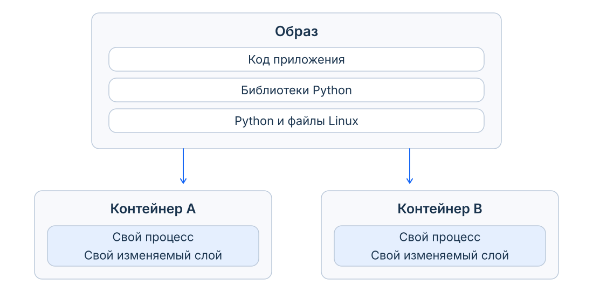
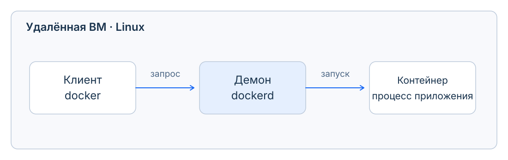
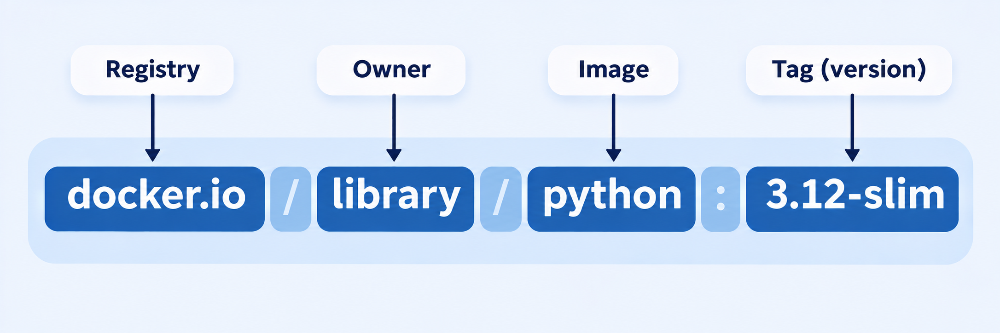
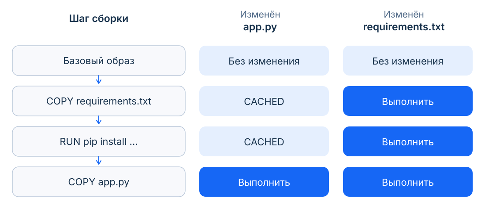
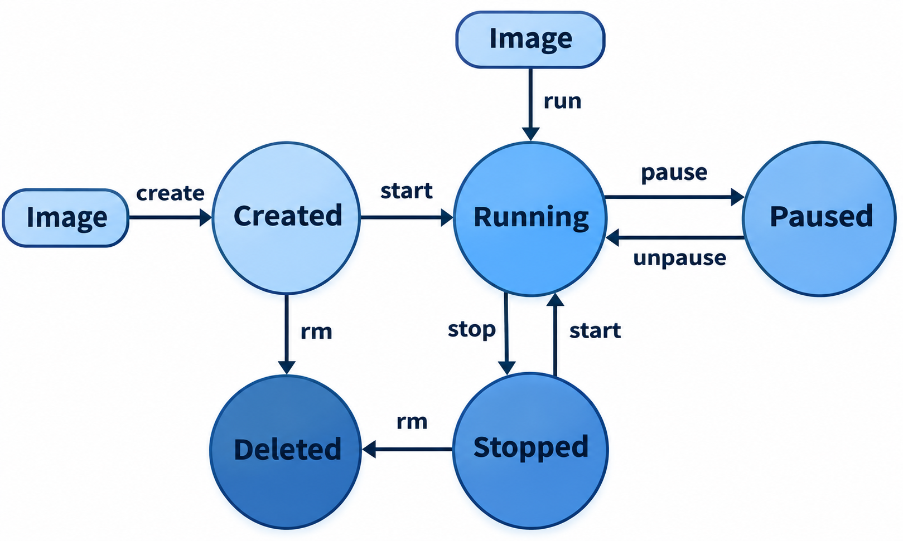
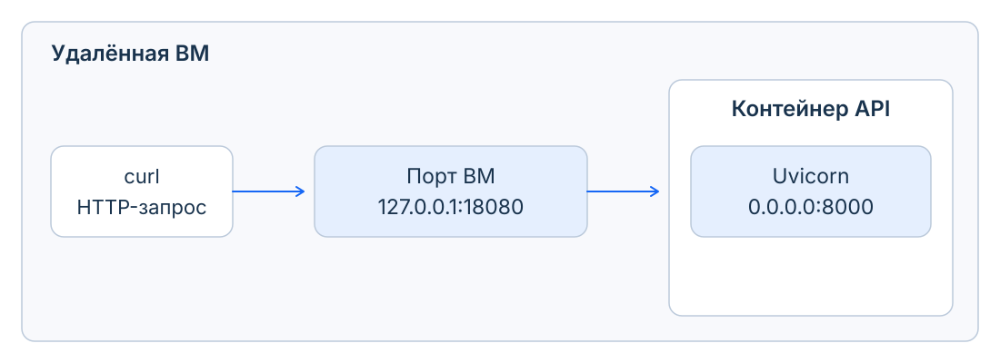
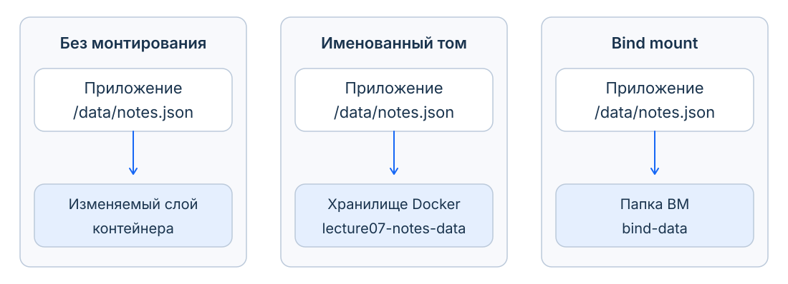

# Docker. Теория

Упакуем сервис заметок, запустим его на ВМ и научимся обновлять приложение, сохраняя записи. Сначала разберём устройство Docker на этом примере, затем проверим его в терминале.

## Как устроен запуск

### Что Docker добавляет к прошлой паре

В шестой паре мы обсуждали два механизма ядра Linux. **Namespaces** задают, что видит процесс: например, свой набор процессов, сетевых интерфейсов и точек монтирования. **Cgroups** позволяют учитывать и ограничивать потребление ресурсов группой процессов: например, память и процессорное время.

Docker использует эти и другие механизмы Linux, чтобы создавать контейнеры. Его удобство для разработчика – в готовых действиях: описать окружение, собрать его, запустить приложение и управлять отдельными экземплярами. Сегодня работаем через Docker; вручную настраивать namespaces и cgroups не будем.

### Что именно мы передаём коллеге

Файл `app.py` ещё не приносит с собой Python, библиотеки и настройки. Если передать только код, коллеге придётся восстановить окружение. Хотим подготовить его один раз и использовать для отдельных запусков.

Есть и другая трудность: одному сервису нужна новая версия системной библиотеки, а другой ещё зависит от старой. Раздельные контейнерные окружения позволяют сохранить для каждого свой набор библиотек, вместо того чтобы обновлять общую установку ради одного приложения.

<div style="padding: 8px 12px; margin: 12px 0; border-radius: 6px; border-left: 3px solid #3b82f6; background-color: #eff6ff; color: #1e40af;">
<strong>Образ (<code>image</code>)</strong> – подготовленные файловые слои и настройки запуска: например, Python, библиотеки и наш код.<br>
<strong>Контейнер (<code>container</code>)</strong> – созданный из образа экземпляр со своими настройками и изменяемым слоем файлов. При запуске в нём работает процесс приложения.
</div>

Образ контейнера не является образом диска полноценной ВМ с загрузкой отдельной ОС.

ВМ имеет собственное ядро. Linux-контейнеры используют ядро хоста: у нас это Ubuntu-ВМ. Поэтому внутри контейнера могут быть файлы Debian и Python, хотя ядро обслуживает процессы со стороны Ubuntu. Не требуется загружать ещё одну ОС для каждого приложения; при этом ресурсы на саму программу всё равно нужны. Механизмы изоляции мы уже разбирали в шестой паре.

<div style="padding: 8px 12px; margin: 12px 0; border-radius: 6px; border-left: 3px solid #64748b; background-color: #f8fafc; color: #475569;">
<strong>Для справки: Java Virtual Machine (JVM)</strong><br>
Один из известных подходов к переносимости программ – JVM. Java-код компилируют в байткод, инструкции для этой виртуальной машины: один и тот же байткод можно выполнять на разных ОС с совместимой JVM. Здесь «виртуальная машина» означает среду выполнения программы, без отдельной гостевой ОС. Версии библиотек, настройки и внешние сервисы всё равно нужно согласовать. <a href="https://docs.oracle.com/javase/specs/jvms/se25/html/jvms-1.html#jvms-1.2">Устройство JVM</a>.
</div>

**Один образ, два независимых контейнера.**



Из одного образа можно создать два независимых запуска. Изменение файла в одном не переписывает образ и не меняет другой контейнер. Это пригодится, когда будем сравнивать способы хранения заметок.

### Почему изучаем Docker

Docker – широко принятый инструмент работы с контейнерами, своего рода стандарт де-факто в разработке. Но контейнеризация не принадлежит одному продукту. Например, **Podman** тоже умеет собирать образы и запускать контейнеры; многие его команды похожи на Docker. Мы изучаем Docker как распространённую отправную точку, а понятия образа, процесса и постоянных данных пригодятся и с другими инструментами.

На macOS также можно встретить **Colima**: она создаёт Linux-ВМ и может запускать в ней Docker Engine. Тогда мы пользуемся обычными командами `docker` без Docker Desktop. Podman – другой инструмент работы с контейнерами, а Colima в таком режиме предоставляет окружение для Docker. В нашей практике Docker уже установлен на удалённой ВМ. [Colima](https://github.com/abiosoft/colima).

При этом формальные стандарты – отдельная вещь: **OCI (Open Container Initiative)** описывает форматы образов, их распространение и запуск. Благодаря общим спецификациям инструменты могут использовать совместимые образы, хотя их возможности и команды не обязаны полностью совпадать. [Спецификации OCI](https://opencontainers.org/about/overview/).

### Кто выполняет команды

Мы подключимся по SSH к ВМ. Команда `docker` там – клиент: он отправляет запрос **Docker daemon**, процессу `dockerd`. Это серверная часть Docker Engine. Демон создаёт и запускает контейнеры, управляет образами, сетями и томами. На нашей ВМ клиент общается с ним через Unix-сокет `/var/run/docker.sock`. [Устройство Docker Engine](https://docs.docker.com/engine/).

<div style="padding: 8px 12px; margin: 12px 0; border-radius: 6px; border-left: 3px solid #3b82f6; background-color: #eff6ff; color: #1e40af;">
<strong>Демон (daemon)</strong><br>
Фоновый процесс, который обслуживает запросы или выполняет служебные задачи без постоянного ввода команд человеком. В Docker эту роль выполняет <code>dockerd</code>.
</div>

Например, `sshd` принимает SSH-подключения, а cron запускает задания по расписанию. Буква `d` в конце имени часто обозначает daemon, хотя это соглашение, а не обязательное правило.

Название появилось задолго до Docker. По воспоминанию Фернандо Корбато, его группа в MIT использовала его примерно с 1963 года, вдохновившись **демоном Максвелла**: воображаемым существом из мысленного эксперимента, которое следит за молекулами и сортирует их по скорости. Компьютерная аналогия – незаметный помощник, постоянно выполняющий работу системы.

Поэтому клиент может вернуть нам терминал, пока демон и приложение продолжают работать. Флаг `-d` (`--detach`) выбирает **detached mode**, отсоединённый режим: контейнер работает в фоне без подключения текущего терминала к его потокам. Здесь пара слов: **attach** – подключить, **detach** – отсоединить. В режиме **attached** клиент остаётся подключённым к потокам основного процесса; команда `docker attach` позволяет подключиться к работающему контейнеру позже.

Важно различать три места: ваша машина, удалённая ВМ и контейнер. Исходники для сборки лежат на ВМ; Docker работает на ВМ; команды внутри контейнера видят его файловое окружение. Устанавливать Docker внутрь контейнера нашего API не нужно.

**Кто выполняет команду после подключения по SSH.**



Здесь и клиент, и демон находятся на ВМ. На вашей машине открыт терминал SSH; запрос клиента к демону на ВМ передаётся через `/var/run/docker.sock`.

### Откуда берётся образ

Образ мы можем **собрать сами**: выбрать окружение, добавить зависимости и код своего приложения. Для этого опишем действия в Dockerfile – файле инструкций сборки, который разберём ниже. После сборки образ хранится локально у Docker; для первого запуска публиковать его куда-либо не обязательно.

Но коллега или другой сервер не видят наше локальное хранилище. Нам нужно место, куда можно отправить образ и откуда затем получить его на другой машине.

<div style="padding: 8px 12px; margin: 12px 0; border-radius: 6px; border-left: 3px solid #3b82f6; background-color: #eff6ff; color: #1e40af;">
<strong>Реестр образов (registry)</strong><br>
Сервис для хранения и распространения образов. Команда <code>push</code> публикует образ в реестре, <code>pull</code> получает его оттуда. Локальная сборка сама по себе ничего не публикует.
</div>

Реестр полезен и в обратную сторону: не обязательно готовить каждое окружение с нуля. Можно найти образ, уже собранный другими разработчиками или компанией: например, `Python`, `PostgreSQL` или `Nginx`. На странице образа смотрим, кто его поддерживает, какие доступны теги и как его запускать. Готовый Python возьмём за основу, а свой API добавим поверх него.

`Docker Hub` хранит публичные и закрытые образы. Организация может также развернуть свой реестр, например Harbor.

Кроме `Docker Hub`, образы можно хранить в других реестрах:

| Реестр                             | Пример ссылки на образ               |
| ---------------------------------- | ------------------------------------ |
| `GitHub Container Registry (GHCR)` | `ghcr.io/team/notes:v1`              |
| `Yandex Container Registry`        | `cr.yandex/<registry-id>/notes:v1`   |
| `Собственный Harbor`               | `registry.example.org/team/notes:v1` |

В Yandex Cloud `<registry-id>` заменяется идентификатором реестра, в GHCR `team` – пользователем или организацией. Для закрытых образов нужны права доступа. В практике используем Docker Hub. [Yandex Container Registry](https://yandex.cloud/ru/docs/container-registry/concepts/repository), [GHCR](https://docs.github.com/en/packages/working-with-a-github-packages-registry/working-with-the-container-registry).

Ссылка `registry.example.org/team/notes:v1` состоит из адреса реестра, пути репозитория и тега. У `python:3.12-slim-bookworm` адрес опущен: используется Docker Hub и официальный репозиторий Python.

<div style="padding: 8px 12px; margin: 12px 0; border-radius: 6px; border-left: 3px solid #3b82f6; background-color: #eff6ff; color: #1e40af;">
<strong>Тег (<code>tag</code>)</strong><br>
Читаемое имя, которое указывает на вариант образа в репозитории: например, <code>3.12-slim-bookworm</code> у Python или <code>v1</code> у нашего сервиса. Автор репозитория может переназначить тег другому содержимому.
</div>

Для точной фиксации содержимого используют **`digest`**, идентификатор в ссылке вида `repository@sha256:…`.



На схеме `docker.io` – Docker Hub, `library` – специальное пространство имён официальных образов, `python` – репозиторий, `3.12-slim` – тег. Подпись `Owner` здесь условна: `library` не является логином автора Python. `Tag (version)` тоже читаем с оговоркой: тег может обозначать версию или другой вариант образа. Короткая запись `python:3.12-slim` соответствует показанной полной ссылке; в практике мы дополнительно указываем `bookworm`.

<div style="padding: 8px 12px; margin: 12px 0; border-radius: 6px; border-left: 3px solid #ef4444; background-color: #fef2f2; color: #991b1b;">
<strong>Антипаттерн</strong><br>
Считать тег неизменяемой версией. <code>latest</code> не ищет самую новую версию автоматически. Даже тег с номером может со временем указывать на другое содержимое: одинаковое имя тега не доказывает одинаковое окружение. Для фиксации содержимого нужен <code>digest</code>.
</div>

### Почему у Python так много образов

Тег выбирает не только версию Python, но и системное окружение. Сравним четыре характерных варианта одной ветки:

| Вариант | Что получаем |
| --- | --- |
| `python:3.12-trixie` | Python на Debian Trixie с более широким набором системных пакетов |
| `python:3.12-slim-trixie` | Python на том же Debian Trixie, но с сокращённым набором пакетов |
| `python:3.12-slim-bookworm` | Сокращённое окружение на предыдущем выпуске Debian – Bookworm; его используем в практике |
| `python:3.12-alpine` | Python на Alpine Linux: другая система и библиотека C – musl вместо glibc |

`trixie` и `bookworm` – названия выпусков Debian. `slim` не урезает язык Python: он уменьшает окружение вокруг него. Поэтому компилятор или системную библиотеку иногда приходится устанавливать отдельно. Alpine тоже нельзя выбирать только по размеру: некоторые готовые бинарные Python-пакеты для него не подходят.

Доступные теги и Dockerfile смотрим на [странице официального Python-образа](https://hub.docker.com/_/python).

### Что будет делать приложение

Наш API принимает HTTP-запросы: `POST /notes` добавляет заметку, `GET /notes` возвращает список, `GET /health` сообщает версию. Заметка содержит `id` и `text`. В JSON-файле будет список таких записей:

```json
[{"id": "example-id", "text": "Проверить резервную копию"}]
```

Код уже подготовлен. Для HTTP используем FastAPI и сервер Uvicorn; приложение записывает JSON в каталог из переменной окружения `DATA_DIR`. Переменная окружения – именованная настройка, которую процесс получает при запуске. Для наших опытов она равна `/data`.

### Как получить собственный образ

**Сборка (`build`)** – получение образа из файлов проекта по заданным инструкциям. Её запускает команда `docker build`; результат – образ, из которого затем создаём контейнеры. Это не обязательно компиляция программы: у нас сборка установит библиотеки и скопирует Python-код.

**Dockerfile** – файл с этими инструкциями. Сначала посмотрим на него целиком: он берёт Python, устанавливает зависимости, добавляет код и описывает будущий запуск. Затем разберём его сверху вниз. Пока не требуется знать значение каждой строки.

```dockerfile
FROM python:3.12-slim-bookworm
WORKDIR /app
COPY requirements.txt ./requirements.txt
RUN python -m pip install --no-cache-dir -r requirements.txt
COPY app.py ./app.py
ENV DATA_DIR=/data
EXPOSE 8000
CMD ["python", "-m", "uvicorn", "app:app", "--host", "0.0.0.0", "--port", "8000"]
```

Это содержимое `demo/Dockerfile`, с которым будем работать в практике.

#### Основа и рабочая папка

Python у нас уже есть в готовом образе. `FROM` выбирает эту основу. Для кода заведём `/app`: `WORKDIR` создаст каталог и сделает его рабочим для следующих инструкций и будущего запуска.

```dockerfile
FROM python:3.12-slim-bookworm
WORKDIR /app
```

Папка `/app` относится к образу. На ВМ мы по-прежнему стоим в `~/devtools-demo/demo`. Сборка связывает два дерева файлов: берёт нужные файлы проекта и помещает их в подготовленное окружение.

#### Зависимости приложения

**Контекст сборки** – файлы, которые мы передаём сборщику. В нашем случае это папка `demo`. `COPY` получает два пути: источник **в контексте** и назначение **в образе**.

```dockerfile
COPY requirements.txt ./requirements.txt
RUN python -m pip install --no-cache-dir -r requirements.txt
```

Первая строка берёт `demo/requirements.txt` и создаёт `/app/requirements.txt`. Точка справа отсчитывается от уже заданного `WORKDIR`. Вторая строка выполняет команду **при сборке**: устанавливает перечисленные пакеты в Python образа.

`python -m pip` запускает модуль `pip`: `-m` означает запуск модуля Python. У `pip` параметр `-r` (`--requirement`) означает «прочитать требования из файла». 
`--no-cache-dir` не сохраняет кэш скачанных пакетов pip. Кэш самой сборки `Docker` – другой механизм; увидим его при изменении кода.

#### Код и его настройки

Теперь в окружении есть библиотеки. Добавим само приложение и выберем, где оно будет хранить заметки:

```dockerfile
COPY app.py ./app.py
ENV DATA_DIR=/data
```

`ENV` задаёт переменную окружения будущего процесса. Здесь `DATA_DIR` выбирает папку для заметок. Это удобно, когда один и тот же код нужно запускать с разными каталогами данных: локально писать в `./data`, в контейнере – в `/data`, а в отдельном запуске – в `/notes`.

В приложении настройка читается явно:

```python
DATA_DIR = Path(os.environ.get("DATA_DIR", "./data"))
```

`os.environ.get` получает значение из окружения, а при отсутствии переменной использует `./data`; `Path` представляет путь. В Dockerfile мы задаём `/data`, поэтому сервер будет сохранять `/data/notes.json`. Без такого чтения в коде произвольная переменная из `ENV` не изменила бы поведение приложения.

При запуске `-e` (`--env`, environment) задаёт переменную для конкретного контейнера. Через `-e DATA_DIR=/notes` выберем другое место хранения без пересборки. Так же приложения могут читать адрес базы или уровень логирования.

Мы копируем два нужных файла, а не всю папку проекта. `.dockerignore` дополнительно ограничивает контекст: локальное окружение, данные и секреты сборщику не нужны. `.gitignore` действует на Git; Docker его вместо `.dockerignore` не использует.

#### Команда запуска

Установленные файлы сами не начинают принимать запросы. Для нашего `FastAPI` нужен сервер `Uvicorn`. Запуск опишем через `CMD`:

```dockerfile
EXPOSE 8000
CMD ["python", "-m", "uvicorn", "app:app", "--host", "0.0.0.0", "--port", "8000"]
```

`python -m uvicorn` запускает модуль Uvicorn. В `app:app` первая часть означает файл `app.py`, вторая – объект приложения в нём. `--port 8000` задаёт порт сервера. `--host 0.0.0.0` разрешает принимать соединения на всех IPv4-интерфейсах **контейнера**.

`EXPOSE 8000` записывает предполагаемый порт в настройки образа. Доступ с ВМ мы ещё не настроили. `CMD` тоже пока ничего не запускает: сохраняет программу и аргументы для будущего контейнера. В квадратных скобках каждый аргумент записан отдельно; промежуточная оболочка здесь не нужна.

Получились два разных момента: **при сборке** установили пакеты через `RUN`, **при запуске** выполним сервер из `CMD`. Если поменять их местами, сборка будет пытаться держать HTTP-сервер, а контейнер – устанавливать пакеты вместо обслуживания запросов.

### Настройка сборки и настройка запуска

В Dockerfile задаём значение по умолчанию:

```dockerfile
ENV DATA_DIR=/data
```

При создании контейнера параметр `-e DATA_DIR=/notes` заменит его на `/notes`. Это настройка одного запуска: образ не меняется. Переменная выбирает путь для нашего приложения, но сама не создаёт каталог и не подключает хранилище. В практике сравним оба значения через Python.

`ARG` решает другую задачу: передаёт параметр **сборке**. Например, начало Dockerfile можно записать так:

```dockerfile
ARG PYTHON_VERSION=3.12
FROM python:${PYTHON_VERSION}-slim-bookworm
```

Для такого Dockerfile команда `docker build --build-arg PYTHON_VERSION=3.13 -t notes:py313 .` выберет Python 3.13. `--build-arg` передаёт параметр сборки, `-t` (`--tag`) задаёт имя и тег результата, точка выбирает текущую папку как контекст. `ARG` сам по себе не становится переменной окружения приложения. Пароли и токены не передаём ни через `ARG`, ни через `ENV` в Dockerfile: эти механизмы не предназначены для секретов. [Параметры сборки](https://docs.docker.com/build/building/variables/).

Теперь отделим **настройку** от **команды запуска**. `RUN` уже выполнился при сборке, а `CMD` только сохранил команду по умолчанию. У нашего образа нет `ENTRYPOINT`, поэтому команда после имени образа заменяет `CMD` целиком. Например, можно попросить запустить `python --version` вместо сервера.

Если хотим закрепить запускаемую программу, можно разделить последнюю строку Dockerfile:

```dockerfile
ENTRYPOINT ["python", "-m", "uvicorn"]
CMD ["app:app", "--host", "0.0.0.0", "--port", "8000"]
```

Здесь `ENTRYPOINT` задаёт программу, `CMD` – её аргументы по умолчанию. Для образа с таким окончанием аргумент `--version` после имени образа заменит `CMD`: получится `python -m uvicorn --version`. Сам `ENTRYPOINT` заменяется отдельным параметром `--entrypoint`. В разделе 12 соберём этот вариант и сравним оба запуска.

### Из чего состоят файловые слои

**Файловый слой** – изменения, которые нужно применить к предыдущему состоянию файловой системы: добавить файлы, заменить их содержимое или отметить удаление. Предыдущий слой при этом не переписывается; новое состояние получается из сочетания слоёв. Это не отдельный виртуальный диск и не обязательно одна папка. Docker объединяет слои образа в одно дерево файлов: приложение видит обычные `/app`, `/usr`, `/data`.

Например, базовый образ приносит Python, установка зависимостей добавляет библиотеки, `COPY app.py` – наш код. Слои готового образа не меняются при запуске. Поверх них у каждого контейнера есть **собственный изменяемый слой**:

| Действие без подключённого хранилища | Где находится результат |
| --- | --- |
| Читаем `/app/app.py` | Читаем файл, пришедший из образа |
| Меняем `/app/app.py` | Изменённая версия появляется в слое этого контейнера; исходный образ остаётся прежним |
| Создаём `/data/notes.json` | Новый файл записывается в слой этого контейнера |
| Удаляем файл из образа | В изменяемом слое отмечается удаление; файл перестаёт быть виден этому контейнеру |

Такой подход называют **копированием при записи (`copy-on-write`)**: общие данные не требуется заранее полностью копировать каждому контейнеру. `notes.json` – файл **внутри слоя**, а не отдельный слой. [Устройство слоёв](https://docs.docker.com/engine/storage/drivers/).

### Зачем нужен кэш сборки

Мы поменяли текст ответа API. Нужно ли заново скачивать все библиотеки? Если сначала скопировать `requirements.txt` и установить зависимости, а потом добавить `app.py`, изменение кода не затронет входные данные установки пакетов. Сборщик сможет повторно использовать её результат.

**Что пересобирается при изменении файлов.**

В обоих случаях базовый образ оставляем прежним. Сравниваем изменение только кода и изменение списка зависимостей.



Кэш pip и кэш сборки Docker независимы: `--no-cache-dir` у pip не отключает кэш Docker.

Если перед установкой скопировать весь проект, изменение кода затронет более ранний шаг. Поэтому порядок инструкций связан с частотой изменений. Файловый слой и инструкция не тождественны: `COPY` и `RUN` могут менять файлы, а `CMD` описывает запуск. Кэш Docker также отличается от кэша скачиваний pip.

<div style="padding: 8px 12px; margin: 12px 0; border-radius: 6px; border-left: 3px solid #ef4444; background-color: #fef2f2; color: #991b1b;">
<strong>Антипаттерн</strong><br>
Копировать весь проект до установки пакетов. <code>COPY . .</code> перед <code>RUN pip install ...</code> связывает установку зависимостей с изменением любого не исключённого файла проекта. Даже правка ответа API может заставить повторно выполнить установку.
</div>

Разделим файлы по тому, от чего зависит следующий шаг: сначала список пакетов, затем код.

<div style="padding: 8px 12px; margin: 12px 0; border-radius: 6px; border-left: 3px solid #3b82f6; background-color: #eff6ff; color: #1e40af;">
<strong>Полезный приём</strong><br>
Зависимости отдельно от кода. Копируем <code>requirements.txt</code>, устанавливаем пакеты, затем копируем <code>app.py</code>. Если изменился только код, результат установки можно взять из кэша. Изменение списка зависимостей, напротив, должно обновить этот шаг.
</div>

### От чьего имени работает приложение

`USER` выбирает пользователя для последующих `RUN` и запуска. Наш Python-образ работает от root; рабочему сервису обычно задают отдельного пользователя с правами на каталог данных. В первом опыте сохраняем исходного пользователя; настройку прав разберём отдельно.

### Когда контейнер работает, а когда существует

У контейнера есть основной процесс. Утилита выводит версию и заканчивает работу; HTTP-сервер остаётся ждать запросов. В обоих случаях поведение нормально. После завершения основного процесса контейнер обычно остаётся как остановленный объект с настройками и файлами.



| Действие | Что меняется |
| --- | --- |
| `create`, затем `start` | Создали контейнер, затем запустили его основной процесс |
| `run` | Создали новый контейнер и запустили |
| `stop` | Попросили процесс завершиться; после тайм-аута возможно принудительное завершение |
| `kill` | По умолчанию отправили SIGKILL, без ожидания корректного завершения |
| `start` | Повторно запустили существующий контейнер |
| `pause`, `unpause` | Приостановили и продолжили процессы |
| `rm` | Удалили контейнер с его изменяемым слоем |

На схеме `Stopped` соответствует обычному состоянию `exited`, `Deleted` – отсутствию объекта. Остановка и удаление – разные действия. Имя, заданное через `--name`, занято даже остановленным контейнером; `rename` меняет имя, а не создаёт новый экземпляр.

<div style="padding: 8px 12px; margin: 12px 0; border-radius: 6px; border-left: 3px solid #f59e0b; background-color: #fffbf0; color: #92400e;">
<strong>Пауза не заменяет остановку</strong><br>
Привычка оставлять ненужный сервис на <code>pause</code> не освобождает его ресурсы: процессы сохраняются вместе с выделенной памятью и открытыми файлами. Они не выполняют код, а запросы к сервису могут зависать или завершаться по тайм-ауту. Для обычного завершения работы используем <code>stop</code>; <code>pause</code> оставляем для кратких специальных остановок.
</div>

Механизм `pause` в Linux замораживает процессы через cgroups; он не завершает их. [Описание команды](https://docs.docker.com/reference/cli/docker/container/pause/).

<div style="padding: 8px 12px; margin: 12px 0; border-radius: 6px; border-left: 3px solid #64748b; background-color: #f8fafc; color: #475569;">
<strong>Откуда взялось sleepy_turing</strong><br>
Без <code>--name</code> Docker выбирает имя сам: слово-характеристику и фамилию из списка учёных и разработчиков, например <code>sleepy_turing</code>. Это случайное сочетание, а не характеристика программы. У контейнера также есть отдельный ID. В генераторе есть шутливое исключение: <code>boring_wozniak</code> не допускается.
</div>

Для повторяемых команд удобнее `--name lecture07-api`: сразу понятно, какой экземпляр изучаем. [Генератор имён Docker](https://github.com/moby/moby/blob/v27.5.1/pkg/namesgenerator/names-generator.go).

### Как работать с запущенным процессом

Сервер должен принимать запросы, пока мы вводим другие команды. Флаг `-d` (`--detach`) у `docker run` выбирает режим **detached** и возвращает терминал. `attach` делает обратное для подключения: присоединяет терминал к потокам уже работающего основного процесса. Ниже используем имя будущего API – `lecture07-api`; создадим его в разделе 6.

| Что хотим сделать | Команда | Что происходит |
| --- | --- | --- |
| Посмотреть вывод приложения | `docker logs lecture07-api` | Показывает сохранённые стандартный вывод и ошибки |
| Наблюдать новые строки | `docker logs -f lecture07-api` | Продолжает читать вывод; `-f` означает `--follow` |
| Выполнить отдельную команду | `docker exec lecture07-api python --version` | Создаёт дополнительный процесс в работающем контейнере |
| Открыть оболочку | `docker exec -it lecture07-api sh` | Запускает отдельную интерактивную оболочку |
| Подключиться к основному процессу | `docker attach lecture07-api` | Подключает терминал к его потокам, не создавая новую программу |

**Посмотрим логи и выполним отдельную команду:**

```bash
docker logs --tail 20 lecture07-api
docker exec lecture07-api python --version
```

`--tail 20` ограничивает вывод последними двадцатью строками. `exec` не заменяет основной сервер: команда печатает версию и завершается, сервер работает дальше. Для остановленного контейнера `exec` не подойдёт.

**Для работы внутри контейнера откроем оболочку:**

```bash
docker exec -it lecture07-api sh
```

У программы есть стандартный ввод для получения данных и вывод для результатов. Для привычной работы человека с оболочкой нужен ещё терминал: он поддерживает ввод строк и управляющие клавиши.

**TTY** – обозначение терминала, исторически от *teletype*. Docker выделяет **псевдотерминал** – программный аналог терминального устройства. Это не сама оболочка: `sh` остаётся отдельной программой. [Псевдотерминалы в Linux](https://man7.org/linux/man-pages/man7/pty.7.html).

| Флаг | Значение |
| --- | --- |
| `-i`, `--interactive` | Сохраняет стандартный ввод открытым |
| `-t`, `--tty` | Выделяет псевдотерминал |
| `-it` | Объединяет оба флага для интерактивной работы |

У `docker build -t` эта же буква означает тег: флаги читаем вместе с командой.

**Как закончить работу, не перепутав процессы:**

| Где находимся | Действие | Что завершится |
| --- | --- | --- |
| Просмотр `docker logs -f` | `Ctrl+C` | Только просмотр логов |
| Оболочка, открытая через `exec` | `exit` | Дополнительная оболочка; сервер останется |
| Подключение через `attach` | `Ctrl+C` | Сигнал может попасть в основной процесс и остановить приложение |

`attach` не открывает оболочку, если основной процесс – HTTP-сервер. Для обычной диагностики достаточно `logs` и `exec`; `attach` нужен для взаимодействия с самой запущенной программой. [Поведение `attach`](https://docs.docker.com/reference/cli/docker/container/attach/).

### Как добраться до HTTP-сервера

Сервер слушает порт `8000` внутри контейнера. Чтобы обратиться к нему через ВМ, публикуем порт: `-p` (`--publish`) в записи `-p 127.0.0.1:18080:8000`. Первое число – порт ВМ, второе – порт контейнера. Адрес перед ними ограничивает публикацию интерфейсом loopback ВМ.

`EXPOSE 8000` в Dockerfile описывает предполагаемый порт, но не публикует его. Сервер внутри контейнера слушает `0.0.0.0`, то есть все его IPv4-интерфейсы. Его собственный `127.0.0.1` не равен адресу ВМ. Для браузера на вашей машине используем SSH-туннель; запросы из терминала ВМ можно делать напрямую.

**Путь HTTP-запроса с ВМ.**



### Что произойдёт с заметками

В нашем первом запуске для `/data` ещё не подключено отдельное хранилище. Поэтому JSON попадает в изменяемый слой: `stop` его сохраняет, `rm` удаляет вместе с контейнером. Это неудобно для обновления: хотим заменять приложение, сохраняя записи.

<div style="padding: 8px 12px; margin: 12px 0; border-radius: 6px; border-left: 3px solid #3b82f6; background-color: #eff6ff; color: #1e40af;">
<strong>Том (<code>volume</code>)</strong> – отдельное хранилище под управлением Docker.<br>
<strong>Bind mount</strong> – подключение выбранной папки хоста к пути внутри контейнера.
</div>

**Монтирование** – подключение хранилища к пути внутри контейнера. Том и папка хоста – два источника файлов: первым управляет Docker, вторую выбираем мы. В обоих случаях выполняем монтирование.

Приложение продолжает писать в `/data`, но файлы оказываются в подключённом хранилище. Папка хоста здесь находится на ВМ, не на вашей машине.

**Один путь внутри контейнера, разные источники файлов.**



Для сравнения на схеме везде выбран `/data/notes.json`. `stop` и `start` сохраняют файл во всех трёх случаях. При удалении контейнера исчезает его изменяемый слой; данные в томе или папке ВМ остаются. В практике для bind mount отдельно выберем `/notes`, чтобы проверить настройку `DATA_DIR`.

Монтирование скрывает прежнее содержимое в точке подключения на время монтирования. Оно не превращает любое содержимое старого контейнера в автоматически перенесённые данные. В практике начнём с пустого хранилища и запишем новые заметки.

<div style="padding: 8px 12px; margin: 12px 0; border-radius: 6px; border-left: 3px solid #f59e0b; background-color: #fffbf0; color: #92400e;">
<strong>Общие файлы – осознанный выход за границу изоляции</strong><br>
Через <code>bind mount</code> контейнер видит выбранные файлы хоста и, если разрешена запись, может изменять и удалять их. Для разработки это удобно: правим исходники на хосте, контейнер видит изменения без новой сборки. Но доступ нужно ограничивать нужной папкой; если запись не нужна, добавляем <code>readonly</code>. Само монтирование не отключает всю изоляцию контейнера.
</div>

Изменённые исходники становятся видны сразу, но работающий сервер перечитает их только при перезапуске или настроенной автоперезагрузке. [Применение bind mounts](https://docs.docker.com/engine/storage/bind-mounts/).

Посмотрим на отдельный короткий пример с временным учебным томом. `--mount` описывает подключение: `type=volume` выбирает том, `source` задаёт его имя, `target` – путь в контейнере. Если такого тома нет, Docker создаст его при `run`. Флаг `--rm` удалит контейнер после завершения команды:

```console
$ docker run --rm --mount type=volume,source=lecture07-volume-example,target=/data python:3.12-slim-bookworm python --version
```

Python завершится, `--rm` удалит контейнер, а **именованный** том останется. Проверим список и удалим этот пустой учебный том:

```console
$ docker volume ls
$ docker volume rm lecture07-volume-example
```

`docker volume rm` удаляет том вместе с его данными. Перед этим нужно удалить использующие его контейнеры, в том числе остановленные. Для заметок в практике заведём отдельный том `lecture07-notes-data`.

**А если не задать имя тому?** В записи `--mount type=volume,target=/data` пропущен `source`. Docker создаст **анонимный том** со случайным длинным именем. Новый контейнер с такой же записью получит новый том, а не прежние данные. В отличие от именованного тома, анонимный удаляется вместе с контейнером при запуске с `--rm`; обычный `docker rm` без `-v` его оставляет. [Именованные и анонимные тома](https://docs.docker.com/engine/storage/volumes/#named-and-anonymous-volumes).

Хранилище переживает замену контейнера, но не защищает от ошибочного изменения самого JSON или потери диска ВМ. Поэтому отдельно сделаем **резервную копию** – сохранённую версию файла, из которой можно восстановиться.

### Как из одного сервиса получается несколько

Если вместо JSON использовать PostgreSQL, появится отдельный процесс базы. Технически API и базу можно запустить в одном контейнере, но отдельно удобнее обновлять, перезапускать и смотреть логи каждого сервиса. Поэтому базе дадим свой контейнер и том, а API – адрес базы. Созданная пользователем **bridge-сеть** объединяет контейнеры на одном Docker-хосте и позволяет обращаться к ним по именам и псевдонимам. Встроенный default bridge не даёт той же автоматической адресации по именам.

В общей пользовательской сети API может подключаться к `db:5432`. `localhost` внутри API указывал бы на сам API. Для общения контейнеров в такой сети не нужно публиковать порт базы на ВМ.

**Compose** сохраняет сервисы, сети, тома и настройки в YAML-файле. Вместо повторения нескольких команд запуска мы создаём проект одним `docker compose up`. Dockerfile описывает сборку образа, Compose – совместный запуск. Запущенная база ещё может инициализироваться: проверка `healthcheck` и зависимость `service_healthy` позволяют дождаться готовности при старте.

Когда нужна работа на нескольких машинах, размещение и восстановление экземпляров, возникает задача **оркестрации**. Kubernetes и Docker Swarm решают её; для первого сервиса на ВМ они не нужны.

### Контейнер как рабочее место разработчика

**Devcontainer** – описанное в проекте окружение для разработки: Python, системные инструменты и настройки. Редактор подключается к контейнеру, где выполняются команды, тесты и отладка. В отличие от `venv`, это окружение не ограничивается Python-пакетами.

Например, в папке `demo` можно создать `.devcontainer/devcontainer.json`:

```json
{
  "name": "Notes API development",
  "image": "python:3.12-slim-bookworm",
  "postCreateCommand": "python -m pip install -r requirements.txt"
}
```

`image` выбирает образ, `postCreateCommand` устанавливает зависимости после создания контейнера. Здесь знакомимся с идеей; подключение редактора оставим на отдельный разбор.

Источники: [containers.dev – спецификация и инструменты](https://containers.dev/), [Dev Containers в VS Code](https://code.visualstudio.com/docs/devcontainers/containers), [разбор на Хабре](https://habr.com/ru/articles/814071/).

### Что оставим на следующую пару

**Многостадийная сборка (`multi-stage build`)** разделяет подготовку приложения и его рабочее окружение: в первой стадии собираем результат, в финальную переносим нужные файлы через `COPY --from`. Например, компилятор остаётся в стадии сборки, а сервер получает готовую программу. Каждый `FROM` начинает новую стадию. Сегодня достаточно этой идеи; полноценный пример разберём на следующей паре вместе с дополнениями к Compose. [Многостадийная сборка Docker](https://docs.docker.com/build/building/multi-stage/).

Продолжение – [практика](<Practise gr2.md>).
