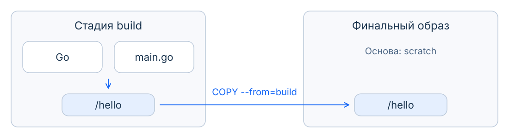
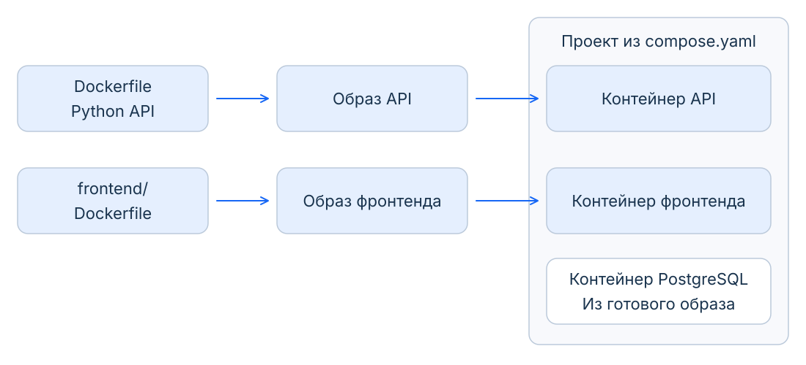
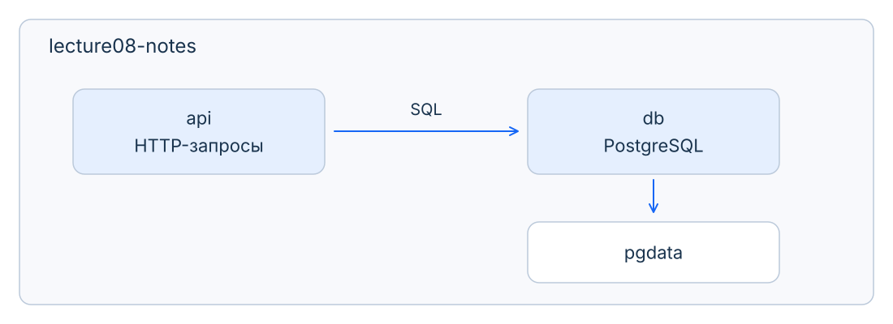
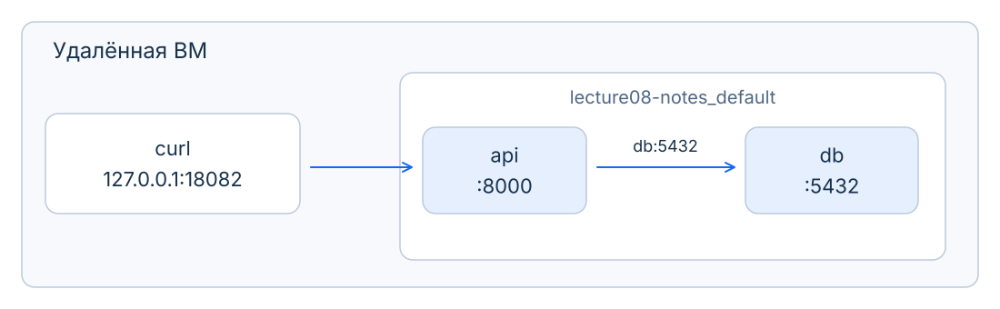
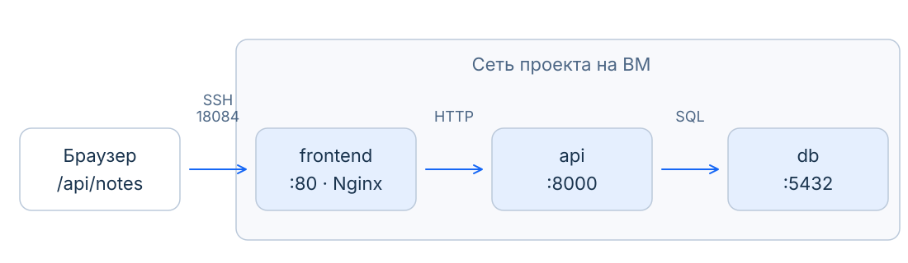
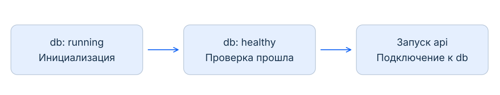

# Docker Compose. Приложение из нескольких сервисов

Сервис заметок умеет принимать HTTP-запросы. Добавим ему страницу в браузере и хранение в PostgreSQL. Разберём, как отдельно упакованные части связать и запустить как одно приложение.

## Часть I. Как описать всё приложение

### От исходников к образу

На прошлой паре мы собирали образ API из Dockerfile. Вспомним знакомую последовательность:

```dockerfile
FROM python:3.12-slim-bookworm
WORKDIR /app
COPY requirements.txt ./requirements.txt
RUN python -m pip install --no-cache-dir -r requirements.txt
COPY app.py ./app.py
CMD ["python", "-m", "uvicorn", "app:app", "--host", "0.0.0.0", "--port", "8000"]
```

`FROM` выбирает основу, `WORKDIR` – рабочую папку. Через `COPY` добавляем файлы, через `RUN` устанавливаем библиотеки **при сборке**. `CMD` сохраняет команду по умолчанию для **будущего запуска контейнера**. В результате получаем образ с Python, зависимостями и кодом приложения.

Но всё ли, что понадобилось при сборке, нужно работающему приложению? Например, **компилятор** переводит исходный код в исполняемую программу. Для получения программы он нужен; для запуска готового результата сам компилятор обычно уже не требуется.

### Сборка в несколько стадий

Допустим, мы установили компилятор, собрали программу и сохранили всё это в одном образе. Программа работает. Но вместе с ней мы передаём на сервер компилятор, инструменты сборки и промежуточные файлы, которые там больше не используются. Их приходится хранить, скачивать из registry и учитывать при обновлении окружения.

Хотим получить **два разных набора файлов**: всё необходимое для изготовления программы и только необходимое для её работы. Многостадийность позволяет описать оба набора в одном Dockerfile. Подготовка остаётся описанной в Dockerfile, а публиковать и скачивать можно только компактный рабочий образ без инструментов, нужных только при сборке. Это экономия места и объёма передачи; сама программа от этого автоматически быстрее не становится.

На маленьком примере это видно лучше, чем на зависимостях API. Возьмём отдельную программу на Go: она только печатает `Ready for Compose`. Исходник [main.go](examples/multistage/main.go) уже подготовлен; здесь важен путь от исходного файла к готовой программе.

```go
package main

import "fmt"

func main() {
    fmt.Println("Ready for Compose")
}
```

Чтобы не включать компилятор в рабочий образ, разделим [Dockerfile](examples/multistage/Dockerfile) на две части:

```dockerfile
FROM golang:1.26-alpine AS build
WORKDIR /src
COPY main.go .
RUN go build -o /hello main.go

FROM scratch
COPY --from=build /hello /hello
CMD ["/hello"]
```

Первый `FROM` берёт окружение с Go. `AS build` даёт этой стадии имя `build`. Команда `go build` компилирует исходник, `-o /hello` задаёт путь результата. Это компиляция программы внутри сборки Docker-образа: два разных действия со словом `build`.

Второй `FROM` начинает новую стадию. `scratch` – специальное обозначение пустой основы, а не скачиваемый дистрибутив Linux. `COPY --from=build` берёт из первой стадии только готовый `/hello`. Компилятор и исходный файл в финальный образ не переходят. При запуске `CMD` выполнит программу: она напечатает строку и завершится.

Из папки `examples/multistage` образ можно собрать и запустить знакомыми командами:

```bash
docker build -t lecture08-hello .
docker run --rm lecture08-hello
```

Результат запуска:

```text
Ready for Compose
```



**Многостадийная сборка (`multi-stage build`)** позволяет готовить результат в одном окружении, а запускать в другом. По умолчанию итогом служит последняя стадия. Стадии сборки не становятся одновременно работающими сервисами. [Устройство multi-stage](https://docs.docker.com/build/building/multi-stage/).

В нашем результате остался один исполняемый файл вместо окружения с целым набором инструментов Go. Первая стадия может сохраняться в локальном кэше сборки, но её файлы не включаются в итоговый образ целиком: мы явно выбрали только `/hello`.

У этой маленькой Go-программы нет внешних библиотек, которые нужно добавить в финальный образ. Перенести туда только Python-файл не получится: ему нужны Python и зависимости. Поэтому Dockerfile нашего API пока оставляем обычным. Само число стадий не гарантирует уменьшения образа: важно, какие файлы попали в результат.

### Почему одного Dockerfile недостаточно

Мы получили образ и определили команду запуска. Теперь вернёмся к API заметок: при запуске мы отдельно выбирали опубликованный порт, переменные окружения и том. Эти подключения и значения для конкретного запуска не появлялись из Dockerfile автоматически.

Пользователю удобнее написать заметку на странице и нажать «Добавить», чем составлять команду `curl`. У небольшого приложения появляются три роли:

| Часть приложения | Что делает |
| --- | --- |
| Фронтенд (`frontend`) | Страница с полем ввода и списком заметок; её JavaScript отправляет HTTP-запросы |
| Бэкенд (`backend`), наш API | Принимает запросы, проверяет данные и обращается к хранилищу |
| PostgreSQL | Сервер базы данных, который хранит записи и выполняет SQL-запросы |

**SQL** – язык работы с базами данных. Код API должен уметь обращаться к PostgreSQL: само добавление контейнера не превращает запись JSON в работу с базой. В примере уже подготовлены оба варианта API и небольшая веб-страница.

Все серверные процессы технически можно поместить в один контейнер. Но отдельные контейнеры позволяют обновить страницу, не перезапуская базу, и отдельно посмотреть логи API. У каждой части своё окружение: API нужен Python, странице – веб-сервер, базе – PostgreSQL. Docker упаковывает каждую часть в образ; запуск приложения требует согласовать несколько таких образов.

Передадим коллеге только образ API. Сможет ли он запустить приложение? Ему ещё понадобятся образ базы, имя сети, том и настройки подключения. Если в одной команде назвать базу `db`, а в другой передать адрес `postgres`, по отдельности команды могут быть правильными, но вместе приложение не заработает.

Shell-скрипт может сохранить команды. Но хотелось бы описать **нужное состояние** в одном месте: какие сервисы существуют и как связаны. А затем попросить инструмент привести проект к этому состоянию.

<div style="padding: 8px 12px; margin: 12px 0; border-radius: 6px; border-left: 3px solid #3b82f6; background-color: #eff6ff; color: #1e40af;">
<strong>Docker Compose</strong><br>
Инструмент для описания и совместного управления сервисами приложения. Читает файл конфигурации и обращается к Docker Engine, который создаёт контейнеры, сети и тома.
</div>

### Как связаны Docker и Docker Compose

Контейнеры по-прежнему запускает **Docker Engine**, знакомый демон Docker. Когда мы пишем `docker run`, клиент передаёт ему параметры одного контейнера. Когда пишем `docker compose up`, Compose читает описание проекта и передаёт тому же Docker Engine необходимые запросы для всех его компонентов.

Поэтому контейнер API, созданный через Compose, виден и в обычном `docker ps`. Его можно посмотреть через `docker inspect` и прочитать логи обычной командой Docker. У Compose удобнее выбирать сервис по имени `api` и управлять всем проектом сразу.

Compose не запускает второй Docker и не добавляет новый слой изоляции. Он автоматизирует согласованную работу с обычными Docker-образами, контейнерами, сетями и томами. Если образ надо собрать, используется тот же механизм сборки Docker: исходники и Dockerfile определяют содержимое результата, а Compose сообщает, для какого сервиса он нужен.

<div style="padding: 8px 12px; margin: 12px 0; border-radius: 6px; border-left: 3px solid #64748b; background-color: #f8fafc; color: #475569;">
<strong>Почему встречается <code>docker-compose</code></strong><br>
Исторически Compose v1 был отдельной программой на Python и вызывался через дефис: <code>docker-compose up</code>. Начиная с Compose v2 обычная форма – плагин Docker CLI с командой <code>docker compose up</code>. Её использует и Compose v5, установленный на нашей ВМ. Версию инструмента проверяем через <code>docker compose version</code>; это не то же самое, что старое поле <code>version: "3.8"</code> в YAML.
</div>

[История версий Compose](https://docs.docker.com/compose/intro/history/).

### Dockerfile, YAML и манифест

Описание приложения сохраним в `compose.yaml`. Здесь важно различать **формат записи** и **смысл записанного**.

**YAML** – формат данных: именованные поля, списки и вложенность через отступы. **Compose Specification** задаёт, какие поля понимает Compose и что они означают. Корректный YAML с произвольными полями ещё не является корректным Compose-файлом. В следующем примере прочитаем эту структуру по строкам.

Такое описание также называют **манифестом**: мы объявляем, какие компоненты и настройки нужны приложению. Сам YAML ничего не запускает; описание читает Compose и обращается к Docker Engine.

| Вопрос | Dockerfile | `compose.yaml` |
| --- | --- | --- |
| Что описывает? | Получение образа и его настройки по умолчанию | Сервисы приложения, их настройки и связи |
| Как записан? | Инструкции `FROM`, `RUN`, `COPY`, `CMD` | Поля и списки в формате YAML |
| Где оказываются код и библиотеки? | Добавляем их в образ при сборке | Выбираем образ или указываем, откуда его собрать |
| Где задаём подключения при запуске? | Не создаёт сеть проекта и не подключает конкретный том | Описываем сети, подключения томов и публикацию портов |
| Где задаём команду и окружение? | Значения по умолчанию внутри образа | Можем переопределить для конкретного сервиса |

Dockerfile содержит не только действия сборки: знакомые `CMD` и `ENV` задают значения для будущего запуска. Compose использует эти значения, если в настройках сервиса мы не выбрали другие. Файлы дополняют друг друга, а контейнеры в обоих случаях обслуживает Docker Engine.



### Сервис, контейнер и проект

**Сервис (`service`)** – описание одной роли в приложении: какой образ использовать, какие параметры передать и к чему подключиться. Из описания создаются конкретные контейнеры. Сервис `api` не исчезает из файла, когда его контейнер остановлен или удалён.

**Проект (`project`)** объединяет связанные сервисы и ресурсы. Наш проект назовём `lecture08-notes`, сначала рассмотрим сервисы `api` и `db`, затем подключим `frontend`. Каждому сервису пока соответствует один контейнер.

**Что входит в проект.**



Том – отдельный ресурс, не третий сервис. На схеме `pgdata` – выбранное имя тома с данными базы; его объявление разберём ниже. Код API находится в образе приложения.

### Как читать Compose-файл

Начнём `compose.yaml` с одного знакомого API:

```yaml
name: lecture08-notes
services:
  api:
    build: .
    ports:
      - "127.0.0.1:18082:8000"
```

`name` задаёт имя проекта. Внутри `services` описываем сервис `api`. Его `build` и `ports` стоят на одном уровне отступов и относятся именно к нему.

`build: .` задаёт **контекст сборки** – папку с Dockerfile и исходниками; здесь точка отсчитывается от папки Compose-файла. Compose сможет собрать из них образ. `ports` содержит список публикаций: дефис начинает элемент, а строка в кавычках задаёт знакомую связь порта ВМ `18082` с портом контейнера `8000`.

Двоеточие после имени поля отделяет ключ от значения. Отступы делаем пробелами. Поле `version: "3.8"`, которое встречается в старых примерах, для современного Compose добавлять не нужно: применяется Compose Specification.

Это первое приближение. Ниже добавим базу и разберём остальные поля; отдельные фрагменты показывают изменения внутри соответствующего сервиса, а не самостоятельные файлы запуска.

### Готовый образ или собственная сборка

API мы пишем сами, поэтому ему нужен `build`. PostgreSQL уже поставляется готовым образом, для него используем `image`:

```yaml
services:
  api:
    build: .
  db:
    image: postgres:17-bookworm
```

Оба имени внутри `services` имеют одинаковый отступ: это два сервиса. `image` выбирает готовый образ; `build` указывает, откуда получить наш собственный. Файлы приложения не копируются в контейнер просто потому, что лежат рядом с `compose.yaml`: это по-прежнему работа Dockerfile.

Версия PostgreSQL здесь выбрана явно. Обновление базы между основными версиями – отдельная операция с миграцией данных, а не произвольная замена числа в теге. Для примера оставляем PostgreSQL 17 и его каталог данных `/var/lib/postgresql/data`.

### Два Dockerfile, один проект

API нужен Python, а браузеру надо получить HTML, CSS и JavaScript. Чтобы отдавать эти файлы по HTTP, используем **Nginx** – веб-сервер. Получаются разные правила сборки и отдельные Dockerfile:

```text
examples/
  Dockerfile          # Python API с PostgreSQL
  postgres_app.py
  frontend/
    Dockerfile        # Веб-сервер и файлы страницы
    nginx.conf
    index.html
    app.js
    style.css
  compose.yaml
```

Dockerfile фронтенда короткий:

```dockerfile
FROM nginx:1.30-alpine
COPY nginx.conf /etc/nginx/nginx.conf
COPY index.html app.js style.css /usr/share/nginx/html/
EXPOSE 80
```

Базовый образ уже содержит команду запуска Nginx. Добавляем настройки сервера и готовые файлы страницы. Их не нужно компилировать, поэтому стадия с Node.js здесь не нужна.

Compose выбирает контекст сборки отдельно для каждой части:

```yaml
services:
  api:
    build: .
  frontend:
    build: ./frontend
  db:
    image: postgres:17-bookworm
```

Первый `build` использует Dockerfile из корня проекта, второй – `frontend/Dockerfile`. Образ базы берём готовым. Мы не объединяем разные Dockerfile в один: Compose собирает нужные образы и управляет их совместным запуском.

### Какая программа запустится

Образ уже содержит команду `CMD`: у нашего API это запуск Uvicorn. Если не переопределять её в Compose, контейнер выполнит именно эту команду.

Поле **`command`** позволяет выбрать другую команду для сервиса без пересборки образа. Например, вместо сервера можно запросить версию Python:

```yaml
services:
  api:
    build: .
    command: ["python", "--version"]
```

Квадратные скобки задают список аргументов. Такой контейнер напечатает версию и **завершится**, поэтому в рабочий API этот фрагмент не добавляем: ему нужно продолжать обслуживать запросы. Поле `command` заменяет `CMD`, но сохраняет `ENTRYPOINT`, если он был задан в образе. В нашем Dockerfile `ENTRYPOINT` нет. [Команда сервиса](https://docs.docker.com/reference/compose-file/services/#command).

### Как API найдёт PostgreSQL

Контейнер API имеет собственное сетевое окружение. Его `localhost` означает **сам контейнер API**, поэтому база из другого контейнера по этому адресу не найдётся.

Если не задать сети явно, Compose создаёт общую сеть проекта. В нашем случае она называется `lecture08-notes_default`. Сервисы подключаются к ней и находят друг друга через имена: `db` для базы, `api` для приложения.

**DNS** сопоставляет имя с IP-адресом. В сети Docker имя сервиса позволяет обращаться к нужному контейнеру, не запоминая его IP. При пересоздании адрес может измениться, а имя `db` останется. Открытое соединение при этом не переносится: приложение должно уметь подключиться заново. [Сети Compose](https://docs.docker.com/compose/how-tos/networking/).

Передадим API адрес базы через уже знакомые переменные окружения:

```yaml
services:
  api:
    environment:
      PGHOST: db
      PGUSER: notes
      PGDATABASE: notes
```

`environment` задаёт окружение процесса в контейнере. В нашем Python-коде эти настройки читает клиентская библиотека PostgreSQL: `PGHOST` – адрес сервера, `PGUSER` – пользователь, `PGDATABASE` – база. Порт по умолчанию – `5432`. Пользователя и базу `notes` настроим ниже при первом запуске PostgreSQL. Произвольная переменная не влияет на приложение, пока его код или библиотека её не используют.

### Два направления подключения

Сравним запрос пользователя и запрос приложения к базе.

**Адрес зависит от того, откуда обращаемся.**



| Откуда обращаемся | Куда | Адрес |
| --- | --- | --- |
| Терминал на ВМ | API | `127.0.0.1:18082` |
| Контейнер API | PostgreSQL | `db:5432` |
| Контейнер базы | Эта же база | `127.0.0.1:5432` |

Для общения API и базы **не нужно** публиковать `5432` на ВМ. Они используют общую сеть и внутренний порт. `ports` нужен для доступа через хост; `expose` не является обязательным разрешением общения и не открывает порт на ВМ.

Адрес `db` также не появляется в DNS вашей машины. Если Docker работает на удалённой ВМ, браузер на вашей машине обращается к опубликованному API через SSH-туннель, как в седьмой паре. Слева на схеме показан именно запрос с ВМ.

<div style="padding: 8px 12px; margin: 12px 0; border-radius: 6px; border-left: 3px solid #ef4444; background-color: #fef2f2; color: #991b1b;">
<strong>Антипаттерн</strong><br>
Записывать в API <code>localhost:5432</code> или IP случайного контейнера. Для отдельной базы в общей сети используем имя сервиса <code>db</code> и порт <code>5432</code>.
</div>

Для этого проекта достаточно одной сети. Когда нужны разные группы доступности, сервисам задают отдельные сети через `networks`: общаться напрямую смогут участники общей сети. Само наличие разных проектов не заменяет контроль доступа к опубликованным портам.

### Как браузер доберётся до API

Файлы страницы хранятся в образе `frontend`, но её JavaScript выполняется **в браузере на вашей машине**. Поэтому адрес `http://api:8000` из сети контейнеров браузеру недоступен.

Страница отправляет запрос на относительный путь `/api/notes` того же сайта, с которого загружена. Nginx в контейнере `frontend` принимает его и передаёт в `http://api:8000/notes`, убирая префикс `/api`. Такая передача запроса серверу за ним называется **обратным проксированием (`reverse proxy`)**.



Для браузера это один сайт на порту `18084`; внутри проекта Nginx и API общаются по сети Docker. Прямую публикацию API на `18082` оставим для знакомых проверок через `curl`. Пароль базы браузеру и фронтенду не передаём.

В [nginx.conf](examples/frontend/nginx.conf) уже настроено обновление адреса `api` через DNS Docker. Это нужно при пересоздании контейнера: имя остаётся, IP может измениться. Подробный синтаксис Nginx здесь не изучаем, но сам путь запроса должен быть понятен.

### Где будут жить записи

Заметка должна пережить обновление приложения. А временный файл, из которого приложение готовит ответ, обычно можно создать заново. От этого различия зависит, куда сохранять данные.

<div style="padding: 8px 12px; margin: 12px 0; border-radius: 6px; border-left: 3px solid #3b82f6; background-color: #eff6ff; color: #1e40af;">
<strong>Персистентные и временные данные</strong><br>
Персистентные (<code>persistent</code>) данные сохраняются независимо от замены экземпляра приложения. В нашем проекте это заметки в отдельном томе. Временные, неперсистентные (<code>ephemeral</code>) данные можно потерять и получить заново: например, промежуточные файлы обработки запроса.
</div>

Сам по себе JSON не является временным или постоянным хранилищем. Если единственная копия заметок находится в изменяемом слое контейнера, удаление контейнера её уничтожит. `stop` и `restart` этот слой сохраняют: временное хранение не означает, что данные обязательно исчезают при остановке процесса. Для нужной нам сохранности подключаем отдельный том.

Есть связанное различие уже **между сервисами**, а не форматами данных:

| Сервис | Где находится состояние между запросами | Наш пример |
| --- | --- | --- |
| `Stateful`, с состоянием | Хранит данные, которые нужны для дальнейшей работы; при замене экземпляра ему нужно вернуть хранилище | API с JSON; PostgreSQL с томом заметок |
| `Stateless`, без собственного состояния | Не требует сохранения собственного состояния между запросами; постоянные данные хранит внешний сервис | API обращается к PostgreSQL; новый экземпляр API может работать с той же базой |

`Stateless` не означает «не работает с данными». Наш API читает и записывает заметки, но хранение передаёт базе. Всё приложение остаётся с состоянием: PostgreSQL нельзя заменить пустой базой без потери заметок. Подключение тома к JSON API тоже не делает его `stateless`: этому сервису по-прежнему нужен его JSON-файл.

Раньше API создавал JSON. Теперь файлы создаёт PostgreSQL. У образа `postgres:17-bookworm` каталог данных уже объявлен через `VOLUME`: без нашего подключения Docker создаст анонимный том. Если удалить контейнер и создавать новый без указания прежнего хранилища, автоматически подключится другой анонимный том. Дадим хранилищу постоянное имя и явно подключим его:

```yaml
services:
  db:
    image: postgres:17-bookworm
    volumes:
      - pgdata:/var/lib/postgresql/data
volumes:
  pgdata:
```

Здесь два уровня. Внешний `volumes` **объявляет ресурс** проекта. `volumes` у `db` **подключает** его к пути внутри контейнера. Слева от двоеточия – имя ресурса `pgdata`, справа – каталог PostgreSQL.

Если оставить `pgdata:/var/lib/postgresql/data`, но убрать верхнее объявление `volumes:`, Compose отклонит конфигурацию: сервис ссылается на необъявленный том. Даже наличие одноимённого тома в Docker не заменяет объявления в проекте. Пустое `pgdata:` означает обычные настройки тома, а не отсутствие хранилища. [Объявление томов](https://docs.docker.com/reference/compose-file/volumes/).

Важно различать три записи в `volumes` сервиса:

| Подключение к `/data` | Источник | Нужно объявлять наверху |
| --- | --- | --- |
| `jsondata:/data` | Именованный том | Да, `volumes: {jsondata: {}}` или такая же запись с отступами |
| `/data` | Анонимный том | Нет: имя выбирает Docker |
| `./data:/data` | Папка ВМ, `bind mount` | Нет: указан путь к папке, а не ресурс проекта |

По умолчанию Docker-имя этого тома будет `lecture08-notes_pgdata`. После пересоздания контейнера база сможет открыть те же файлы. Имя проекта поэтому влияет не только на подписи: если поменять его, по умолчанию получится другой том, и база начнёт с пустого хранилища.

<div style="padding: 8px 12px; margin: 12px 0; border-radius: 6px; border-left: 3px solid #f59e0b; background-color: #fffbf0; color: #92400e;">
<strong>Том не заменяет резервную копию</strong><br>
Он переживает замену контейнера, но не ошибочный SQL-запрос или потерю диска. Для PostgreSQL нужны согласованные резервные копии, например логический экспорт через <code>pg_dump</code>; копировать работающий каталог базы как JSON-файл нельзя.
</div>

### Кто создаёт базу и пользователя

Один сервер PostgreSQL может содержать несколько баз данных. Для приложения выделим базу `notes` и пользователя `notes`, от имени которого API будет к ней подключаться. Это разные сущности с одинаковым выбранным именем.

На пустом томе образ PostgreSQL выполняет первоначальную настройку. Укажем имя пользователя и базы:

```yaml
services:
  db:
    environment:
      POSTGRES_USER: notes
      POSTGRES_DB: notes
```

Это **настройки инициализации сервера**. Ранее `PGUSER` и `PGDATABASE` задавали **параметры подключения клиента**. Слова похожи, но читатели разные: образ PostgreSQL и библиотека нашего API.

Таблицу `notes` с полями `id` и `text` создаёт при старте наш API. Это уже структура данных приложения; образ PostgreSQL сам о заметках ничего не знает.

Нужен ещё пароль. Если том уже содержит базу, изменение переменных инициализации не переименует пользователя и не сменит его пароль. Для изменения существующей базы нужны её административные команды. [Официальный образ PostgreSQL](https://hub.docker.com/_/postgres).

### Как передать пароль

Пароль нужен двум процессам: базе при инициализации и API при подключении. Его не следует записывать в Dockerfile или коммитить рядом с кодом. Сохраним пароль в отдельном файле `secrets/db_password.txt` и объявим **секрет (`secret`)**:

```yaml
secrets:
  db_password:
    file: ./secrets/db_password.txt
```

Объявление описывает источник. Доступ сервису выдаётся отдельно:

```yaml
services:
  db:
    secrets:
      - db_password
    environment:
      POSTGRES_PASSWORD_FILE: /run/secrets/db_password
  api:
    secrets:
      - db_password
```

Файл появляется в контейнерах по пути `/run/secrets/db_password`. Образ PostgreSQL понимает переменную `POSTGRES_PASSWORD_FILE`; наш API явно читает этот файл в Python. Compose сам не переписывает код приложения, чтобы оно стало читать секреты.

Локальный Compose подключает файловый секрет из файла хоста. Это не шифрование исходного файла и не отдельное хранилище паролей. Файл исключаем из Git, ограничиваем доступ к нему и выдаём только нужным сервисам. [Секреты Compose](https://docs.docker.com/compose/how-tos/use-secrets/).

### Процесс запущен, но база ещё не готова

При первом запуске PostgreSQL создаёт файлы и настраивает базу. Контейнер уже может быть в состоянии `running`, хотя принимать запросы ещё рано. Если в этот момент запустится API, первое подключение может завершиться ошибкой.

<div style="padding: 8px 12px; margin: 12px 0; border-radius: 6px; border-left: 3px solid #3b82f6; background-color: #eff6ff; color: #1e40af;">
<strong>Проверка состояния (<code>healthcheck</code>)</strong><br>
Команда, которую Docker периодически выполняет внутри контейнера. По её коду завершения он определяет, проходит ли сервис заданную проверку. Это дополнительное состояние к факту работы процесса.
</div>

Для базы используем поставляемую с PostgreSQL утилиту `pg_isready`:

```yaml
services:
  db:
    healthcheck:
      test: ["CMD", "pg_isready", "-h", "127.0.0.1", "-U", "notes", "-d", "notes"]
      interval: 2s
      timeout: 3s
      retries: 30
```

`test` задаёт команду. `CMD` здесь означает выполнить список аргументов без оболочки; это не инструкция запуска из Dockerfile. `-h` выбирает хост, `-U` пользователя, `-d` базу. Команда работает **в контейнере базы**, поэтому `127.0.0.1` здесь верен.

После запуска состояние проверки – `starting`. Одна успешная проверка даёт `healthy`; серия последовательных неудач – `unhealthy`. При последующем успехе сервис снова станет `healthy`: после ошибки проверки не прекращаются.

| Параметр | Что регулирует |
| --- | --- |
| `interval: 2s` | Интервал между проверками; время выполнения самой команды тоже влияет на момент следующего запуска |
| `timeout: 3s` | Сколько максимум ждать одну проверку; превышение считается неудачей |
| `retries: 30` | Сколько неудач подряд нужно для `unhealthy`; успех сбрасывает счётчик |
| `start_period: 10s` | Начальный период, когда неудачи ещё не расходуют лимит; ранний успех завершает эту льготу |

`start_period` не откладывает все проверки и не заставляет ждать ровно 10 секунд. У базы выше он не задан, у API добавим его вместе с `retries: 3`, чтобы наблюдать отказ без долгого ожидания. Это учебные пороги. `pg_isready` проверяет приём подключений, а не наличие таблиц и права приложения.

Теперь API может ждать готовности базы:

```yaml
services:
  api:
    depends_on:
      db:
        condition: service_healthy
```

`depends_on` задаёт зависимость запуска. Точное имя условия – **`service_healthy`**, с окончанием `healthy`:

| Условие | Чего ждём перед запуском API |
| --- | --- |
| `service_started` | Контейнер базы запущен; так работает и короткая запись `depends_on: [db]` |
| `service_healthy` | База прошла свой `healthcheck`; у неё должна быть задана проверка |

Нам подходит второе: запущенный процесс ещё не гарантирует готовность принимать запросы. Сама проверка также может быть ошибочной; это увидим в практике.

**Порядок запуска с проверкой готовности.**



После запуска приложение всё равно должно обрабатывать ошибки подключения. База может перестать отвечать позже; `depends_on` не приостанавливает API и не восстанавливает его соединения. [Управление порядком запуска](https://docs.docker.com/compose/how-tos/startup-order/).

У API тоже зададим `healthcheck`. В полном файле он обращается к `http://127.0.0.1:8000/health` **внутри контейнера API**. Этот обработчик выполняет в базе `SELECT 1` – простой запрос без чтения таблиц. Так проверяем и ответ API, и соединение с PostgreSQL. Для HTTP-запроса используем уже установленный Python; добавлять в образ `curl` не нужно.

### Где задавать проверку: в образе или в Compose

Проверка состояния не является отдельной возможностью только Compose. Автор образа может сохранить её прямо в Dockerfile инструкцией `HEALTHCHECK`. Например, для образа PostgreSQL проверку можно описать так:

```dockerfile
HEALTHCHECK --interval=2s --timeout=3s --retries=30 \
    CMD pg_isready -h 127.0.0.1 -U notes -d notes
```

Эта строка предназначена для Dockerfile образа с установленным `pg_isready`. Как и `CMD`, она сохраняет настройку для будущего контейнера, а не проверяет работающую базу во время сборки.

В нашем случае удобнее `healthcheck` в Compose: мы используем готовый образ PostgreSQL и хотим настроить проверку под этот проект без его пересборки. Настройка сервиса может переопределить проверку из образа. В обоих случаях выполняет её Docker Engine внутри контейнера. [Инструкция `HEALTHCHECK`](https://docs.docker.com/reference/dockerfile/#healthcheck).

### Что делать, если процесс завершился

Рассмотрим две разные поломки. В первой процесс API жив, но база недоступна: HTTP-запросы завершаются ошибкой. Во второй сам процесс API завершился, и запросы больше некому принимать. `healthcheck` помогает обнаружить первую ситуацию, а для второй нужна **политика перезапуска (`restart policy`)**.

Без Compose её можно выбрать при `docker run` параметром `--restart unless-stopped`. В Dockerfile такой инструкции нет: это решение для конкретного запуска. В Compose оно записывается у сервиса:

```yaml
services:
  api:
    restart: unless-stopped
```

`unless-stopped` просит Docker снова запустить завершившийся контейнер независимо от кода завершения. При этом ручная остановка через `stop` сохраняется, в том числе после перезапуска Docker Engine. Политика работает и после закрытия SSH-сеанса: за ней следит демон, а не терминал с Compose.

| Политика | Когда перезапускать |
| --- | --- |
| `"no"` | Не перезапускать автоматически; значение по умолчанию |
| `on-failure:3` | При ненулевом коде завершения, не более трёх повторных попыток; перезапуск демона сам по себе не запускает такой контейнер |
| `always` | После завершения процесса независимо от кода; ручная остановка действует до следующего запуска Docker Engine |
| `unless-stopped` | Как `always`, но ручная остановка сохраняется и после запуска Docker Engine |

В учебном файле начинаем с `restart: "no"`, чтобы увидеть поведение без автоматического восстановления. Затем изменим настройку и проверим её действие. [Политики перезапуска Docker](https://docs.docker.com/engine/containers/start-containers-automatically/).

<div style="padding: 8px 12px; margin: 12px 0; border-radius: 6px; border-left: 3px solid #f59e0b; background-color: #fffbf0; color: #92400e;">
<strong>Проверка не равна восстановлению</strong><br>
Состояние <code>unhealthy</code> само по себе не запускает политику <code>restart</code>: основной процесс ещё работает. Перезапуск также не исправляет неверный пароль и не возвращает недоступную базу. Обработку ошибок и повторное подключение обеспечивает приложение.
</div>

`depends_on` решает третью задачу: согласует первоначальный запуск сервисов. Вместе эти механизмы дают понятный порядок старта, наблюдение за состоянием и реакцию на завершение процесса. Они не заменяют резервные копии и не восстанавливают потерянную ВМ.

### Настройки проекта и окружение приложения

Двум разработчикам могут понадобиться разные порты. Не будем ради этого редактировать одно и то же число в файле. Compose поддерживает **подстановку (`interpolation`)**:

```yaml
services:
  api:
    ports:
      - "127.0.0.1:${APP_PORT:-18082}:8000"
```

`${APP_PORT:-18082}` означает: взять непустое значение `APP_PORT`, иначе использовать `18082`. Значение можно записать в `.env` рядом с `compose.yaml`:

```dotenv
APP_PORT=18082
```

Для нашего запуска из одной папки Compose читает `.env` автоматически; значение из окружения оболочки имеет приоритет. Файл с примером настроек назовём `.env.example`, его можно хранить в Git. Само это имя не заставляет Compose прочитать файл: нужна копия `.env` или явный выбор через `--env-file`.

<div style="padding: 8px 12px; margin: 12px 0; border-radius: 6px; border-left: 3px solid #3b82f6; background-color: #eff6ff; color: #1e40af;">
<strong>Два разных получателя настроек</strong><br>
<code>.env</code> предоставляет значения для подстановки самим Compose. Поле <code>environment</code> передаёт значения процессу в контейнере. Переменная из <code>.env</code> не оказывается внутри контейнера автоматически.
</div>

Если приложению нужен целый файл переменных, используют поле сервиса `env_file`. А `--env-file` у команды Compose выбирает источник подстановок в конфигурацию. Похожие названия решают разные задачи. Пока достаточно `.env` для портов и `environment` для настроек API. [Подстановка переменных](https://docs.docker.com/compose/how-tos/environment-variables/variable-interpolation/).

### Добавим инструмент для просмотра базы

API скрывает детали хранения. При разработке полезно открыть таблицу и проверить её содержимое. **Adminer** – веб-интерфейс для работы с базами данных. Это отдельный сервис: он обслуживает страницу в браузере и сам подключается к PostgreSQL.

```yaml
services:
  adminer:
    image: adminer:5
    environment:
      ADMINER_DEFAULT_SERVER: db
    ports:
      - "127.0.0.1:18083:8080"
    profiles: [tools]
```

Здесь уже знакомы `image`, `environment` и `ports`. Adminer обращается к `db:5432` из общей сети; браузер открывает опубликованный порт `18083` на ВМ через туннель. `ADMINER_DEFAULT_SERVER` подставляет адрес сервера, но не выдаёт доступ к базе: для входа всё равно нужны пользователь, база и пароль.

Новое поле – **профиль (`profile`)**: метка, позволяющая включать необязательные сервисы. API и база не имеют профиля и входят в обычный запуск. Для включения Adminer понадобится параметр `--profile tools`. Профиль выбирает сервисы, а не создаёт отдельный проект или сеть. Ниже применим его при запуске. [Профили Compose](https://docs.docker.com/compose/how-tos/profiles/).

Сейчас добавили только инструмент с понятной задачей. Кэш или очередь сообщений потребовали бы изменений в коде приложения; само добавление Redis в YAML не сделает API быстрее.

### Полный пример для разбора

В [итоговом Compose-файле](examples/steps/08-adminer.yaml) соединены разобранные части: API, фронтенд, PostgreSQL, том, секрет, проверки готовности и необязательный Adminer. Исходники и Dockerfile лежат в `examples/`. Перед командами запуска прочитаем этот файл целиком: каждый его блок уже разобран. В практике рабочий `compose.yaml` будем дополнять постепенно.

| Верхний уровень файла | За что отвечает |
| --- | --- |
| `name` | Имя проекта |
| `services` | Описание API, фронтенда, базы и необязательного инструмента |
| `volumes` | Именованные хранилища проекта |
| `secrets` | Источники секретов, доступ к которым выдаётся сервисам |

В файле фронтенд ждёт готовности API, а Adminer – базы. Порты API, фронтенда и Adminer задаются через `APP_PORT`, `FRONTEND_PORT` и `ADMINER_PORT`.

Настоящий `secrets/db_password.txt` в репозиторий не включён. Пример предполагает, что он подготовлен перед запуском; в этой части разбираем конфигурацию и смысл команд, без последовательного запуска сервисов.

### Почему похожие настройки находятся в разных файлах

Один образ можно запустить в разных проектах: с разными адресами базы, портами и хранилищами. Поэтому общую основу сохраняем в образе, а параметры конкретного запуска – в Compose.

| Что хотим изменить | Dockerfile | Compose |
| --- | --- | --- |
| Установить библиотеку | `RUN` при сборке | `build` вызывает сборку по Dockerfile; `command` не заменяет установку зависимости в образ |
| Выбрать программу | `CMD` задаёт команду по умолчанию | `command` переопределяет её при запуске |
| Передать настройку | `ENV` сохраняет значение в образе | `environment` задаёт значение для сервиса без пересборки |
| Открыть доступ с хоста | `EXPOSE` описывает порт, но не публикует его | `ports` создаёт публикацию; `EXPOSE` для этого не обязателен |
| Сохранить данные | `VOLUME` объявляет точку тома; без явного подключения создаётся анонимный том | `volumes` выбирает конкретный том или папку и путь подключения |
| Проверять состояние | `HEALTHCHECK` сохраняет проверку в образе | `healthcheck` задаёт или переопределяет её для сервиса |
| Возобновить завершившийся процесс | Инструкции для политики перезапуска нет | `restart` задаёт политику Docker Engine |

Меняем зависимости или код внутри образа – нужна сборка. Меняем параметры запуска – обычно достаточно применить Compose-файл с пересозданием контейнера. Именно поэтому настройку базы не стоит зашивать в Dockerfile одного разработчика.

### Проверяем описание до запуска

Команды выполняются из папки с `compose.yaml`; иной файл можно выбрать через `-f`, например `docker compose -f compose.yaml config`. Флаг `-f` относится к Compose и идёт до подкоманды. Все следующие команды относятся к полному подготовленному проекту, а не к отдельным фрагментам выше.

Сначала проверим, что Compose прочитал описание без ошибок:

```bash
docker compose config --quiet
```

`config` разбирает конфигурацию, `--quiet` оставляет только сообщения об ошибках. Например, проверка обнаружит неизвестное поле сервиса или ссылку на необъявленный том. Но доступность базы и правильность пароля она не проверяет.

Без `--quiet` команда показывает **итоговое описание**: с подставленными переменными и развёрнутыми короткими записями. Посмотрим, как меняется опубликованный порт:

```bash
APP_PORT=28082 docker compose config
```

Присваивание перед командой задаёт переменную только для этого вызова. В выводе у API увидим порт хоста `28082`, а порт контейнера останется `8000`. Контейнеры при этом не создаются. Это полезная проверка того, что Compose действительно понял наши настройки. Вывод может содержать значения из `environment`, поэтому его нельзя бездумно публиковать, если там есть пароли. [Проверка и разворачивание конфигурации](https://docs.docker.com/reference/cli/docker/compose/config/).

### Что делает команда up

Команда **`docker compose up`** создаёт недостающее, запускает сервисы и при необходимости пересоздаёт контейнеры, конфигурация или образ которых изменились. Это не просто последовательность `docker start`.

Чтобы заранее посмотреть предполагаемые действия, есть **пробный режим (`dry run`)**:

```bash
docker compose --dry-run up -d --build
```

`-d` (`--detach`) выбирает запуск в фоне, `--build` – сборку образов перед запуском. Но с `--dry-run`, который стоит до `up`, Compose показывает план операций без реальной сборки и запуска сервисов. Отметка успешной операции в пробном выводе ещё не означает, что она действительно выполнена. Режиму может понадобиться доступ к Docker Engine. [Пробный режим Compose](https://docs.docker.com/reference/cli/docker/compose/#use-dry-run-mode-to-test-your-command).

Для настоящего запуска убираем `--dry-run` и добавляем ожидание готовности:

```bash
docker compose up -d --build --wait
```

`--wait` ждёт состояния `running` или `healthy`; для содержательной проверки готовности сервису нужен `healthcheck`. У API это разобранный запрос к `/health`, который проверяет и доступность базы.

Чтобы вместе с API и базой запустить Adminer, добавляем разобранный профиль:

```bash
docker compose --profile tools up -d --build --wait
```

Без `--profile tools` необязательный сервис не создаётся. Но если Adminer уже работает, повторный обычный `up` его не остановит: включение профиля и остановка контейнеров – разные действия.

### Изменили файл. Что выполнять дальше?

| Что изменили или хотим сделать | Команда | Результат |
| --- | --- | --- |
| Запустить проект с текущей конфигурацией | `docker compose up -d` | Создаёт и при необходимости пересоздаёт контейнеры |
| Изменили код, который Dockerfile копирует в образ | `docker compose up -d --build api` | Пересобирает образ API и применяет результат |
| Временно остановить проект | `docker compose stop` | Сохраняет контейнеры и данные |
| Продолжить остановленные контейнеры | `docker compose start` | Запускает существующие контейнеры |
| Перезапустить текущие процессы | `docker compose restart api` | Не применяет изменения Compose-файла |
| Удалить контейнеры и сеть проекта | `docker compose down` | Именованный том по умолчанию остаётся |

Для остановки только Adminer используем `docker compose stop adminer`. Чтобы удалить проект вместе с необязательным сервисом, явно включаем профиль: `docker compose --profile tools down`.

Указание `api` выбирает сервис, но Compose может также запустить его зависимости. В этой паре не обходим их вручную: база нужна приложению.

<div style="padding: 8px 12px; margin: 12px 0; border-radius: 6px; border-left: 3px solid #ef4444; background-color: #fef2f2; color: #991b1b;">
<strong>Антипаттерн</strong><br>
После изменения <code>environment</code> выполнить только <code>restart</code> и ждать новой настройки. Перезапускается прежний контейнер. Чтобы применить описание, используем <code>up -d</code>; если изменилось содержимое образа, добавляем сборку.
</div>

`docker compose down -v` дополнительно удаляет объявленные именованные тома и связанные анонимные тома. Это удаление данных, а не обычная остановка. Том, явно объявленный внешним через `external: true`, Compose не создаёт и не удаляет; в нашем файле том обычный, управляемый проектом.

### Как разбираться, если не работает

Начинаем с описания, затем проверяем процесс и его сообщения:

```bash
docker compose ps -a
docker compose logs --tail 30 api db
```

Синтаксис уже проверили через `config`. `ps -a` показывает также завершившиеся контейнеры. У `logs` параметр `--tail 30` ограничивает последние строки, а `api db` выбирает сервисы.

| Задача | Команда | Как закончить |
| --- | --- | --- |
| Следить за новыми сообщениями | `docker compose logs -f api` | `Ctrl+C` завершает просмотр, API работает дальше |
| Открыть оболочку в работающем API | `docker compose exec api sh` | `exit` завершает только дополнительную оболочку |
| Выполнить одну команду в API | `docker compose exec -T api python --version` | Команда завершится сама |
| Создать одноразовый контейнер для команды | `docker compose run --rm api python --version` | После команды контейнер удаляется |

У `logs` флаг `-f` означает `--follow`. В отличие от обычного `docker exec`, Compose по умолчанию уже выделяет терминал; для неинтерактивного запуска используем `-T`. Команда `run` заменяет команду сервиса, может поднять зависимости и по умолчанию **не публикует порты сервиса**. `exec` использует уже работающий контейнер, `run` создаёт новый.

Сообщение об ошибке помогает понять, до какого этапа дошло подключение:

| Что видим | Что проверить сначала |
| --- | --- |
| Не удаётся разрешить имя `db` | Совпадает ли имя сервиса и подключены ли контейнеры к общей сети |
| `connection refused` | Правильны ли адрес и порт; запущена ли база и принимает ли она подключения |
| Ошибка аутентификации | Пользователя и пароль; сервер уже ответил, это не проблема поиска адреса |
| Таблица `notes` не существует | К нужной ли базе подключились и созданы ли таблицы приложением |

Это направления поиска, а не единственные возможные причины. Начинаем с конкретного сообщения, а не с удаления тома: пересоздание данных не исправляет ошибку адреса.

### Что именно доказывает проверка

Корректная конфигурация, работающий процесс и работающее приложение – разные уровни проверки. Каждый следующий отвечает на более содержательный вопрос:

| Проверка | Что узнаём | Чего ещё не знаем |
| --- | --- | --- |
| `docker compose config --quiet` | Compose принимает описание | Смогут ли сервисы запуститься |
| `docker compose ps -a` | Какие контейнеры запущены или завершились | Выполняются ли пользовательские запросы |
| `healthcheck` базы с `pg_isready` | Сервер принимает подключения | Верны ли пароль приложения и структура таблиц |
| Запрос к `/health` API | API отвечает и выполняет в базе `SELECT 1` | Работают ли запись и чтение заметок |
| `POST /notes`, затем `GET /notes` | Заметка проходит всю цепочку от HTTP до хранения и чтения | Переживут ли данные замену контейнера |

Если бы `/health` всегда возвращал `{"status": "ok"}` без обращения к базе, мы проверяли бы только ответ API. Смысл состояния `healthy` зависит от того, что делает проверка.

Дальше полезны два небольших опыта. **Сохранность данных:** записать заметку, пересоздать контейнер базы с тем же именованным томом и прочитать запись снова. Перезапуск прежнего контейнера слабее: его собственный изменяемый слой тоже сохраняется.

**Отказ зависимости:** остановить базу и обратиться к API. В нашем примере запрос завершится ошибкой, а после нескольких неудачных проверок API получит состояние `unhealthy`. Сам процесс при этом продолжит работать. После запуска базы новые запросы восстановятся: наш код открывает соединение при каждом запросе; последующая успешная проверка вернёт `healthy`. Это поведение кода и проверок, а не автоматическое восстановление связей через `depends_on`.

### Почему имена лучше оставить Compose

Имя `api` удобно для обращения из команд и сети. Конкретный контейнер обычно получает имя вида `lecture08-notes-api-1`: проект, сервис, номер экземпляра. Не нужно вручную добавлять `container_name`, чтобы база находилась по имени `db`.

Имя проекта можно переопределить: `docker compose -p notes-test up -d`. Здесь `-p` означает **project name**, а не публикацию порта из `docker run -p`. Получатся отдельные контейнеры, сеть и обычные именованные тома проекта. Но порты ВМ останутся теми же: для одновременного запуска двух проектов нужно также выбрать разные `APP_PORT`, `FRONTEND_PORT` и, при включении Adminer, `ADMINER_PORT`.

Общие bind mount пути или внешние тома при этом автоматически не разделяются. Для нашего проекта данные разделяет обычный том с префиксом имени проекта.

### Где заканчивается роль Compose

Compose удобен для разработки, проверки и запуска небольшого приложения на одной машине. Он описывает ресурсы, но не делает базу отказоустойчивой и не переносит приложение на другой сервер при потере ВМ.

Несколько экземпляров API тоже не получаются только от смены числа: им нужны общий внешний источник данных и способ распределять запросы. Фиксированный опубликованный порт не смогут одновременно занять два контейнера. В этой паре оставляем по одному экземпляру каждого сервиса.

## Часть II. От одного сервиса к приложению

Начнём со знакомого API, который хранит заметки в JSON. Затем будем по одному добавлять том, базу, связь с ней, проверки и инструмент просмотра данных. Все команды выполняются **на ВМ**.

### 1. Один сервис вместо одной команды docker run

Перейдём в подготовленную папку:

```bash
cd ~/devtools-compose/examples
ls -a
```

В `json_app.py` лежит знакомый API из седьмой пары, в `Dockerfile.json` – его сборка. PostgreSQL нам пока не нужен. Первый `compose.yaml` содержит только один сервис:

```yaml
name: lecture08-notes
services:
  api:
    build:
      context: .
      dockerfile: Dockerfile.json
    ports:
      - "127.0.0.1:18082:8000"
```

`context: .` выбирает текущую папку для сборки, `dockerfile` – конкретный файл инструкций. Получается обычный образ API с обычной публикацией порта. Остальные компоненты будем добавлять позже.

Рабочий файл – один, `compose.yaml`. В `steps/` лежат полные версии после каждого изменения для сверки. Можно редактировать файл вручную; команды `cp` ниже применяют уже показанное изменение целиком. Они заменяют рабочий `compose.yaml`, поэтому собственные правки перед копированием нужно сохранить. Сами версии через `-f steps/...` не запускаем: относительные пути должны отсчитываться от папки проекта.

<!-- check: simple-config -->
```bash
cp steps/01-api.yaml compose.yaml
docker compose config --quiet
docker compose config --services
```

`--quiet` проверяет описание без вывода нормализованного файла, `--services` выводит имена сервисов. Пока получим только `api`.

Запустим его:

<!-- check: simple-up -->
```bash
docker compose up -d --build
docker compose ps
docker ps
```

Один и тот же контейнер виден обеим командам. Compose создал обычный Docker-контейнер, а не отдельный вид контейнеров.

Проверим HTTP и создадим первую заметку:

<!-- check: json-note -->
```bash
curl -fsS --retry 5 --retry-all-errors http://127.0.0.1:18082/health
curl -fsS http://127.0.0.1:18082/notes \
  -H 'Content-Type: application/json' \
  -d '{"text":"Первая заметка в JSON"}'
curl -fsS http://127.0.0.1:18082/notes
```

Контейнер может запуститься чуть раньше HTTP-сервера. `--retry 5` разрешает повторить неудачный запрос, `--retry-all-errors` учитывает и ошибки соединения, пока сервер ещё запускается. Здесь повторяем только читающие GET-запросы; создание заметки автоматически не повторяем. В `curl` флаг `-f` сообщает об HTTP-ошибке, `-s` убирает индикатор передачи, `-S` сохраняет сообщения об ошибках. `-H` передаёт заголовок, `-d` – JSON-тело и выбирает POST.

В ответах находим одну и ту же заметку по `id`. Уже есть небольшой работающий результат, а весь Compose-файл помещается на экране.

#### Логи и команды внутри API

Посмотрим сообщения сервера. В логах найдём и запуск Uvicorn, и наши HTTP-запросы:

<!-- check: api-logs -->
```bash
docker compose logs --tail 15 api
```

Чтобы видеть новые сообщения по мере появления, включим наблюдение:

<!-- check: follow-logs -->
```bash
docker compose logs -f --tail 5 api
```

Откройте `http://127.0.0.1:18082/docs` через подготовленный SSH-туннель: появится новая строка запроса. Затем нажмите `Ctrl+C`. Мы закрыли просмотр логов; API продолжает работать.

Теперь откроем дополнительную оболочку **в контейнере**:

<!-- check: shell-enter -->
```bash
docker compose exec api sh
```

Следующие команды вводим уже в ней:

<!-- check: shell-inside -->
```bash
pwd
python --version
exit
```

Увидим рабочую папку `/app` и версию Python из образа. `exit` вернёт нас в терминал ВМ; основной сервер не завершится. Состав Compose-проекта проверяем снова на ВМ.

#### Остановка и перезапуск

Сохраним ID контейнера для сравнения и остановим API:

<!-- check: stop-json-api -->
```bash
docker compose ps -q api
docker compose stop api
docker compose ps -a
```

`-q` показывает только ID, `-a` включает остановленные контейнеры. Статус станет `Exited`; контейнер и его файлы всё ещё существуют. Возобновим тот же контейнер:

<!-- check: start-json-api -->
```bash
docker compose start api
curl -fsS --retry 5 --retry-all-errors http://127.0.0.1:18082/notes
docker compose ps -q api
```

ID контейнера прежний, заметка сохранилась даже без тома. `start` не создаёт новый контейнер. Если нужно подряд остановить и запустить существующий, используем `restart`:

<!-- check: restart-json-api -->
```bash
docker compose restart api
curl -fsS --retry 5 --retry-all-errors http://127.0.0.1:18082/notes
docker compose ps -q api
```

Снова сохранились и ID, и запись. А вот замену контейнера это хранилище не переживёт.

### 2. Данные отдельно от контейнера

Пока JSON лежит в изменяемом слое контейнера. При его удалении заметка потеряется. Подключим том в `/data`, куда пишет наше приложение. К описанию добавляются два небольших блока:

```yaml
services:
  api:
    volumes:
      - jsondata:/data
volumes:
  jsondata:
```

Это фрагмент изменения: прежние `build` и `ports` сохраняются. Внешний `volumes` объявляет том, внутренний подключает его к API.

Проверим, зачем нужно внешнее объявление. Скопируем версию с томом:

<!-- check: prepare-missing-volume -->
```bash
cp steps/02-json-volume.yaml compose.yaml
```

Откройте `nano compose.yaml` и временно удалите **только две последние строки**: верхнеуровневый `volumes:` и вложенный `jsondata:`. Строку `- jsondata:/data` у API оставьте. Сохраним файл и проверим:

<!-- check: missing-volume -->
```bash
docker compose config --quiet
```

Ожидаем ошибку с текстом `refers to undefined volume jsondata`. Ссылка есть, а ресурс не объявлен. Проверка не меняет уже работающий контейнер. Вернём правильное описание и применим его:

<!-- check: json-volume -->
```bash
cp steps/02-json-volume.yaml compose.yaml
docker compose up -d
curl -fsS --retry 5 --retry-all-errors http://127.0.0.1:18082/notes
```

Compose пересоздаёт API с новой настройкой. Старый JSON из изменяемого слоя прежнего контейнера в новый том **не переносится**. При первом прохождении список пуст; при повторном здесь могут быть записи из уже существующего тома.

Создадим запись уже в томе и проверим заменой контейнера:

<!-- check: json-volume-note -->
```bash
curl -fsS http://127.0.0.1:18082/notes \
  -H 'Content-Type: application/json' \
  -d '{"text":"Эта заметка живёт в томе"}'
docker compose up -d --force-recreate api
curl -fsS --retry 5 --retry-all-errors http://127.0.0.1:18082/notes
```

`--force-recreate` требует создать контейнер заново, даже если описание не менялось. Запись с тем же `id` остаётся: новый контейнер подключил прежний `jsondata`.

Теперь заметка хранится персистентно относительно замены контейнера. API пока `stateful`: он сам читает и меняет JSON. Том сохранил состояние, но не убрал потребность приложения в нём.

### 3. Добавляем базу как отдельный сервис

Теперь хотим хранить заметки в PostgreSQL. Сначала запустим саму базу и убедимся, что она работает. API пока продолжает писать JSON: добавление соседа не меняет Python-код.

В `services`, рядом с `api`, добавляем `db`:

```yaml
  db:
    image: postgres:17-bookworm
    environment:
      POSTGRES_USER: notes
      POSTGRES_DB: notes
      POSTGRES_PASSWORD_FILE: /run/secrets/db_password
    secrets:
      - db_password
    volumes:
      - pgdata:/var/lib/postgresql/data
```

Образ готовый. Пользователь и база называются `notes`, пароль берётся из подготовленного файла. Это первоначальные настройки PostgreSQL, а не параметры API.

На верхнем уровне дополняем ресурсы проекта:

```yaml
volumes:
  jsondata:
  pgdata:
secrets:
  db_password:
    file: ./secrets/db_password.txt
```

У каждого хранилища свой том: JSON-файл остаётся в `jsondata`, файлы PostgreSQL попадут в `pgdata`. Публиковать порт базы на ВМ не требуется.

<!-- check: add-db -->
```bash
cp steps/03-database.yaml compose.yaml
docker compose config --quiet
docker compose up -d db
docker compose ps
docker compose logs --tail 10 db
```

Теперь контейнеров два. При первом запуске база ещё создаёт служебные файлы. Проверим готовность из её контейнера:

<!-- check: db-ready -->
```bash
docker compose exec -T db pg_isready -h 127.0.0.1 -U notes -d notes
```

Если видим `rejecting connections` или `no response`, повторяем эту команду через несколько секунд. Это ожидаемая стадия инициализации. Когда получим `accepting connections`, выполним простой запрос:

<!-- check: db-sql -->
```bash
docker compose exec -T db psql -U notes -d notes -c 'SELECT 1;'
```

`exec` запускает команду внутри существующего контейнера, `-T` отключает выделение терминала. `psql` – клиент PostgreSQL: `-U` выбирает пользователя, `-d` – базу, `-c` – SQL-запрос. Результат `1` подтверждает, что база принимает запросы. API ещё не обращается к ней.

### 4. Подключаем API к PostgreSQL

Мы вручную дождались базы. Но после общего запуска это ожидание должно работать само. Добавим `healthcheck` **сервису `db`**:

```yaml
    healthcheck:
      test: ["CMD", "pg_isready", "-h", "127.0.0.1", "-U", "notes", "-d", "notes"]
      interval: 2s
      timeout: 3s
      retries: 30
```

Теперь знакомую проверку будет повторять Docker. Применим её и дождёмся успешного состояния базы:

<!-- check: db-health -->
```bash
cp steps/04-db-health.yaml compose.yaml
docker compose up -d --wait --wait-timeout 90 db
docker compose ps
```

`--wait` ждёт готовности, `--wait-timeout 90` ограничивает ожидание 90 секундами. У базы появится `healthy`. API по-прежнему работает с JSON.

Чтобы переключить хранилище, нужен код, который выполняет SQL-запросы. Такой вариант подготовлен в `postgres_app.py`; обычный `Dockerfile` добавляет его в образ. Меняем описание `api`:

```yaml
  api:
    build: .
    ports:
      - "127.0.0.1:18082:8000"
    environment:
      PGHOST: db
      PGUSER: notes
      PGDATABASE: notes
    secrets:
      - db_password
    depends_on:
      db:
        condition: service_healthy
```

Теперь `build: .` использует обычный `Dockerfile`, который собирает вариант API для PostgreSQL. Имя `db` – адрес базы в сети проекта. API получает доступ к тому же файлу пароля и ждёт успешной проверки базы. Подключение `jsondata` у API убрали: для нового кода оно больше не нужно.

#### Действительно ли API ждёт проверку базы?

Подготовим новое описание и удалим прежние контейнеры, **сохранив тома**. Так увидим именно новый запуск, а не поведение уже работающего API:

<!-- check: prepare-dependency -->
```bash
docker compose down
cp steps/05-postgres-api.yaml compose.yaml
```

Сделаем одну намеренную ошибку в проверке. В `nano compose.yaml` заменим блок `healthcheck` **у `db`** на:

```yaml
    healthcheck:
      test: ["CMD", "pg_isready", "-h", "127.0.0.1", "-p", "1", "-U", "notes", "-d", "notes"]
      interval: 2s
      timeout: 3s
      retries: 3
```

Флаг `-p` у `pg_isready` задаёт порт. PostgreSQL работает на `5432`, а проверка теперь обращается к `1`. Число неудач уменьшили до трёх, чтобы не ждать минуту. Сам сервер базы мы не меняли. Запустим проект:

<!-- check: blocked-dependency -->
```bash
docker compose up -d --build --wait --wait-timeout 30
```

Эта команда **должна завершиться ошибкой**: после трёх неудач база получает `unhealthy`, а условие `service_healthy` не позволяет запустить API. Посмотрим состояние и проверим настоящий порт:

<!-- check: inspect-dependency -->
```bash
docker compose ps -a
docker compose exec -T db pg_isready -h 127.0.0.1 -p 5432 -U notes -d notes
docker inspect --format '{{.State.Health.Status}} {{.State.Health.FailingStreak}}' "$(docker compose ps -q db)"
```

API не работает. При этом `pg_isready` на правильном порту сообщает `accepting connections`: ошибка в проверке, а не в самой базе. `$(...)` подставляет ID в `docker inspect`; `FailingStreak` показывает число неудачных проверок подряд. Compose доверяет заданной команде, поэтому её смысл важнее самого наличия `healthcheck`.

Вернём правильную проверку копированием исходной версии. Теперь запускаем тот же проект успешно:

<!-- check: postgres-api -->
```bash
cp steps/05-postgres-api.yaml compose.yaml
docker compose up -d --build --wait --wait-timeout 90
curl -fsS --retry 5 --retry-all-errors http://127.0.0.1:18082/health
```

У API пока нет своей проверки: Compose ждёт только запуска его процесса, а HTTP-запрос подтверждает готовность. Старая заметка из JSON **не переехала в PostgreSQL**. Том `jsondata` остаётся в Docker, но больше не нужен текущему описанию: убираем его также из верхнего `volumes`, оставляя `pgdata`. Перенос записей между форматами – отдельная задача.

Создадим новую запись через API и найдём её непосредственно в базе:

<!-- check: create-note -->
```bash
curl -fsS http://127.0.0.1:18082/notes \
  -H 'Content-Type: application/json' \
  -d '{"text":"Проверить сохранность заметки"}'
curl -fsS http://127.0.0.1:18082/notes
```

<!-- check: sql -->
```bash
docker compose exec -T db psql -U notes -d notes \
  -c 'SELECT id, text FROM notes;'
```

В SQL-результате находим тот же `id`. Теперь два контейнера участвуют в одной операции: API принимает HTTP-запрос, PostgreSQL сохраняет заметку.

Этот вариант API уже `stateless` относительно заметок: ему не нужно сохранять собственные файлы с записями между запросами. Постоянное состояние обслуживает PostgreSQL с томом `pgdata`.

### 5. Проверяем готовность самого API

Мы пока проверяли ответ API вручную. Автоматизируем и это: добавим **сервису `api`** проверку `/health` и явно оставим автоматический перезапуск выключенным:

```yaml
    restart: "no"
    healthcheck:
      test: ["CMD", "python", "-c", "from urllib.request import urlopen; urlopen('http://127.0.0.1:8000/health', timeout=2)"]
      interval: 2s
      timeout: 3s
      retries: 3
      start_period: 10s
```

Проверка выполняется внутри API. Его `/health` теперь делает запрос `SELECT 1` к базе, поэтому проверяем и HTTP, и соединение с PostgreSQL.

<!-- check: api-health -->
```bash
cp steps/06-api-health.yaml compose.yaml
docker compose up -d --wait --wait-timeout 90
docker compose ps
```

Теперь `healthy` должно быть у обоих сервисов. Именно такую готовность ждёт `--wait`, когда у сервиса есть `healthcheck`.

### 6. Добавляем свою страницу

Заметки уже можно сохранять через API. Теперь сделаем это удобным для человека: подключим готовую страницу с полем ввода, кнопкой «Добавить» и списком заметок.

Посмотрим, что она собирается отдельно от Python:

```bash
cat frontend/Dockerfile
```

У API остаётся его Dockerfile, у страницы – свой. Добавим в `services` ещё один блок:

```yaml
  frontend:
    build: ./frontend
    ports:
      - "127.0.0.1:${FRONTEND_PORT:-18084}:80"
    depends_on:
      api:
        condition: service_healthy
```

`build: ./frontend` выбирает папку с Dockerfile и файлами страницы. На её порт `80` направляем порт ВМ `18084`; значение можно задать в `.env` через `FRONTEND_PORT`. Фронтенд запускается после готовности API.

<!-- check: frontend -->
```bash
cp steps/07-frontend.yaml compose.yaml
docker compose up -d --build --wait --wait-timeout 90
docker compose ps
curl -fsS --retry 5 --retry-all-errors http://127.0.0.1:18084/api/health
```

Последний запрос проходит через Nginx к API, а API проверяет базу. У `frontend` сейчас проверяется только состояние `running`: собственного `healthcheck` ему не добавляли.

При работающем SSH-туннеле откроем **на вашей машине** `http://127.0.0.1:18084`. Уже созданная SQL-заметка видна на странице. Добавим ещё одну и нажмём «Обновить». В браузере теперь выполняется та же операция POST и GET, которую мы делали через `curl`.

Можно проверить весь путь и из терминала:

<!-- check: frontend-note -->
```bash
curl -fsS http://127.0.0.1:18084/api/notes \
  -H 'Content-Type: application/json' \
  -d '{"text":"Запись через веб-сервер"}'
curl -fsS http://127.0.0.1:18082/notes
```

Запрос отправили на порт фронтенда, а прочитали запись напрямую через API. Отдельные образы вместе обслуживают одно приложение; данные по-прежнему находятся в PostgreSQL.

### Дополнительно. Adminer для просмотра таблиц

Данные уже можно прочитать через SQL. Для удобного просмотра таблиц добавим необязательный сервис Adminer:

```yaml
  adminer:
    image: adminer:5
    profiles: [tools]
    environment:
      ADMINER_DEFAULT_SERVER: db
    ports:
      - "127.0.0.1:${ADMINER_PORT:-18083}:8080"
    depends_on:
      db:
        condition: service_healthy
```

Для Adminer используем настройку внешнего порта из `.env`: `${ADMINER_PORT:-18083}`, для API заменяем строку публикации на `"127.0.0.1:${APP_PORT:-18082}:8000"`. В подготовленном `.env` сохранены прежние значения, поэтому адреса не изменятся.

<!-- check: final-config -->
```bash
cp steps/08-adminer.yaml compose.yaml
docker compose config --quiet
docker compose config --services
docker compose --dry-run --profile tools up -d
```

Без профиля список содержит `api`, `frontend` и `db`. Пробный запуск с профилем показывает, что к проекту добавится Adminer. Выполним его:

<!-- check: adminer -->
```bash
docker compose --profile tools up -d --wait --wait-timeout 90
docker compose --profile tools ps
```

При работающем SSH-туннеле открываем **на вашей машине** `http://127.0.0.1:18083`. Выбираем PostgreSQL, сервер `db`, пользователя `notes` и базу `notes`; вводим подготовленный пароль. В таблице `notes` находим запись.

Браузер общается с Adminer через опубликованный порт, а Adminer сам обращается к базе по `db:5432`. После просмотра инструмент можно остановить:

<!-- check: stop-adminer -->
```bash
docker compose stop adminer
```

API, фронтенд и база продолжают работать. Из одного сервиса мы постепенно получили весь проект; теперь проверим его поведение при изменениях и сбоях.

### 7. Проверяем адреса изнутри и снаружи

Какой адрес базы знает приложение? Узнаем из контейнера API:

<!-- check: network -->
```bash
docker compose exec -T api python -c 'import os; print(os.environ["PGHOST"])'
docker compose exec -T api python -c 'import socket; print(socket.gethostbyname("db"))'
docker compose port api 8000
```

Первая команда выведет `db`, вторая – текущий IP контейнера базы. `socket.gethostbyname` запрашивает адрес по имени. Этот IP не переносим в настройки: при замене контейнера он может измениться.

`docker compose port api 8000` покажет публикацию API: `127.0.0.1:18082`. Это адрес для обращения с ВМ. Само приложение ходит в базу по `db:5432`, а имя `db` доступно в сети проекта, не в DNS вашей машины.

### 8. База недоступна, но API ещё работает

Что увидим, если остановить только PostgreSQL?

<!-- check: stop-db -->
```bash
docker compose stop db
curl -i --max-time 5 http://127.0.0.1:18082/health
docker compose ps -a
docker compose logs --tail 15 api
```

`curl -i` показывает HTTP-заголовки вместе с телом, `--max-time 5` ограничивает запрос пятью секундами. Здесь **ожидаем HTTP 500**: сервер API жив и отвечает, но его обращение к базе не удалось. Это намеренно созданная неисправность.

Страница фронтенда при этом может открываться, но её кнопка «Обновить» покажет ошибку загрузки заметок. Наличие HTML-страницы ещё не означает работоспособность всей цепочки.

Через несколько проверок повторим:

<!-- check: unhealthy -->
```bash
docker compose ps -a
docker inspect --format '{{.State.Health.Status}} {{.State.Health.FailingStreak}}' "$(docker compose ps -q api)"
docker inspect --format '{{range .State.Health.Log}}{{println .Start .ExitCode .Output}}{{end}}' "$(docker compose ps -q api)"
```

У API появится `unhealthy`, а процесс останется запущенным. При наших порогах обычно достаточно порядка 10–20 секунд; ориентируемся на состояние, а не на точный секундомер. `FailingStreak` растёт после каждой неудачи, а в `.State.Health.Log` хранятся последние результаты проверок. Последняя команда выводит время начала (`Start`), код завершения и сообщение каждой проверки. Сравним время соседних запусков и найдём ошибку HTTP-запроса. Это вывод самой проверки, он хранится отдельно от `docker compose logs api`; синтаксис шаблона `range` здесь можно использовать готовым.

Сопоставим увиденное с настройками: `interval: 2s` задаёт ритм, `timeout: 3s` ограничивает один запуск, `retries: 3` задаёт порог. `start_period: 10s` относился к первоначальному запуску API; после состояния `healthy` эта льгота уже закончилась. `healthcheck` обнаружил проблему, но не запустил базу заново.

Вернём PostgreSQL и дождёмся готовности:

<!-- check: recover-db -->
```bash
docker compose up -d --wait --wait-timeout 90 db
curl -fsS --retry 5 http://127.0.0.1:18082/health
curl -fsS http://127.0.0.1:18082/notes
```

Ждём готовности именно `db`. У уже работающего API до следующей проверки ещё может сохраняться `unhealthy`, поэтому пока не просим Compose ждать весь проект. `--retry 5` разрешает `curl` повторить запрос при временной HTTP-ошибке. Успешный ответ подтверждает восстановление, а очередной `healthcheck` вернёт API состояние `healthy`.

Запись на месте. Существующий API открыл новое соединение, когда база снова стала доступна. Восстановление такого подключения предусмотрено его кодом; `depends_on` сам не переподключал приложение.

После следующей успешной проверки снова посмотрим состояние:

<!-- check: healthy-again -->
```bash
docker inspect --format '{{.State.Health.Status}} {{.State.Health.FailingStreak}}' "$(docker compose ps -q api)"
```

Получим `healthy 0`. Не требуется три успеха подряд: `retries` задаёт порог неудач, а для восстановления достаточно одного успеха.

### 9. Удаляем контейнеры, сохраняем данные

До удаления посмотрим ID базы:

<!-- check: before-down -->
```bash
docker compose ps -q db
docker compose --profile tools down
docker volume ls --filter name=lecture08-notes_pgdata
```

Контейнеры и сеть удалены, именованный том остался. Это сильнее предыдущего опыта: при `stop` сохранялись и сами контейнеры.

Создадим проект снова:

<!-- check: recreate -->
```bash
docker compose up -d --wait --wait-timeout 90
docker compose ps -q db
curl -fsS http://127.0.0.1:18082/notes
```

ID базы изменился, а `id` и текст заметки остались прежними. Данные лежали в томе, который новый контейнер подключил по тому же описанию проекта.

### 10. Изменяем настройку работающего сервиса

Теперь хотим, чтобы Docker возобновлял API после завершения основного процесса. В `compose.yaml` **только у сервиса `api`** заменим `restart: "no"` на:

```yaml
    restart: unless-stopped
```

Файл можно открыть командой `nano compose.yaml`. Сохраняем изменение. Достаточно ли перезапустить уже созданный контейнер?

<!-- check: restart-old-config -->
```bash
docker compose config --quiet
docker compose restart api
docker inspect --format '{{.HostConfig.RestartPolicy.Name}}' "$(docker compose ps -q api)"
```

`ps -q api` возвращает только ID контейнера; подстановка `$(...)` передаёт его в `docker inspect`. Формат выбирает имя политики. Пока увидим `no`: `restart` перезапустил прежний контейнер с прежними настройками.

Применим новое описание:

<!-- check: apply-restart -->
```bash
docker compose up -d --wait --wait-timeout 90
docker inspect --format '{{.HostConfig.RestartPolicy.Name}}' "$(docker compose ps -q api)"
curl -fsS http://127.0.0.1:18082/notes
```

Теперь политика – `unless-stopped`. Compose применил настройку, а заметка в PostgreSQL сохранилась. Кнопка «Обновить» на странице продолжит работать после обновления DNS-адреса API; это может занять несколько секунд. Пересобирать образ ради политики перезапуска не нужно.

### Дополнительно. Завершение процесса и автоматический рестарт

Политика у API уже равна `unless-stopped`, база работает. Проверим именно автоматическое действие Docker. Сохраним ID контейнера и дадим ему поработать не менее десяти секунд:

<!-- check: restart-before -->
```bash
api_id=$(docker compose ps -q api)
sleep 10
docker inspect --format '{{.RestartCount}}' "$api_id"
```

`RestartCount` – счётчик автоматических перезапусков. В новом контейнере обычно увидим `0`.

Попросим главный процесс API завершиться сигналом `SIGTERM` **изнутри контейнера**:

<!-- check: terminate-api -->
```bash
docker compose exec -T api python -c 'import os, signal; os.kill(1, signal.SIGTERM)'
```

У нашего сервера Uvicorn есть обработчик этого сигнала. Он завершит процесс с PID 1, но Docker не получит команду ручной остановки контейнера. Это проверка завершения процесса, не обязательно ошибки с ненулевым кодом. Команда `exec` при завершении контейнера тоже может прерваться.

Через несколько секунд проверим состояние. Между этими действиями **не выполняем** `up`, `start` или `restart`, иначе сами вмешаемся в восстановление:

<!-- check: restart-after -->
```bash
docker inspect --format '{{.RestartCount}} {{.State.Status}} {{.State.Health.Status}}' "$api_id"
curl -fsS http://127.0.0.1:18082/health
```

Счётчик увеличился, тот же контейнер снова работает и становится `healthy`. Теперь остановим его явно:

<!-- check: manual-stop -->
```bash
docker compose stop api
docker compose ps -a
```

API останется в `Exited`: `unless-stopped` уважает ручную остановку. Возобновим работу:

<!-- check: resume-api -->
```bash
docker compose up -d --wait --wait-timeout 90
```

### Дополнительно. Резервная копия PostgreSQL

Том переживает замену контейнера, но ошибочный SQL-запрос изменит данные в самом томе. Сделаем логическую копию: `pg_dump` выгружает структуру и записи базы в SQL-команды.

<!-- check: backup -->
```bash
mkdir -p backups
docker compose exec -T db pg_dump -U notes -d notes --no-owner --no-privileges \
  > backups/notes.sql
test -s backups/notes.sql
```

`>` сохраняет вывод **на ВМ**, поскольку перенаправление выполняет её оболочка. `--no-owner` и `--no-privileges` исключают команды назначения владельцев и прав. `test -s` подтверждает только, что файл непустой. При повторном выполнении файл заменяется.

Проверим копию восстановлением в отдельную базу `notes_restore`, сохраняя исходные заметки:

<!-- check: restore -->
```bash
docker compose exec -T db createdb -U notes notes_restore
docker compose exec -T db psql -U notes -d notes_restore -v ON_ERROR_STOP=1 \
  < backups/notes.sql
docker compose exec -T db psql -U notes -d notes_restore \
  -c 'SELECT id, text FROM notes;'
```

`createdb` создаёт базу, `<` передаёт SQL-файл на вход `psql`. Терминал отключён через `-T`, чтобы передавались обычные данные. `ON_ERROR_STOP=1` требует остановиться при SQL-ошибке. В восстановленной таблице находим прежний `id` заметки.

Удалим только проверочную базу:

<!-- check: drop-restore -->
```bash
docker compose exec -T db dropdb -U notes notes_restore
```

Если при повторении `createdb` сообщает, что база уже существует, сначала проверьте её содержимое: предыдущий опыт мог остаться незавершённым. Не удаляйте её автоматически. SQL-файл содержит данные приложения; он исключён из Git, а для настоящей резервной копии его также надо хранить вне этой ВМ.

### Завершение работы

Удалим контейнеры и сеть, сохранив данные для повторного запуска:

<!-- check: cleanup -->
```bash
docker compose --profile tools down
```

Если именно учебные данные больше не нужны, `docker compose --profile tools down -v` удаляет том базы из текущего проекта. Старый JSON-том уже не описан в финальном файле; его удаляют отдельно через `docker volume rm lecture08-notes_jsondata`. Обе команды осознанно удаляют данные и не являются обязательным завершением занятия.

## Дополнительно почитать

- [Compose Specification](https://docs.docker.com/reference/compose-file/) – поля полного файла.
- [Жизненный цикл `up`](https://docs.docker.com/reference/cli/docker/compose/up/) и [одноразовый `run`](https://docs.docker.com/reference/cli/docker/compose/run/).
- [Официальный образ Adminer](https://hub.docker.com/_/adminer).
