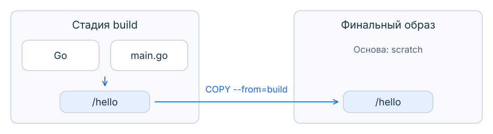
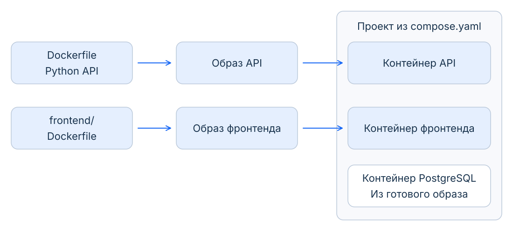
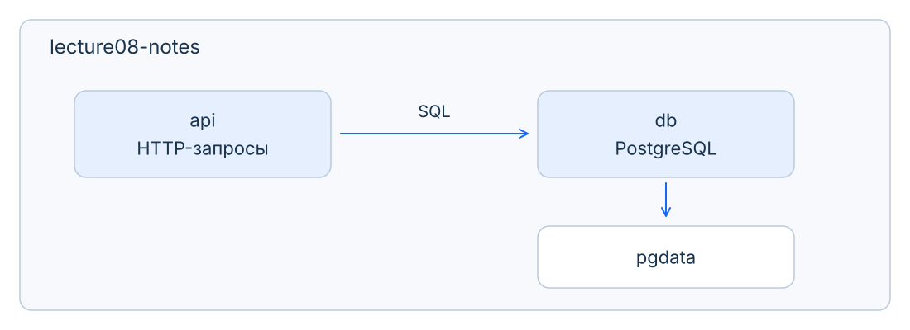
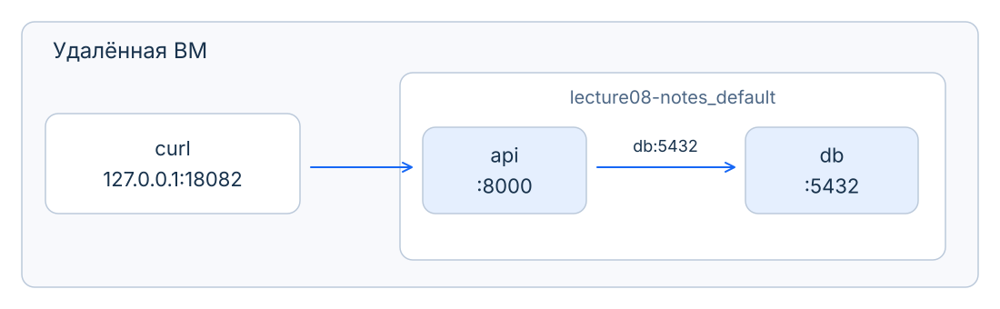
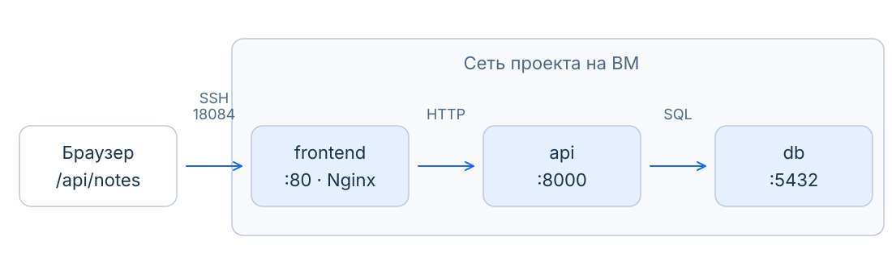
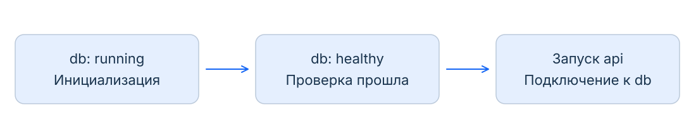

# Docker Compose. Теория

Сервис заметок умеет принимать HTTP-запросы. Добавим ему страницу в браузере и хранение в PostgreSQL. Разберём, как отдельно упакованные части связать и запустить как одно приложение.

## Как описать всё приложение

### От исходников к образу

На прошлой паре мы собирали образ API из Dockerfile. Вспомним знакомую последовательность:

```dockerfile
FROM python:3.12-slim-bookworm
WORKDIR /app
COPY requirements.txt ./requirements.txt
RUN python -m pip install --no-cache-dir -r requirements.txt
COPY app.py ./app.py
CMD ["python", "-m", "uvicorn", "app:app", "--host", "0.0.0.0", "--port", "8000"]
```

`FROM` выбирает основу, `WORKDIR` – рабочую папку. Через `COPY` добавляем файлы, через `RUN` устанавливаем библиотеки **при сборке**. `CMD` сохраняет команду по умолчанию для **будущего запуска контейнера**. В результате получаем образ с Python, зависимостями и кодом приложения.

Но всё ли, что понадобилось при сборке, нужно работающему приложению? Например, **компилятор** переводит исходный код в исполняемую программу. Для получения программы он нужен; для запуска готового результата сам компилятор обычно уже не требуется.

### Сборка в несколько стадий

Допустим, мы установили компилятор, собрали программу и сохранили всё это в одном образе. Программа работает. Но вместе с ней мы передаём на сервер компилятор, инструменты сборки и промежуточные файлы, которые там больше не используются. Их приходится хранить, скачивать из registry и учитывать при обновлении окружения.

Хотим получить **два разных набора файлов**: всё необходимое для изготовления программы и только необходимое для её работы. Многостадийность позволяет описать оба набора в одном Dockerfile. Подготовка остаётся описанной в Dockerfile, а публиковать и скачивать можно только компактный рабочий образ без инструментов, нужных только при сборке. Это экономия места и объёма передачи; сама программа от этого автоматически быстрее не становится.

На маленьком примере это видно лучше, чем на зависимостях API. Возьмём отдельную программу на Go: она только печатает `Ready for Compose`. Исходник [main.go](examples/multistage/main.go) уже подготовлен; здесь важен путь от исходного файла к готовой программе.

```go
package main

import "fmt"

func main() {
    fmt.Println("Ready for Compose")
}
```

Чтобы не включать компилятор в рабочий образ, разделим [Dockerfile](examples/multistage/Dockerfile) на две части:

```dockerfile
# -- stage 1 --
FROM golang:1.26-alpine AS build
WORKDIR /src
COPY main.go .
RUN go build -o /hello main.go

# -- stage 2 --
FROM scratch
COPY --from=build /hello /hello
CMD ["/hello"]
```

Первый `FROM` берёт окружение с Go. `AS build` даёт этой стадии имя `build`. Команда `go build` компилирует исходник, `-o /hello` задаёт путь результата. Это компиляция программы внутри сборки Docker-образа: два разных действия со словом `build`.

Второй `FROM` начинает новую стадию. `scratch` – специальное обозначение пустой основы, а не скачиваемый дистрибутив Linux. `COPY --from=build` берёт из первой стадии только готовый `/hello`. Компилятор и исходный файл в финальный образ не переходят. При запуске `CMD` выполнит программу: она напечатает строку и завершится.

Из папки `examples/multistage` образ можно собрать и запустить знакомыми командами:

```bash
docker build -t lecture08-hello .
docker run --rm lecture08-hello
```

Результат запуска:

```text
Ready for Compose
```



**Многостадийная сборка (`multi-stage build`)** позволяет готовить результат в одном окружении, а запускать в другом. По умолчанию итогом служит последняя стадия. Стадии сборки не становятся одновременно работающими сервисами. [Устройство multi-stage](https://docs.docker.com/build/building/multi-stage/).

В нашем результате остался один исполняемый файл вместо окружения с целым набором инструментов Go. Первая стадия может сохраняться в локальном кэше сборки, но её файлы не включаются в итоговый образ целиком: мы явно выбрали только `/hello`.

У этой маленькой Go-программы нет внешних библиотек, которые нужно добавить в финальный образ. Перенести туда только Python-файл не получится: ему нужны Python и зависимости. Поэтому Dockerfile нашего API пока оставляем обычным. Само число стадий не гарантирует уменьшения образа: важно, какие файлы попали в результат.

### Почему одного Dockerfile недостаточно

Многостадийность ответила на вопрос **«что положить в один итоговый образ?»**. Теперь другой вопрос: **«как запустить приложение из нескольких образов и связать его части?»** Число стадий в Dockerfile эту задачу не решает: стадия сборки не является отдельным работающим сервисом.

Вернёмся к API заметок: при запуске мы отдельно выбирали опубликованный порт, переменные окружения и том. Эти подключения и значения для конкретного запуска не появлялись из Dockerfile автоматически.

Пользователю удобнее написать заметку на странице и нажать «Добавить», чем составлять команду `curl`. У небольшого приложения появляются три роли:

| Часть приложения | Что делает |
| --- | --- |
| Фронтенд (`frontend`) | Страница с полем ввода и списком заметок; её JavaScript отправляет HTTP-запросы |
| Бэкенд (`backend`), наш API | Принимает запросы, проверяет данные и обращается к хранилищу |
| PostgreSQL | Сервер базы данных, который хранит записи и выполняет SQL-запросы |

**SQL** – язык работы с базами данных. Код API должен уметь обращаться к PostgreSQL: само добавление контейнера не превращает запись JSON в работу с базой. В примере уже подготовлены оба варианта API и небольшая веб-страница.

Все серверные процессы технически можно поместить в один контейнер. Но отдельные контейнеры позволяют обновить страницу, не перезапуская базу, и отдельно посмотреть логи API. У каждой части своё окружение: API нужен Python, странице – веб-сервер, базе – PostgreSQL. Docker упаковывает каждую часть в образ; запуск приложения требует согласовать несколько таких образов.

Передадим коллеге только образ API. Сможет ли он запустить приложение? Ему ещё понадобятся образ базы, имя сети, том и настройки подключения. Если в одной команде назвать базу `db`, а в другой передать адрес `postgres`, по отдельности команды могут быть правильными, но вместе приложение не заработает.

Shell-скрипт может сохранить команды. Но хотелось бы описать **нужное состояние** в одном месте: какие сервисы существуют и как связаны. А затем попросить инструмент привести проект к этому состоянию.

<div style="padding: 8px 12px; margin: 12px 0; border-radius: 6px; border-left: 3px solid #3b82f6; background-color: #eff6ff; color: #1e40af;">
<strong>Docker Compose</strong><br>
Инструмент для описания и совместного управления сервисами приложения. Читает файл конфигурации и обращается к Docker Engine, который создаёт контейнеры, сети и тома.
</div>

### Как связаны Docker и Docker Compose

Контейнеры по-прежнему запускает **Docker Engine**, знакомый демон Docker. Когда мы пишем `docker run`, клиент передаёт ему параметры одного контейнера. Когда пишем `docker compose up`, Compose читает описание проекта и передаёт тому же Docker Engine необходимые запросы для всех его компонентов.

Поэтому контейнер API, созданный через Compose, виден и в обычном `docker ps`. Его можно посмотреть через `docker inspect` и прочитать логи обычной командой Docker. У Compose удобнее выбирать сервис по имени `api` и управлять всем проектом сразу.

Compose не запускает второй Docker и не добавляет новый слой изоляции. Он автоматизирует согласованную работу с обычными Docker-образами, контейнерами, сетями и томами. Если образ надо собрать, используется тот же механизм сборки Docker: исходники и Dockerfile определяют содержимое результата, а Compose сообщает, для какого сервиса он нужен.

<div style="padding: 8px 12px; margin: 12px 0; border-radius: 6px; border-left: 3px solid #64748b; background-color: #f8fafc; color: #475569;">
<strong>Почему встречается <code>docker-compose</code></strong><br>
Исторически Compose v1 был отдельной программой на Python и вызывался через дефис: <code>docker-compose up</code>. Начиная с Compose v2 обычная форма – плагин Docker CLI с командой <code>docker compose up</code>. Её использует и Compose v5, установленный на нашей ВМ. Версию инструмента проверяем через <code>docker compose version</code>; это не то же самое, что старое поле <code>version: "3.8"</code> в YAML.
</div>

### Dockerfile, YAML и манифест

Описание приложения сохраним в `compose.yaml`. Здесь важно различать **формат записи** и **смысл записанного**.

**YAML** – формат данных: именованные поля, списки и вложенность через отступы. **Compose Specification** задаёт, какие поля понимает Compose и что они означают. Корректный YAML с произвольными полями ещё не является корректным Compose-файлом. В следующем примере прочитаем эту структуру по строкам.

Такое описание также называют **манифестом**: мы объявляем, какие компоненты и настройки нужны приложению. Сам YAML ничего не запускает; описание читает Compose и обращается к Docker Engine.

| Вопрос                              | Dockerfile                                             | `compose.yaml`                                        |
| ----------------------------------- | ------------------------------------------------------ | ----------------------------------------------------- |
| Что описывает?                      | Получение образа и его настройки по умолчанию          | Сервисы приложения, их настройки и связи              |
| Как записан?                        | Инструкции `FROM`, `RUN`, `COPY`, `CMD`                | Поля и списки в формате YAML                          |
| Где оказываются код и библиотеки?   | Добавляем их в образ при сборке                        | Выбираем образ или указываем, откуда его собрать      |
| Где задаём подключения при запуске? | Не создаёт сеть проекта и не подключает конкретный том | Описываем сети, подключения томов и публикацию портов |
| Где задаём команду и окружение?     | Значения по умолчанию внутри образа                    | Можем переопределить для конкретного сервиса          |

Dockerfile содержит не только действия сборки: знакомые `CMD` и `ENV` задают значения для будущего запуска. Compose использует эти значения, если в настройках сервиса мы не выбрали другие. Файлы дополняют друг друга, а контейнеры в обоих случаях обслуживает Docker Engine.



### Сервис, контейнер и проект

**Сервис (`service`)** – описание одной роли в приложении: какой образ использовать, какие параметры передать и к чему подключиться. Из описания создаются конкретные контейнеры. Сервис `api` не исчезает из файла, когда его контейнер остановлен или удалён.

**Проект (`project`)** объединяет связанные сервисы и ресурсы. Наш проект назовём `lecture08-notes`, сначала рассмотрим сервисы `api` и `db`, затем подключим `frontend`. Каждому сервису пока соответствует один контейнер.

**Что входит в проект.**



Том – отдельный ресурс, не третий сервис. На схеме `pgdata` – выбранное имя тома с данными базы; его объявление разберём ниже. Код API находится в образе приложения.

### Как читать Compose-файл

Начнём с одного знакомого API, который хранит заметки в JSON. В подготовленной папке файлы лежат так:

```text
examples/
  compose.yaml
  Dockerfile
  json_app.py
  requirements.txt
```

В [Dockerfile](examples/Dockerfile) находятся инструкции сборки: взять Python, установить зависимости из `requirements.txt`, скопировать `json_app.py` как `/app/app.py` и сохранить команду запуска Uvicorn. Рядом запишем `compose.yaml`:

```yaml
name: lecture08-notes
services:
  api:
    build: .
    ports:
      - "127.0.0.1:18082:8000"
```

`name` задаёт имя проекта. Внутри `services` описываем сервис `api`. Его `build` и `ports` стоят на одном уровне отступов и относятся именно к нему.

`build: .` выбирает **контекст сборки** – папку, из которой Dockerfile может брать файлы через `COPY`. Здесь точка отсчитывается от папки Compose-файла. В этой папке Compose по умолчанию ищет файл с точным именем `Dockerfile`.

Получается знакомая сборка по `examples/Dockerfile`: он выбирает основу Python, зависимости и код API. Compose не придумывает инструкции и не копирует всю папку автоматически. Если Dockerfile отсутствует, сборка завершится ошибкой.

`ports` содержит список публикаций: дефис начинает элемент, а строка в кавычках задаёт знакомую связь порта ВМ `18082` с портом контейнера `8000`.

Двоеточие после имени поля отделяет ключ от значения. Отступы делаем пробелами. Поле `version: "3.8"`, которое встречается в старых примерах, для современного Compose добавлять не нужно: применяется Compose Specification.

Это первое приближение. Ниже добавим базу и разберём остальные поля; отдельные фрагменты показывают изменения внутри соответствующего сервиса, а не самостоятельные файлы запуска.

### Готовый образ или собственная сборка

API мы пишем сами, поэтому ему нужен `build`. Сам PostgreSQL поставляется готовым образом, для него используем `image`. Пока добавляем только сервер базы; подключение к ней из API разберём отдельно:

```yaml
services:
  api:
    build: .
  db:
    image: postgres:17-bookworm
```

Оба имени внутри `services` имеют одинаковый отступ: это два сервиса. `image` выбирает готовый образ; `build` указывает, откуда получить наш собственный. Файлы приложения не копируются в контейнер просто потому, что лежат рядом с `compose.yaml`: это по-прежнему работа Dockerfile.

Версия PostgreSQL здесь выбрана явно. Обновление базы между основными версиями – отдельная операция с миграцией данных, а не произвольная замена числа в теге. Для примера оставляем PostgreSQL 17 и его каталог данных `/var/lib/postgresql/data`.

### Два Dockerfile, один проект

API нужен Python, а браузеру надо получить HTML, CSS и JavaScript. Чтобы отдавать эти файлы по HTTP, используем **Nginx** – веб-сервер. Получаются разные правила сборки и отдельные Dockerfile:

```text
examples/
  Dockerfile          # Python API с JSON
  json_app.py
  requirements.txt
  frontend/
    Dockerfile        # Веб-сервер и файлы страницы
    nginx.conf
    index.html
    app.js
    style.css
  compose.yaml
```

Dockerfile фронтенда короткий:

```dockerfile
FROM nginx:1.30-alpine
COPY nginx.conf /etc/nginx/nginx.conf
COPY index.html app.js style.css /usr/share/nginx/html/
EXPOSE 80
```

Базовый образ уже содержит команду запуска Nginx. Добавляем настройки сервера и готовые файлы страницы. Их не нужно компилировать, поэтому стадия с Node.js здесь не нужна.

Compose выбирает контекст сборки отдельно для каждой части:

```yaml
services:
  api:
    build: .
  frontend:
    build: ./frontend
  db:
    image: postgres:17-bookworm
```

Первый `build` использует Dockerfile из корня проекта, второй – `frontend/Dockerfile`. Образ базы берём готовым. Мы не объединяем разные Dockerfile в один: Compose собирает нужные образы и управляет их совместным запуском.

### Какая программа запустится

Образ уже содержит команду `CMD`: у нашего API это запуск Uvicorn. Если не переопределять её в Compose, контейнер выполнит именно эту команду.

Поле **`command`** позволяет выбрать другую команду для сервиса без пересборки образа. Например, вместо сервера можно запросить версию Python:

```yaml
services:
  api:
    build: .
    command: ["python", "--version"]
```

Квадратные скобки задают список аргументов. Такой контейнер напечатает версию и **завершится**, поэтому в рабочий API этот фрагмент не добавляем: ему нужно продолжать обслуживать запросы. Поле `command` заменяет `CMD`, но сохраняет `ENTRYPOINT`, если он был задан в образе. В нашем Dockerfile `ENTRYPOINT` нет. [Команда сервиса](https://docs.docker.com/reference/compose-file/services/#command).

### Как API найдёт PostgreSQL

Контейнер API имеет собственное сетевое окружение. Его `localhost` означает **сам контейнер API**, поэтому база из другого контейнера по этому адресу не найдётся.

Если не задать сети явно, Compose создаёт общую сеть проекта. На нашей Linux-ВМ это сеть с драйвером **`bridge`**, именем `lecture08-notes_default`.

**Bridge**, сетевой мост, здесь соединяет виртуальные сетевые интерфейсы контейнеров на одной машине. У API и базы остаются свои IP-адреса и свои `localhost`, но через общую сеть они могут отправлять друг другу пакеты. Это не подключение контейнеров напрямую к домашней сети вашей машины.

Compose создаёт отдельную пользовательскую сеть, а не подключает всё к встроенной сети Docker с именем `bridge`. У сетей один тип драйвера, но разные настройки и участники. В пользовательской сети работает встроенный DNS Docker: сервисы находят друг друга по именам `db` и `api`. [Драйвер bridge](https://docs.docker.com/engine/network/drivers/bridge/).

**DNS** сопоставляет имя с IP-адресом. В сети Docker имя сервиса позволяет обращаться к нужному контейнеру, не запоминая его IP. При пересоздании адрес может измениться, а имя `db` останется. Открытое соединение при этом не переносится: приложение должно уметь подключиться заново. [Сети Compose](https://docs.docker.com/compose/how-tos/networking/).

Передадим API адрес базы через уже знакомые переменные окружения:

```yaml
services:
  api:
    environment:
      PGHOST: db
      PGUSER: notes
      PGDATABASE: notes
```

`environment` задаёт окружение процесса в контейнере. В нашем Python-коде эти настройки читает клиентская библиотека PostgreSQL: `PGHOST` – адрес сервера, `PGUSER` – пользователь, `PGDATABASE` – база. Порт по умолчанию – `5432`. Пользователя и базу `notes` настроим ниже при первом запуске PostgreSQL. Произвольная переменная не влияет на приложение, пока его код или библиотека её не используют.

### Два направления подключения

Сравним запрос пользователя и запрос приложения к базе.

**Адрес зависит от того, откуда обращаемся.**



| Откуда обращаемся | Куда        | Адрес             |
| ----------------- | ----------- | ----------------- |
| Терминал на ВМ    | API         | `127.0.0.1:18082` |
| Контейнер API     | PostgreSQL  | `db:5432`         |
| Контейнер базы    | Эта же база | `127.0.0.1:5432`  |

Для общения API и базы **не нужно** публиковать `5432` на ВМ. Они используют общую сеть и внутренний порт. `ports` нужен для доступа через хост; `expose` не является обязательным разрешением общения и не открывает порт на ВМ.

Адрес `db` также не появляется в DNS вашей машины. Если Docker работает на удалённой ВМ, браузер на вашей машине обращается к опубликованному API через SSH-туннель, как в седьмой паре. Слева на схеме показан именно запрос с ВМ.

<div style="padding: 8px 12px; margin: 12px 0; border-radius: 6px; border-left: 3px solid #ef4444; background-color: #fef2f2; color: #991b1b;">
<strong>Антипаттерн</strong><br>
Записывать в API <code>localhost:5432</code> или IP случайного контейнера. Для отдельной базы в общей сети используем имя сервиса <code>db</code> и порт <code>5432</code>.
</div>

Для этого проекта достаточно одной сети. Когда нужны разные группы доступности, сервисам задают отдельные сети через `networks`: общаться напрямую смогут участники общей сети. Само наличие разных проектов не заменяет контроль доступа к опубликованным портам.

### Как браузер доберётся до API

Файлы страницы хранятся в образе `frontend`, но её JavaScript выполняется **в браузере на вашей машине**. Поэтому адрес `http://api:8000` из сети контейнеров браузеру недоступен.

Страница отправляет запрос на относительный путь `/api/notes` того же сайта, с которого загружена. Nginx в контейнере `frontend` принимает его и передаёт в `http://api:8000/notes`, убирая префикс `/api`. Такая передача запроса серверу за ним называется **обратным проксированием (`reverse proxy`)**.



Для браузера это один сайт на порту `18084`; внутри проекта Nginx и API общаются по сети Docker. Прямую публикацию API на `18082` оставим для знакомых проверок через `curl`. Пароль базы браузеру и фронтенду не передаём.

В [nginx.conf](examples/frontend/nginx.conf) уже настроено обновление адреса `api` через DNS Docker. Это нужно при пересоздании контейнера: имя остаётся, IP может измениться. Подробный синтаксис Nginx здесь не изучаем, но сам путь запроса должен быть понятен.

### Где будут жить записи

Заметка должна пережить обновление приложения. А временный файл, из которого приложение готовит ответ, обычно можно создать заново. От этого различия зависит, куда сохранять данные.

<div style="padding: 8px 12px; margin: 12px 0; border-radius: 6px; border-left: 3px solid #3b82f6; background-color: #eff6ff; color: #1e40af;">
<strong>Персистентные и временные данные</strong><br>
Персистентные (<code>persistent</code>) данные сохраняются независимо от замены экземпляра приложения. В нашем проекте это заметки в отдельном томе. Временные, неперсистентные (<code>ephemeral</code>) данные можно потерять и получить заново: например, промежуточные файлы обработки запроса.
</div>

Сам по себе JSON не является временным или постоянным хранилищем. Если единственная копия заметок находится в изменяемом слое контейнера, удаление контейнера её уничтожит. `stop` и `restart` этот слой сохраняют: временное хранение не означает, что данные обязательно исчезают при остановке процесса. Для нужной нам сохранности подключаем отдельный том.

Есть связанное различие уже **между сервисами**, а не форматами данных:

| Сервис | Где находится состояние между запросами | Наш пример |
| --- | --- | --- |
| `Stateful`, с состоянием | Хранит данные, которые нужны для дальнейшей работы; при замене экземпляра ему нужно вернуть хранилище | API с JSON; PostgreSQL с томом заметок |
| `Stateless`, без собственного состояния | Не требует сохранения собственного состояния между запросами; постоянные данные хранит внешний сервис | API обращается к PostgreSQL; новый экземпляр API может работать с той же базой |

`Stateless` не означает «не работает с данными». Наш API читает и записывает заметки, но хранение передаёт базе. Всё приложение остаётся с состоянием: PostgreSQL нельзя заменить пустой базой без потери заметок. Подключение тома к JSON API тоже не делает его `stateless`: этому сервису по-прежнему нужен его JSON-файл.

Раньше API создавал JSON. Теперь файлы создаёт PostgreSQL. У образа `postgres:17-bookworm` каталог данных уже объявлен через `VOLUME`: без нашего подключения Docker создаст анонимный том. Если удалить контейнер и создавать новый без указания прежнего хранилища, автоматически подключится другой анонимный том. Дадим хранилищу постоянное имя и явно подключим его:

```yaml
services:
  db:
    image: postgres:17-bookworm
    volumes:
      - pgdata:/var/lib/postgresql/data
volumes:
  pgdata:
```

Здесь два уровня. Внешний `volumes` **объявляет ресурс** проекта. `volumes` у `db` **подключает** его к пути внутри контейнера. Слева от двоеточия – имя ресурса `pgdata`, справа – каталог PostgreSQL.

Если оставить `pgdata:/var/lib/postgresql/data`, но убрать верхнее объявление `volumes:`, Compose отклонит конфигурацию: сервис ссылается на необъявленный том. Даже наличие одноимённого тома в Docker не заменяет объявления в проекте. Пустое `pgdata:` означает обычные настройки тома, а не отсутствие хранилища. [Объявление томов](https://docs.docker.com/reference/compose-file/volumes/).

Важно различать три записи в `volumes` сервиса:

| Подключение к `/data` | Источник               | Нужно объявлять наверху                                       |
| --------------------- | ---------------------- | ------------------------------------------------------------- |
| `jsondata:/data`      | Именованный том        | Да, `volumes: {jsondata: {}}` или такая же запись с отступами |
| `/data`               | Анонимный том          | Нет: имя выбирает Docker                                      |
| `./data:/data`        | Папка ВМ, `bind mount` | Нет: указан путь к папке, а не ресурс проекта                 |

По умолчанию Docker-имя этого тома будет `lecture08-notes_pgdata`. После пересоздания контейнера база сможет открыть те же файлы. Имя проекта поэтому влияет не только на подписи: если поменять его, по умолчанию получится другой том, и база начнёт с пустого хранилища.

<div style="padding: 8px 12px; margin: 12px 0; border-radius: 6px; border-left: 3px solid #f59e0b; background-color: #fffbf0; color: #92400e;">
<strong>Том не заменяет резервную копию</strong><br>
Он переживает замену контейнера, но не ошибочный SQL-запрос или потерю диска. Для PostgreSQL нужны согласованные резервные копии, например логический экспорт через <code>pg_dump</code>; копировать работающий каталог базы как JSON-файл нельзя.
</div>

### Кто создаёт базу и пользователя

Один сервер PostgreSQL может содержать несколько баз данных. Для приложения выделим базу `notes` и пользователя `notes`, от имени которого API будет к ней подключаться. Это разные сущности с одинаковым выбранным именем.

На пустом томе образ PostgreSQL выполняет первоначальную настройку. Укажем имя пользователя и базы:

```yaml
services:
  db:
    environment:
      POSTGRES_USER: notes
      POSTGRES_DB: notes
```

Это **настройки инициализации сервера**. Ранее `PGUSER` и `PGDATABASE` задавали **параметры подключения клиента**. Слова похожи, но читатели разные: образ PostgreSQL и библиотека нашего API.

Таблицу `notes` с полями `id` и `text` создаёт при старте наш API. Это уже структура данных приложения; образ PostgreSQL сам о заметках ничего не знает.

Нужен ещё пароль. Если том уже содержит базу, изменение переменных инициализации не переименует пользователя и не сменит его пароль. Для изменения существующей базы нужны её административные команды. [Официальный образ PostgreSQL](https://hub.docker.com/_/postgres).

### Как передать пароль

Пароль нужен двум процессам: базе при инициализации и API при подключении. Его не следует записывать в Dockerfile или коммитить рядом с кодом. Сохраним пароль в отдельном файле `secrets/db_password.txt` и объявим **секрет (`secret`)**:

```yaml
secrets:
  db_password:
    file: ./secrets/db_password.txt
```

Объявление описывает источник. Доступ сервису выдаётся отдельно:

```yaml
services:
  db:
    secrets:
      - db_password
    environment:
      POSTGRES_PASSWORD_FILE: /run/secrets/db_password
  api:
    secrets:
      - db_password
```

Файл появляется в контейнерах по пути `/run/secrets/db_password`. Образ PostgreSQL понимает переменную `POSTGRES_PASSWORD_FILE`; наш API явно читает этот файл в Python. Compose сам не переписывает код приложения, чтобы оно стало читать секреты.

Локальный Compose подключает файловый секрет из файла хоста. Это не шифрование исходного файла и не отдельное хранилище паролей. Файл исключаем из Git, ограничиваем доступ к нему и выдаём только нужным сервисам. [Секреты Compose](https://docs.docker.com/compose/how-tos/use-secrets/).

### Процесс запущен, но база ещё не готова

При первом запуске PostgreSQL создаёт файлы и настраивает базу. Контейнер уже может быть в состоянии `running`, хотя принимать запросы ещё рано. Если в этот момент запустится API, первое подключение может завершиться ошибкой.

<div style="padding: 8px 12px; margin: 12px 0; border-radius: 6px; border-left: 3px solid #3b82f6; background-color: #eff6ff; color: #1e40af;">
<strong>Проверка состояния (<code>healthcheck</code>)</strong><br>
Команда, которую Docker периодически выполняет внутри контейнера. По её коду завершения он определяет, проходит ли сервис заданную проверку. Это дополнительное состояние к факту работы процесса.
</div>

Для базы используем поставляемую с PostgreSQL утилиту `pg_isready`:

```yaml
services:
  db:
    healthcheck:
      test: ["CMD", "pg_isready", "-h", "127.0.0.1", "-U", "notes", "-d", "notes"]
      interval: 2s
      timeout: 3s
      retries: 30
```

`test` задаёт команду. `CMD` здесь означает выполнить список аргументов без оболочки; это не инструкция запуска из Dockerfile. `-h` выбирает хост, `-U` пользователя, `-d` базу. Команда работает **в контейнере базы**, поэтому `127.0.0.1` здесь верен.

После запуска состояние проверки – `starting`. Одна успешная проверка даёт `healthy`; серия последовательных неудач – `unhealthy`. При последующем успехе сервис снова станет `healthy`: после ошибки проверки не прекращаются.

| Параметр            | Что регулирует                                                                                     |
| ------------------- | -------------------------------------------------------------------------------------------------- |
| `interval: 2s`      | Интервал между проверками; время выполнения самой команды тоже влияет на момент следующего запуска |
| `timeout: 3s`       | Сколько максимум ждать одну проверку; превышение считается неудачей                                |
| `retries: 30`       | Сколько неудач подряд нужно для `unhealthy`; успех сбрасывает счётчик                              |
| `start_period: 10s` | Начальный период, когда неудачи ещё не расходуют лимит; ранний успех завершает эту льготу          |

`start_period` не откладывает все проверки и не заставляет ждать ровно 10 секунд. У базы выше он не задан, у API добавим его вместе с `retries: 3`, чтобы наблюдать отказ без долгого ожидания. Это учебные пороги. `pg_isready` проверяет приём подключений, а не наличие таблиц и права приложения.

Теперь API может ждать готовности базы:

```yaml
services:
  api:
    depends_on:
      db:
        condition: service_healthy
```

`depends_on` задаёт зависимость запуска. Точное имя условия – **`service_healthy`**, с окончанием `healthy`:

| Условие           | Чего ждём перед запуском API                                              |
| ----------------- | ------------------------------------------------------------------------- |
| `service_started` | Контейнер базы запущен; так работает и короткая запись `depends_on: [db]` |
| `service_healthy` | База прошла свой `healthcheck`; у неё должна быть задана проверка         |

Нам подходит второе: запущенный процесс ещё не гарантирует готовность принимать запросы. Сама проверка также может быть ошибочной; это увидим в практике.

**Порядок запуска с проверкой готовности.**



После запуска приложение всё равно должно обрабатывать ошибки подключения. База может перестать отвечать позже; `depends_on` не приостанавливает API и не восстанавливает его соединения. [Управление порядком запуска](https://docs.docker.com/compose/how-tos/startup-order/).

У API тоже зададим `healthcheck`. В полном файле он обращается к `http://127.0.0.1:8000/health` **внутри контейнера API**. Этот обработчик выполняет в базе `SELECT 1` – простой запрос без чтения таблиц. Так проверяем и ответ API, и соединение с PostgreSQL. Для HTTP-запроса используем уже установленный Python; добавлять в образ `curl` не нужно.

### Где задавать проверку: в образе или в Compose

Проверка состояния не является отдельной возможностью только Compose. Автор образа может сохранить её прямо в Dockerfile инструкцией `HEALTHCHECK`. Например, для образа PostgreSQL проверку можно описать так:

```dockerfile
HEALTHCHECK --interval=2s --timeout=3s --retries=30 \
    CMD pg_isready -h 127.0.0.1 -U notes -d notes
```

Эта строка предназначена для Dockerfile образа с установленным `pg_isready`. Как и `CMD`, она сохраняет настройку для будущего контейнера, а не проверяет работающую базу во время сборки.

В нашем случае удобнее `healthcheck` в Compose: мы используем готовый образ PostgreSQL и хотим настроить проверку под этот проект без его пересборки. Настройка сервиса может переопределить проверку из образа. В обоих случаях выполняет её Docker Engine внутри контейнера. [Инструкция `HEALTHCHECK`](https://docs.docker.com/reference/dockerfile/#healthcheck).

### Что делать, если процесс завершился

Рассмотрим две разные поломки. В первой процесс API жив, но база недоступна: HTTP-запросы завершаются ошибкой. Во второй сам процесс API завершился, и запросы больше некому принимать. `healthcheck` помогает обнаружить первую ситуацию, а для второй нужна **политика перезапуска (`restart policy`)**.

Без Compose её можно выбрать при `docker run` параметром `--restart unless-stopped`. В Dockerfile такой инструкции нет: это решение для конкретного запуска. В Compose оно записывается у сервиса:

```yaml
services:
  api:
    restart: unless-stopped
```

`unless-stopped` просит Docker снова запустить завершившийся контейнер независимо от кода завершения. При этом ручная остановка через `stop` сохраняется, в том числе после перезапуска Docker Engine. Политика работает и после закрытия SSH-сеанса: за ней следит демон, а не терминал с Compose.

| Политика         | Когда перезапускать                                                                                                        |
| ---------------- | -------------------------------------------------------------------------------------------------------------------------- |
| `"no"`           | Не перезапускать автоматически; значение по умолчанию                                                                      |
| `on-failure:3`   | При ненулевом коде завершения, не более трёх повторных попыток; перезапуск демона сам по себе не запускает такой контейнер |
| `always`         | После завершения процесса независимо от кода; ручная остановка действует до следующего запуска Docker Engine               |
| `unless-stopped` | Как `always`, но ручная остановка сохраняется и после запуска Docker Engine                                                |

В учебном файле начинаем с `restart: "no"`, чтобы увидеть поведение без автоматического восстановления. Затем изменим настройку и проверим её действие. [Политики перезапуска Docker](https://docs.docker.com/engine/containers/start-containers-automatically/).

<div style="padding: 8px 12px; margin: 12px 0; border-radius: 6px; border-left: 3px solid #f59e0b; background-color: #fffbf0; color: #92400e;">
<strong>Проверка не равна восстановлению</strong><br>
Состояние <code>unhealthy</code> само по себе не запускает политику <code>restart</code>: основной процесс ещё работает. Перезапуск также не исправляет неверный пароль и не возвращает недоступную базу. Обработку ошибок и повторное подключение обеспечивает приложение.
</div>

`depends_on` решает третью задачу: согласует первоначальный запуск сервисов. Вместе эти механизмы дают понятный порядок старта, наблюдение за состоянием и реакцию на завершение процесса. Они не заменяют резервные копии и не восстанавливают потерянную ВМ.

### Сколько ресурсов может занять сервис

Контейнеры изолируют процессы, но делят процессор и память ВМ. Без явных лимитов один сервис может занять ресурсы, нужные соседям. В шестой паре мы называли механизм Linux для таких ограничений – `cgroups`; теперь зададим ограничения через Docker.

У обычного `docker run` для этого есть `--cpus` и `--memory`. В Compose задаём соответствующие поля у сервиса, на одном уровне с `build` и `restart`:

```yaml
services:
  api:
    cpus: 0.5
    mem_limit: 256m
```

`cpus: 0.5` ограничивает суммарное процессорное время эквивалентом половины одного CPU. Это не закрепление за конкретным ядром и не половина всех ядер ВМ. При достижении лимита процесс ждёт следующей порции процессорного времени.

`mem_limit: 256m` ограничивает оперативную память контейнера 256 МиБ. Это потолок, а не заранее выделенная память. При нехватке памяти возможна ошибка выделения или завершение процесса механизмом OOM (`out of memory`). Подкачка на диск, если она разрешена на хосте, регулируется отдельно; лимит памяти не ограничивает размер образа и томов.

Лимиты относятся к контейнеру при запуске, поэтому в Dockerfile их не задаём. Они также не ускоряют приложение: выбираем значения по наблюдениям. В практике посмотрим потребление через `docker compose stats --no-stream` и отдельно проверим применённые ограничения. [Ресурсы контейнера](https://docs.docker.com/engine/containers/resource_constraints/), [поля сервиса Compose](https://docs.docker.com/reference/compose-file/services/#cpus).

### Настройки проекта и окружение приложения

Двум разработчикам могут понадобиться разные порты. Не будем ради этого редактировать одно и то же число в файле. Compose поддерживает **подстановку (`interpolation`)**:

```yaml
services:
  api:
    ports:
      - "127.0.0.1:${APP_PORT:-18082}:8000"
```

`${APP_PORT:-18082}` означает: взять непустое значение `APP_PORT`, иначе использовать `18082`. Значение можно записать в `.env` рядом с `compose.yaml`:

```dotenv
APP_PORT=18082
```

Все команды выполняем из папки с `compose.yaml` и `.env`. При каждом вызове Compose читает `.env`, берёт значения для `${...}` и получает итоговое описание. Например, `${APP_PORT:-18082}` превратится в `18082` ещё до создания контейнера. `source .env` и Python-библиотека для этого не нужны: файл читает сам Compose.

Если переменная уже передана из оболочки, она имеет приоритет над `.env`. Другой файл можно выбрать явно: `docker compose --env-file .env.example config`. Путь после `--env-file` отсчитывается от текущей папки. Файл с примером `.env.example` можно хранить в Git, но автоматически Compose ищет именно `.env`. Если запускать команды из другой папки или менять каталог проекта, правила поиска сложнее; здесь сохраняем одну рабочую папку.

<div style="padding: 8px 12px; margin: 12px 0; border-radius: 6px; border-left: 3px solid #3b82f6; background-color: #eff6ff; color: #1e40af;">
<strong>Два разных получателя настроек</strong><br>
<code>.env</code> предоставляет значения для подстановки самим Compose. Поле <code>environment</code> передаёт значения процессу в контейнере. Переменная из <code>.env</code> не оказывается внутри контейнера автоматически.
</div>

Чтобы значение из `.env` попало именно в приложение, нужна явная связь. Например, `DB_HOST=db` в `.env` и `PGHOST: ${DB_HOST:-db}` внутри `environment` сервиса дадут процессу переменную `PGHOST` со значением `db`.

Если приложению нужен целый файл переменных, используют поле сервиса `env_file`. А `--env-file` у команды Compose выбирает источник подстановок в конфигурацию. Похожие названия решают разные задачи. Изменение `.env` само по себе не меняет работающий контейнер: применяем описание через `up -d`. [Подстановка переменных](https://docs.docker.com/compose/how-tos/environment-variables/variable-interpolation/).

### Добавим инструмент для просмотра базы

API скрывает детали хранения. При разработке полезно открыть таблицу и проверить её содержимое. **Adminer** – веб-интерфейс для работы с базами данных. Это отдельный сервис: он обслуживает страницу в браузере и сам подключается к PostgreSQL.

```yaml
services:
  adminer:
    image: adminer:5
    environment:
      ADMINER_DEFAULT_SERVER: db
    ports:
      - "127.0.0.1:18083:8080"
    profiles: [tools]
```

Здесь уже знакомы `image`, `environment` и `ports`. Adminer обращается к `db:5432` из общей сети; браузер открывает опубликованный порт `18083` на ВМ через туннель. `ADMINER_DEFAULT_SERVER` подставляет адрес сервера, но не выдаёт доступ к базе: для входа всё равно нужны пользователь, база и пароль.

Новое поле – **профиль (`profile`)**: метка, позволяющая включать необязательные сервисы. API и база не имеют профиля и входят в обычный запуск. Для включения Adminer понадобится параметр `--profile tools`. Профиль выбирает сервисы, а не создаёт отдельный проект или сеть. Ниже применим его при запуске. [Профили Compose](https://docs.docker.com/compose/how-tos/profiles/).

Сейчас добавили только инструмент с понятной задачей. Кэш или очередь сообщений потребовали бы изменений в коде приложения; само добавление Redis в YAML не сделает API быстрее.

### Полный пример для разбора

В [итоговом Compose-файле](examples/steps/09-resources.yaml) соединены разобранные части: API, фронтенд, PostgreSQL, том, секрет, проверки готовности, лимиты ресурсов и необязательный Adminer. Исходники и Dockerfile лежат в `examples/`. В практике рабочий `compose.yaml` будем дополнять постепенно.

В итоге API работает с PostgreSQL, поэтому у его `build` выбраны `context: .` и `dockerfile: postgres/Dockerfile`. Это развёрнутая запись: отдельно указаны папка исходников и имя файла инструкций. Она позволяет сохранить первоначальный `Dockerfile` с JSON API. Переход между вариантами разберём в практике при подключении базы.

| Верхний уровень файла | За что отвечает |
| --- | --- |
| `name` | Имя проекта |
| `services` | Описание API, фронтенда, базы и необязательного инструмента |
| `volumes` | Именованные хранилища проекта |
| `secrets` | Источники секретов, доступ к которым выдаётся сервисам |

В файле фронтенд ждёт готовности API, а Adminer – базы. У API включён `unless-stopped` и ограничены ресурсы; в практике сначала увидим поведение без этих настроек, затем применим их. Порты API, фронтенда и Adminer задаются через `APP_PORT`, `FRONTEND_PORT` и `ADMINER_PORT`.

Настоящий `secrets/db_password.txt` в репозиторий не включён. Пример предполагает, что он подготовлен перед запуском; в этой части разбираем конфигурацию и смысл команд, без последовательного запуска сервисов.

### Почему похожие настройки находятся в разных файлах

Один образ можно запустить в разных проектах: с разными адресами базы, портами и хранилищами. Поэтому общую основу сохраняем в образе, а параметры конкретного запуска – в Compose.

| Что хотим изменить | Dockerfile | Compose |
| --- | --- | --- |
| Установить библиотеку | `RUN` при сборке | `build` вызывает сборку по Dockerfile; `command` не заменяет установку зависимости в образ |
| Выбрать программу | `CMD` задаёт команду по умолчанию | `command` переопределяет её при запуске |
| Передать настройку | `ENV` сохраняет значение в образе | `environment` задаёт значение для сервиса без пересборки |
| Открыть доступ с хоста | `EXPOSE` описывает порт, но не публикует его | `ports` создаёт публикацию; `EXPOSE` для этого не обязателен |
| Сохранить данные | `VOLUME` объявляет точку тома; без явного подключения создаётся анонимный том | `volumes` выбирает конкретный том или папку и путь подключения |
| Проверять состояние | `HEALTHCHECK` сохраняет проверку в образе | `healthcheck` задаёт или переопределяет её для сервиса |
| Возобновить завершившийся процесс | Инструкции для политики перезапуска нет | `restart` задаёт политику Docker Engine |
| Ограничить ресурсы контейнера | Инструкций для лимитов запуска нет | `cpus` и `mem_limit` ограничивают процессорное время и память |

Меняем зависимости или код внутри образа – нужна сборка. Меняем параметры запуска – обычно достаточно применить Compose-файл с пересозданием контейнера. Именно поэтому настройку базы не стоит зашивать в Dockerfile одного разработчика.

### Проверяем описание до запуска

Команды выполняются из папки с `compose.yaml`; иной файл можно выбрать через `-f`, например `docker compose -f compose.yaml config`. Флаг `-f` относится к Compose и идёт до подкоманды. Все следующие команды относятся к полному подготовленному проекту, а не к отдельным фрагментам выше.

Сначала проверим, что Compose прочитал описание без ошибок:

```bash
docker compose config --quiet
```

`config` разбирает конфигурацию, `--quiet` оставляет только сообщения об ошибках. Например, проверка обнаружит неизвестное поле сервиса или ссылку на необъявленный том. Но доступность базы и правильность пароля она не проверяет.

Без `--quiet` команда показывает **итоговое описание**: с подставленными переменными и развёрнутыми короткими записями. Посмотрим, как меняется опубликованный порт:

```bash
APP_PORT=28082 docker compose config
```

Присваивание перед командой задаёт переменную только для этого вызова. В выводе у API увидим порт хоста `28082`, а порт контейнера останется `8000`. Контейнеры при этом не создаются. Это полезная проверка того, что Compose действительно понял наши настройки. Вывод может содержать значения из `environment`, поэтому его нельзя бездумно публиковать, если там есть пароли. [Проверка и разворачивание конфигурации](https://docs.docker.com/reference/cli/docker/compose/config/).

### Что делает команда up

Команда **`docker compose up`** создаёт недостающее, запускает сервисы и при необходимости пересоздаёт контейнеры, конфигурация или образ которых изменились. Это не просто последовательность `docker start`.

На каждом вызове Compose читает файл, подставляет переменные и выбирает сервисы с учётом профилей. Затем запрашивает состояние у Docker Engine: контейнеры помечены именем проекта и сервиса, поэтому Compose узнаёт созданные ранее объекты. Сравнивает их настройки и образы с текущим описанием и выполняет нужные действия:

| Что обнаружил Compose | Что делает `up` |
| --- | --- |
| Контейнера ещё нет | Создаёт и запускает его; при необходимости создаёт сеть и том |
| Контейнер работает, настройки и образ прежние | Оставляет его работать |
| Контейнер остановлен, описание не изменилось | Запускает существующий контейнер |
| Настройки или образ изменились | При необходимости останавливает и пересоздаёт контейнер, сохраняя подключённые тома |

Поэтому несколько вызовов `up -d` подряд допустимы: выключать весь проект между ними не нужно. Пересоздание отдельного сервиса может дать короткий перерыв в работе. Изменение исходного кода само по себе ещё не меняет образ: для кода, добавленного через `COPY`, нужна сборка с `--build`.

С `-d` команда заканчивает работу, а контейнеры остаются под управлением Docker Engine. Compose не продолжает следить за YAML в фоне: после правки снова вызываем `up`. Автоматический рестарт завершившегося процесса обеспечивает политика Engine. [Поведение `up`](https://docs.docker.com/reference/cli/docker/compose/up/).

Чтобы заранее посмотреть предполагаемые действия, есть **пробный режим (`dry run`)**:

```bash
docker compose --dry-run up -d --build
```

`-d` (`--detach`) выбирает запуск в фоне, `--build` – сборку образов перед запуском. Но с `--dry-run`, который стоит до `up`, Compose показывает план операций без реальной сборки и запуска сервисов. Отметка успешной операции в пробном выводе ещё не означает, что она действительно выполнена. Режиму может понадобиться доступ к Docker Engine. [Пробный режим Compose](https://docs.docker.com/reference/cli/docker/compose/#use-dry-run-mode-to-test-your-command).

Для настоящего запуска убираем `--dry-run` и добавляем ожидание готовности:

```bash
docker compose up -d --build --wait
```

`--wait` ждёт состояния `running` или `healthy`; для содержательной проверки готовности сервису нужен `healthcheck`. У API это разобранный запрос к `/health`, который проверяет и доступность базы.

Чтобы вместе с API и базой запустить Adminer, добавляем разобранный профиль:

```bash
docker compose --profile tools up -d --build --wait
```

Без `--profile tools` необязательный сервис не создаётся. Но если Adminer уже работает, повторный обычный `up` его не остановит: включение профиля и остановка контейнеров – разные действия.

### Изменили файл. Что выполнять дальше?

| Что изменили или хотим сделать                    | Команда                            | Результат                                          |
| ------------------------------------------------- | ---------------------------------- | -------------------------------------------------- |
| Запустить проект с текущей конфигурацией          | `docker compose up -d`             | Создаёт и при необходимости пересоздаёт контейнеры |
| Изменили код, который Dockerfile копирует в образ | `docker compose up -d --build api` | Пересобирает образ API и применяет результат       |
| Временно остановить проект                        | `docker compose stop`              | Сохраняет контейнеры и данные                      |
| Продолжить остановленные контейнеры               | `docker compose start`             | Запускает существующие контейнеры                  |
| Перезапустить текущие процессы                    | `docker compose restart api`       | Не применяет изменения Compose-файла               |
| Удалить контейнеры и сеть проекта                 | `docker compose down`              | Именованный том по умолчанию остаётся              |

Для остановки только Adminer используем `docker compose stop adminer`. Чтобы удалить проект вместе с необязательным сервисом, явно включаем профиль: `docker compose --profile tools down`.

Указание `api` выбирает сервис, но Compose может также запустить его зависимости. В этой паре не обходим их вручную: база нужна приложению.

<div style="padding: 8px 12px; margin: 12px 0; border-radius: 6px; border-left: 3px solid #ef4444; background-color: #fef2f2; color: #991b1b;">
<strong>Антипаттерн</strong><br>
После изменения <code>environment</code> выполнить только <code>restart</code> и ждать новой настройки. Перезапускается прежний контейнер. Чтобы применить описание, используем <code>up -d</code>; если изменилось содержимое образа, добавляем сборку.
</div>

`docker compose down -v` дополнительно удаляет объявленные именованные тома и связанные анонимные тома. Это удаление данных, а не обычная остановка. Том, явно объявленный внешним через `external: true`, Compose не создаёт и не удаляет; в нашем файле том обычный, управляемый проектом.

### Как down завершает проект

`down` сначала останавливает контейнеры, затем удаляет их и сети проекта. Зависимости учитываются в обратном порядке: в нашей цепочке сначала фронтенд и API, потом база.

Остановка начинается с сигнала основному процессу. Обычно это `SIGTERM`, но образ или поле `stop_signal` могут выбрать другой сигнал. Docker даёт приложению время завершить запросы и закрыть файлы. Если оно не завершилось за отведённый срок, отправляется `SIGKILL`. Для сервиса срок задаёт `stop_grace_period` (по умолчанию 10 секунд); для конкретной команды его можно выбрать так:

```bash
docker compose down --timeout 30
```

Это ожидание до 30 секунд при остановке контейнера, а не обязательная пауза. Если процесс завершился сразу, ждать весь срок не нужно. Для нашего проекта с Adminer добавляем уже знакомый `--profile tools` перед `down`.

Обычный `down` сохраняет образы и именованные тома. Последующий `up` создаст новые контейнеры и подключит прежние тома. Чтобы только приостановить работу без удаления контейнеров, используем `stop`.

Удаление сервиса из YAML само по себе тоже не удаляет его старый контейнер. Для осознанной уборки таких контейнеров проекта есть `--remove-orphans`. [Команда `down`](https://docs.docker.com/reference/cli/docker/compose/down/), [ожидание остановки сервиса](https://docs.docker.com/reference/compose-file/services/#stop_grace_period).

### Как разбираться, если не работает

Начинаем с описания, затем проверяем процесс и его сообщения:

```bash
docker compose ps -a
docker compose logs --tail 30 api db
```

Синтаксис уже проверили через `config`. `ps -a` показывает также завершившиеся контейнеры. У `logs` параметр `--tail 30` ограничивает последние строки, а `api db` выбирает сервисы.

| Задача | Команда | Как закончить |
| --- | --- | --- |
| Следить за новыми сообщениями | `docker compose logs -f api` | `Ctrl+C` завершает просмотр, API работает дальше |
| Открыть оболочку в работающем API | `docker compose exec api sh` | `exit` завершает только дополнительную оболочку |
| Выполнить одну команду в API | `docker compose exec -T api python --version` | Команда завершится сама |
| Создать одноразовый контейнер для команды | `docker compose run --rm api python --version` | После команды контейнер удаляется |

У `logs` флаг `-f` означает `--follow`. В отличие от обычного `docker exec`, Compose по умолчанию уже выделяет терминал; для неинтерактивного запуска используем `-T`. Команда `run` заменяет команду сервиса, может поднять зависимости и по умолчанию **не публикует порты сервиса**. `exec` использует уже работающий контейнер, `run` создаёт новый.

Сообщение об ошибке помогает понять, до какого этапа дошло подключение:

| Что видим | Что проверить сначала |
| --- | --- |
| Не удаётся разрешить имя `db` | Совпадает ли имя сервиса и подключены ли контейнеры к общей сети |
| `connection refused` | Правильны ли адрес и порт; запущена ли база и принимает ли она подключения |
| Ошибка аутентификации | Пользователя и пароль; сервер уже ответил, это не проблема поиска адреса |
| Таблица `notes` не существует | К нужной ли базе подключились и созданы ли таблицы приложением |

Это направления поиска, а не единственные возможные причины. Начинаем с конкретного сообщения, а не с удаления тома: пересоздание данных не исправляет ошибку адреса.

### Что именно доказывает проверка

Корректная конфигурация, работающий процесс и работающее приложение – разные уровни проверки. Каждый следующий отвечает на более содержательный вопрос:

| Проверка                          | Что узнаём                                                | Чего ещё не знаем                             |
| --------------------------------- | --------------------------------------------------------- | --------------------------------------------- |
| `docker compose config --quiet`   | Compose принимает описание                                | Смогут ли сервисы запуститься                 |
| `docker compose ps -a`            | Какие контейнеры запущены или завершились                 | Выполняются ли пользовательские запросы       |
| `healthcheck` базы с `pg_isready` | Сервер принимает подключения                              | Верны ли пароль приложения и структура таблиц |
| Запрос к `/health` API            | API отвечает и выполняет в базе `SELECT 1`                | Работают ли запись и чтение заметок           |
| `POST /notes`, затем `GET /notes` | Заметка проходит всю цепочку от HTTP до хранения и чтения | Переживут ли данные замену контейнера         |

Если бы `/health` всегда возвращал `{"status": "ok"}` без обращения к базе, мы проверяли бы только ответ API. Смысл состояния `healthy` зависит от того, что делает проверка.

Дальше полезны два небольших опыта. **Сохранность данных:** записать заметку, пересоздать контейнер базы с тем же именованным томом и прочитать запись снова. Перезапуск прежнего контейнера слабее: его собственный изменяемый слой тоже сохраняется.

**Отказ зависимости:** остановить базу и обратиться к API. В нашем примере запрос завершится ошибкой, а после нескольких неудачных проверок API получит состояние `unhealthy`. Сам процесс при этом продолжит работать. После запуска базы новые запросы восстановятся: наш код открывает соединение при каждом запросе; последующая успешная проверка вернёт `healthy`. Это поведение кода и проверок, а не автоматическое восстановление связей через `depends_on`.

### Почему имена лучше оставить Compose

Имя `api` удобно для обращения из команд и сети. Конкретный контейнер обычно получает имя вида `lecture08-notes-api-1`: проект, сервис, номер экземпляра. Не нужно вручную добавлять `container_name`, чтобы база находилась по имени `db`.

Имя проекта можно переопределить: `docker compose -p notes-test up -d`. Здесь `-p` означает **project name**, а не публикацию порта из `docker run -p`. Получатся отдельные контейнеры, сеть и обычные именованные тома проекта. Но порты ВМ останутся теми же: для одновременного запуска двух проектов нужно также выбрать разные `APP_PORT`, `FRONTEND_PORT` и, при включении Adminer, `ADMINER_PORT`.

Общие bind mount пути или внешние тома при этом автоматически не разделяются. Для нашего проекта данные разделяет обычный том с префиксом имени проекта.

### От Compose к оркестрации нескольких машин

Compose удобен для разработки, проверки и запуска небольшого приложения на одной машине. Он описывает ресурсы, но не делает базу отказоустойчивой и не переносит приложение на другой сервер при потере ВМ.

Несколько экземпляров API тоже не получаются только от смены числа: им нужны общий внешний источник данных и способ распределять запросы. Фиксированный опубликованный порт не смогут одновременно занять два контейнера. В этой паре оставляем по одному экземпляру каждого сервиса.

Следующий шаг – **кластер**, несколько машин под общим управлением. Хотим объявить «держать три экземпляра API», размещать их там, где хватает ресурсов, заменять потерянные экземпляры и обновлять приложение по частям. Это задачи **оркестрации**: система постоянно сопоставляет желаемое состояние с реальным, а не только выполняет команду запуска.

[Docker Swarm](https://docs.docker.com/engine/swarm/) развивает эту идею средствами Docker Engine; [Kubernetes](https://kubernetes.io/docs/concepts/overview/) предоставляет отдельную платформу оркестрации. Они управляют размещением экземпляров, обнаружением сервисов и обновлениями в кластере. Это не следующий флаг у `docker compose up`: нужны настроенный кластер и его описание приложения.

Если ВМ с базой потеряна, запуск нового контейнера на другом узле не вернёт локальный том автоматически. Доступность данных и резервные копии всё равно проектируем отдельно. Для нашего приложения пока достаточно одной ВМ; на следующей паре применим знакомые образы, настройки и сервисы к Telegram-боту.

Продолжение – [практика](<Practise gr2.md>).
